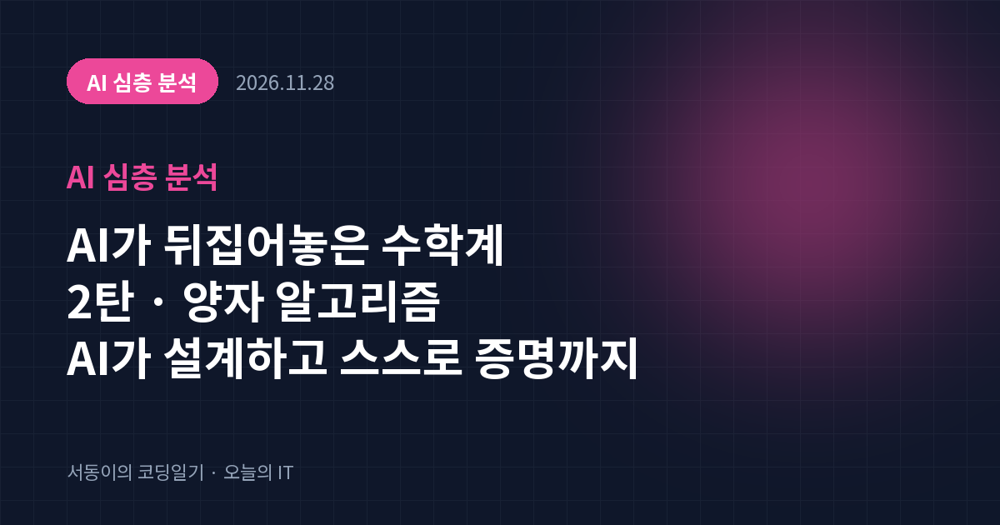

# AI가 뒤집어놓은 수학계 ② 양자 알고리즘, AI가 설계하고 증명까지 한 양자 회로

> 🔬 **AI 심층 분석** · 2026-11-28 · 📝 [티스토리에서 보기](https://dongseodong.tistory.com/82)



1탄의 리만 가설이 "AI가 증명을 썼다"는 이야기였다면, 2탄은 **"AI가 알고리즘을 설계하고, 그 설계가 맞다는 증명까지 붙여서 냈다"** 는 이야기입니다. 2026년 11월 구글 딥마인드와 Google Quantum AI는 Gemini 4 에이전트 팀이 양자 프로그램을 만들고 Lean으로 정확성을 증명한 연구(arXiv 2611.09822)를 공개했습니다. 이 글에서는 양자 알고리즘이 왜 어려운지, AI가 무엇을 얼마나 줄였는지, 그리고 올해 4월 TIME이 보도한 "AI가 앞당긴 양자 암호 위협" 이야기까지 함께 정리합니다.

TL;DR · 한눈에 보기

1 **양자 알고리즘** 은 설계도 어렵고, 지금의 컴퓨터로는 제대로 돌려 보며 검증하기도 어렵습니다. 그래서 "맞는지 어떻게 아는가"가 늘 문제였습니다.

2 **2026년 11월 구글 딥마인드** 의 Gemini 4 에이전트 팀은 Lean 명세에 맞춰 양자 프로그램을 설계해, 양자 산술 비용을 290배, 핵융합 시뮬레이션 비용을 12배 줄였다고 발표했습니다(논문 초록 기준).

3 회로의 정확성과 비용 계산은 Lean으로 검증되었지만, **오류 정정과 실제 하드웨어** 는 검증 범위 밖이며 논문도 동료 심사 전입니다.

📚 AI가 뒤집어놓은 수학계 시리즈

1탄 · 리만 가설 [167년 난제에 AI가 두 번 도전한 이야기](https://dongseodong.tistory.com/81)

2탄 · 양자 알고리즘 **AI가 양자 회로를 설계하고 증명까지** 지금 읽는 글

3탄 · VP ≠ VNP [Claude와 OpenAI, 몇 시간 차이의 증명 공개](https://dongseodong.tistory.com/83)

4탄 · OpenAI 9편 하루에 올라온 수학 논문 아홉 편예정

5탄 · 구글 6편 Cogentic과 소인수분해 난제예정

목차

[1. 양자 알고리즘은 왜 어려운가](#s1)

[2. AI가 한 일: Lean으로 증명된 양자 프로그램 (2026년 11월)](#s2)

[3. 앞서 있었던 일: AI가 앞당긴 '양자 암호 위협' (2026년 4월)](#s3)

[4. 앞으로 벌어질 일](#s4)

## 01 양자 알고리즘은 왜 어려운가

**한 줄 요약:** 양자 알고리즘은 설계도 어렵지만, 무엇보다 "제대로 동작하는지"를 확인할 방법이 마땅치 않다는 것이 큰 문제입니다.

### 비유로 이해하기: 동시에 모든 길을 걷는 미로 탐험

일반 컴퓨터는 미로를 풀 때 길을 하나씩 가 봅니다. 양자 컴퓨터는 큐비트의 **중첩** 덕분에 여러 길을 한꺼번에 "흐릿하게" 걷습니다. 다만 마지막에 결과를 보는 순간 하나의 답만 남기 때문에, 정답 쪽 확률은 키우고 오답 쪽 확률은 서로 상쇄되도록 **간섭** 을 정교하게 설계해야 합니다. 이 설계도가 양자 알고리즘입니다.

| 개념 | 뜻 | 쉽게 말하면 |
|----|----|----|
| 큐비트 | 0과 1의 중첩 상태를 가질 수 있는 양자 비트 | 동시에 여러 길에 발을 걸친 탐험가 |
| 논리 큐비트 | 오류 정정으로 보호된 '믿을 수 있는' 큐비트 | 여러 물리 큐비트를 묶어 만든 튼튼한 큐비트 |
| T 게이트 | 오류 내성 양자 컴퓨터에서 가장 비싼 기본 연산 | 미로에서 가장 통행료가 비싼 다리 |
| 그로버 탐색 | N개 중 정답 찾기를 약 √N번 만에 하는 알고리즘(1996) | 100만 개 상자를 약 1,000번 열어 보고 찾기 |

### 무엇이 '비용'인가

오류 내성 양자 컴퓨터에서는 T 게이트가 특히 비쌉니다. T 게이트를 실행하려면 '매직 상태'라는 특별한 재료를 따로 만들어야 하기 때문입니다. 그래서 양자 알고리즘의 비용은 흔히 **"논리 큐비트를 몇 개 쓰는가 × T 게이트를 몇 번 쓰는가"** 로 잽니다. 이번 딥마인드 연구도 이 곱을 비용으로 삼았습니다.

실제로 작은 회로를 만들어 T 게이트 수를 세어 보면 감이 옵니다. 아래는 Qiskit으로 3큐비트 토폴리(CCX) 게이트를 기본 게이트로 풀었을 때 T 게이트가 몇 개 나오는지 세는 예시입니다.

▶ Qiskit으로 회로의 T 게이트 수 세어 보기

```
# pip install qiskit
from qiskit import QuantumCircuit, transpile

qc = QuantumCircuit(3)
qc.ccx(0, 1, 2)   # 토폴리 게이트: 양자 산술의 기본 부품

# 오류 내성 컴퓨터에서 쓰는 기본 게이트 집합(Clifford + T)으로 분해
basis = ["h", "s", "sdg", "t", "tdg", "cx"]
out = transpile(qc, basis_gates=basis, optimization_level=1)

ops = out.count_ops()
print(ops)                                  # 게이트 종류별 개수
print("T 계열:", ops.get("t", 0) + ops.get("tdg", 0))   # 보통 7개가 나옵니다
```

토폴리 게이트 하나에 T 게이트가 7개 정도 들어갑니다. 큰 수의 덧셈이나 곱셈 같은 양자 산술에는 이런 부품이 수천, 수만 개 들어가기 때문에 T 게이트를 줄이는 것이 곧 양자 알고리즘을 현실로 끌어오는 일입니다.

### 검증이 어려운 이유

큐비트 수십 개만 넘어가도 일반 컴퓨터로는 양자 회로를 시뮬레이션하기 어렵습니다. 그런데 실제로 유용한 양자 알고리즘은 논리 큐비트 수백~수천 개를 씁니다. 그러니 **"돌려 보고 맞는지 확인"하는 방식이 통하지 않습니다.** 남는 방법은 수학적으로 증명하는 것뿐인데, 회로가 커질수록 사람이 손으로 증명하기도 벅찹니다.

💡 왜 중요할까

이번 연구의 핵심이 바로 여기입니다. AI가 더 싼 회로를 찾는 것만으로는 믿을 수 없습니다. 그래서 딥마인드는 AI가 회로와 함께 "이 회로가 맞고, 비용이 이만큼이다"라는 증명까지 Lean으로 제출하게 만들었습니다.

## 02 AI가 한 일: Lean으로 증명된 양자 프로그램 (2026년 11월)

**한 줄 요약:** Gemini 4 에이전트 팀이 미리 고정된 Lean 명세를 만족하는 양자 프로그램을 스스로 설계했고, 외부 검증기가 그 증명을 다시 확인했습니다.

### 누가, 무엇을 발표했나

논문 제목은 **"Discovering formally verified quantum programs with AI"** 입니다. arXiv에는 2026년 11월에 올라왔고(번호 2611.09822), 저자는 25명입니다. Ryan Babbush, Sergio Boixo, Guang Hao Low, Pushmeet Kohli 등 구글 딥마인드와 Google Quantum AI의 연구자들이 이름을 올렸습니다.

### 어떻게 일했나: AI 연구소를 통째로 흉내 냈습니다

1 · 명세 고정

사람이 Lean으로 "이 회로는 이런 결과를 내야 하고, 비용은 이렇게 센다"를 먼저 적어 둡니다. 이 명세는 AI가 바꿀 수 없습니다.

2 · 팀 작업

Gemini 4 에이전트 여러 팀이 각자 회로를 설계하고 증명을 씁니다.

3 · 위키와 학회

팀끼리 위키로 결과를 나누고, 4시간마다 가상 "학회"를 열어 아이디어를 교환합니다.

4 · 외부 검증

제출물은 깨끗한 샌드박스에서 다시 실행되어 정의, 허용된 공리, 주장한 비용까지 검사받습니다.

정확성 명세는 **양자 호어 논리(quantum Hoare logic)** 를 바탕으로 한 Lean 4 라이브러리로 작성되었습니다. 호어 논리는 "이 조건에서 시작해 이 프로그램을 돌리면 이 조건으로 끝난다"를 증명하는 방법인데, 이를 양자 프로그램용으로 확장한 것입니다.

### 얼마나 줄였나

논문 초록에 적힌 개선 폭은 다음과 같습니다.

산술

290배

핵융합

12배

광화학

8배

병렬탐색

2.57배

약물대사

2.5배

비용 감소 폭 (arXiv 2611.09822 초록 기준)

| 분야 | 무엇을 줄였나 | 세부 수치 (Unite.AI 정리) |
|----|----|----|
| 양자 산술 | 시공간 비용 290배 이상 감소 | 큐비트 100개, T 게이트 3,698개 회로 |
| 핵융합 저지능 계산 | 양자 워크 단계 약 12배 감소 | 논리 큐비트 5,650개 → 4,338개 |
| 광화학 (분자 동역학) | 비용 약 8배 감소 | 4.98×10<sup>15</sup> → 6.06×10<sup>14</sup> |
| 약물 대사 (시토크롬 P450) | 비용 약 2.5배 감소 | 논리 큐비트 481개 → 333개 |
| 병렬 그로버 탐색 | 오라클 호출 횟수 감소 | 목표 하나 1.22배, 전체 목표 2.57배 |

📌 알아둘 점

세부 수치는 Unite.AI의 정리를 인용했습니다. 이 매체는 핵융합 항목을 11.8배로도 적어 초록의 12배와 조금 다릅니다. 정확한 값은 논문 원문을 기준으로 봐야 합니다. 또 Unite.AI는 개선의 61%가 팀 내부, 15%가 위키, 24%가 가상 학회에서 나왔다고 추정했지만, 기여를 정확히 나누기는 어렵다고 덧붙였습니다.

### 어디까지 검증되었나

| 검증된 것 | 검증되지 않은 것 |
|----|----|
| 회로가 명세대로 정확한 결과를 낸다는 것 | 오류 정정 과정 전체 |
| 주장한 논리 큐비트 수와 T 게이트 비용 | 큐비트 배치와 라우팅, 실제 칩 위의 물리 배치 |
| 허용된 공리만 썼다는 것 | 실제 양자 하드웨어에서의 실행 (하드웨어는 쓰지 않았습니다) |

딥마인드도 이런 시뮬레이션을 처음부터 끝까지 실제로 돌리려면 지금보다 훨씬 많은 자원이 필요하다고 밝혔습니다. 즉 이번 결과는 "미래의 양자 컴퓨터에 넣을 설계도를 더 싸고, 틀리지 않게 만들었다"는 의미입니다.

## 03 앞서 있었던 일: AI가 앞당긴 '양자 암호 위협' (2026년 4월)

**한 줄 요약:** 2026년 4월 TIME은 AI 도구가 도운 연구로, 암호를 깨는 양자 컴퓨터가 예상보다 빨리 올 수 있다는 분석이 나왔다고 보도했습니다.

### 무슨 일이 있었나

TIME(2026년 4월 7일 보도)에 따르면 양자 스타트업 **Oratomic** 과 연구진(John Preskill 등 참여)은 원자 기반 양자 컴퓨터에서 **논리 큐비트 하나를 원자 3개로 만드는 방식** 을 제시했습니다. 기존에는 원자 100~1,000개가 필요하다고 봤으니, 원자 수를 약 100분의 1로 줄인 셈입니다.

논문 저자들은 AI가 이 알고리즘 개발에 "결정적(instrumental)"이었다고 밝혔습니다. 연구팀은 LLM(Gemini, Claude 등)을 써서 알고리즘을 진화시키는 오픈소스 도구 **OpenEvolve** 를 썼고, 처음에는 목표보다 성능이 약 1,000배 나빴던 핵심 알고리즘을 AI 제안으로 크게 개선했다고 합니다. 다만 Preskill은 연구를 이끈 것은 여전히 사람이었다고 강조했습니다.

### 업계의 반응

| 주체 | 내용 (TIME 보도) |
|----|----|
| 구글 | 2026년 3월 25일, 양자 내성 암호 전환 목표를 2029년으로 발표했습니다. |
| Cloudflare | Bas Westerbaan은 자사 전환 목표도 2029년으로 앞당긴다고 밝혔습니다. |
| 미국 NIST | 기존 권고 전환 기한은 2035년입니다. |
| Jeff Thompson (프린스턴) | 논문은 동료 심사 전이며, 많은 가정이 아직 검증되지 않았다고 지적했습니다. |

💡 왜 중요할까

오늘날 인터넷 암호(RSA, 타원곡선)는 큰 수의 소인수분해나 이산로그가 어렵다는 데 기대고 있습니다. 충분히 큰 양자 컴퓨터는 쇼어 알고리즘으로 이 문제를 풀 수 있습니다. AI가 양자 하드웨어와 알고리즘의 필요 자원을 줄이면 줄일수록, 그날이 앞당겨질 수 있다는 것이 업계가 서두르는 이유입니다.

## 04 앞으로 벌어질 일

**한 줄 요약:** AI가 양자 알고리즘의 설계자이자 검증자가 되면서, 양자 컴퓨터의 '쓸모'가 생기는 시점과 암호 전환 일정이 함께 움직이고 있습니다.

### 1. 양자 알고리즘 연구 방식의 변화

이번 연구가 보여 준 것은 "명세는 사람이 쓰고, 설계와 증명은 AI가 하고, 검사는 컴퓨터가 한다"는 분업입니다. 논문은 이런 검증된 AI 발견이 지금의 고전·양자 컴퓨터로는 시험할 수 없는 회로까지 다룰 수 있어 실용 양자 컴퓨팅으로 가는 길을 줄인다고 설명합니다.

### 2. 양자 화학과 신약 개발

핵융합, 광화학, 약물 대사처럼 이번에 다룬 문제는 모두 "분자와 원자를 정확히 시뮬레이션"하는 문제입니다. 필요한 논리 큐비트와 T 게이트 수가 줄어들수록, 같은 시뮬레이션을 돌리는 데 필요한 양자 컴퓨터의 크기도 작아집니다. 이번 연구에서 시토크롬 P450 계산에 필요한 논리 큐비트가 481개에서 333개로 줄어든 것이 그 예입니다.

### 3. 개발자가 지금 할 일: 양자 내성 암호(PQC) 준비

구글과 Cloudflare가 2029년을 목표로 잡은 만큼, 서비스를 운영하는 개발자도 양자 내성 암호를 점검해 둘 필요가 있습니다. NIST는 2024년에 ML-KEM(FIPS 203), ML-DSA(FIPS 204) 등을 표준으로 확정했습니다.

▶ 내 환경의 OpenSSL이 양자 내성 알고리즘(ML-KEM)을 지원하는지 확인하기

```
# OpenSSL 버전 확인 (3.5 이상부터 ML-KEM, ML-DSA 기본 지원)
openssl version

# 사용 가능한 KEM(키 교환) 알고리즘 목록에서 ML-KEM 찾기
openssl list -kem-algorithms | grep -i ml-kem

# 하이브리드 키 교환(X25519MLKEM768)으로 접속해 보기
openssl s_client -connect cloudflare.com:443 -groups X25519MLKEM768 </dev/null 2>/dev/null | grep -i "group"
```

✦ 지금 해볼 것

☐ 서비스가 쓰는 TLS 라이브러리 버전을 확인하고, 하이브리드 키 교환 지원 여부 점검하기

☐ 오래 보관해야 하는 민감 데이터가 있다면 "지금 저장하고 나중에 해독(harvest now, decrypt later)" 위험 검토하기

☐ 사용 중인 클라우드·CDN의 양자 내성 암호 로드맵 문서 읽어 보기

## 정리

**문제:** 양자 알고리즘은 설계와 검증이 모두 어렵고, 특히 큰 회로는 돌려 보며 확인할 수 없습니다.

**AI가 한 일:** 구글 딥마인드의 Gemini 4 에이전트 팀이 Lean으로 증명된 양자 프로그램을 만들어 산술 비용 290배, 핵융합 시뮬레이션 비용 12배 등을 줄였다고 발표했습니다.

**앞으로:** 실용 양자 컴퓨팅이 앞당겨질 수 있다는 기대와 함께, 양자 내성 암호 전환 일정도 빨라지고 있습니다.

## 자주 묻는 질문

### AI가 새로운 양자 알고리즘을 발견했다는 게 사실인가요?

2026년 11월 구글 딥마인드와 Google Quantum AI가 arXiv 2611.09822 논문으로 발표한 내용입니다. Gemini 4 에이전트가 기존 문제를 더 싸게 푸는 양자 회로를 설계하고 Lean으로 정확성을 증명했으며, 양자 산술 비용을 290배 줄였다고 밝혔습니다. 논문은 아직 동료 심사 전입니다.

### 이번 연구로 양자 컴퓨터가 지금 당장 암호를 깰 수 있게 되었나요?

아닙니다. 이번 연구는 실제 하드웨어를 쓰지 않았고, 오류 정정과 물리 배치는 검증 범위 밖입니다. 다만 2026년 4월 TIME 보도처럼 필요 자원을 줄이는 연구가 이어지면서 구글과 Cloudflare는 양자 내성 암호 전환 목표를 2029년으로 잡았습니다.

### Lean 검증은 무엇을 보장하나요?

회로가 미리 적어 둔 명세대로 정확한 결과를 내고, 주장한 논리 큐비트 수와 T 게이트 비용이 맞다는 것을 보장합니다. 명세 자체가 올바른지, 실제 기계에서 잡음 속에서도 동작하는지는 별도로 확인해야 합니다.

## 참고 링크

[arXiv 2611.09822 · 원문 논문 ↗](https://arxiv.org/abs/2611.09822) [Unite.AI · 세부 수치 정리 ↗](https://www.unite.ai/google-deepmind-agent-teams-discover-lean-verified-quantum-algorithms/) [TIME · AI가 앞당긴 양자 돌파 ↗](https://time.com/article/2026/04/07/ai-quantum-computing-advance/) [NIST · 양자 내성 암호 ↗](https://csrc.nist.gov/projects/post-quantum-cryptography)

---

`#양자알고리즘` `#양자컴퓨터` `#AI수학` `#구글딥마인드` `#GoogleQuantumAI` `#Gemini` `#Lean` `#형식검증` `#양자내성암호` `#AI심층분석`
