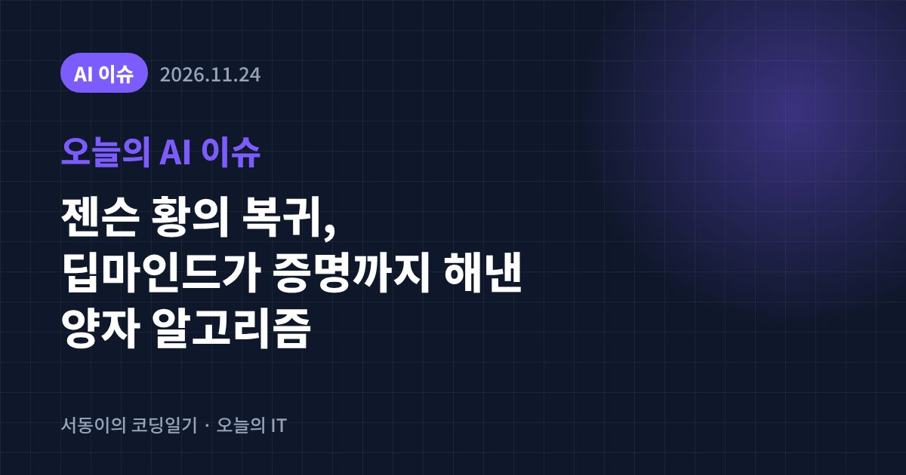

# 오늘의 AI 이슈 (2026.11.24) - 젠슨 황의 복귀, 딥마인드가 증명까지 해낸 양자 알고리즘

> 🤖 **AI 이슈** · 2026-11-24 · 📝 [티스토리에서 보기](https://dongseodong.tistory.com/59)



11월 23일 하루 동안 AI 업계에 굵직한 발표가 세 개나 나왔어요. AI 반도체 1위 기업의 리더십 문제, AI가 과학 연구를 하는 방식의 변화, 그리고 매일 쓰는 ChatGPT의 기본 모델 교체예요. 오늘은 이 세 가지를 **무슨 일이 있었는지, 왜 그렇게 됐는지, 우리에게 어떤 의미인지** 순서로 깊게 정리해 볼게요.

TL;DR · 한눈에 보기

1 엔비디아 이사회가 만장일치로 **젠슨 황을 CEO로 복귀** 시키고, 국가안보·수출통제 위원회를 새로 만들었어요.

2 구글 딥마인드는 **Gemini 에이전트 팀 + Lean 형식 검증** 으로 양자 알고리즘 비용을 최대 290배까지 줄였어요.

3 오픈AI가 ChatGPT 채팅 탭 기본 모델을 **GPT-6.2 Sol** 로 바꾸고 있어요. 정책 준수율이 77~80%에서 91~94%로 올랐대요.

목차

[1. 젠슨 황, 11일 만에 엔비디아 CEO 복귀](#s1)

[2. 딥마인드: AI가 양자 알고리즘을 고치고 증명까지](#s2)

[3. GPT-6.2 Sol, ChatGPT 채팅 탭에 배포](#s3)

[그 밖의 소식](#s9)

[정리](#s-sum)

## 01 젠슨 황, 11일 만에 엔비디아 CEO 복귀

### 무슨 일이 있었나

엔비디아 이사회는 11월 23일 보도자료에서 젠슨 황을 **사장 겸 CEO, 이사회 멤버로 즉시 복귀** 시킨다고 발표했어요. 결정은 만장일치였고, 이사회는 황과 여러 차례 논의한 끝에 그의 솔직함과 리더십에 만족했다고 밝혔어요.

황이 물러나 있던 동안에는 CFO인 콜렛 크레스가 임시 CEO를 맡았어요. 크레스는 CFO 자리를 그대로 지키고, 하비 존스 이사회 의장도 자리를 유지해요.

### 배경: 왜 물러났고, 왜 돌아왔나

이사회 발표에 따르면 황이 **해외 정보기관 공작의 표적이 됐다는 보도** 가 있었고, 이사회는 독립 이사로만 구성된 위원회를 만들어 외부 변호인과 함께 조사를 진행해 왔어요. 사임의 구체적인 이유는 이번 발표에 나와 있지 않아요.

복귀 결정에서 눈에 띄는 대목은 **미국 정부 고위급의 의견을 들었다** 는 점이에요. 이사회는 그 결과 황의 복귀가 국가안보상 위험이 되지 않는다고 판단했다고 밝혔어요. 조사는 끝까지 진행되고, 황도 협조하겠다고 했어요.

| 조치                          | 내용                                                                                   |
|-------------------------------|----------------------------------------------------------------------------------------|
| 독립 조사 위원회              | 독립 이사로만 구성, 외부 변호인 선임. 해외 정보기관 표적 보도 관련 조사를 끝까지 진행  |
| 국가안보·수출통제 위원회      | 새로 신설. 무역 규정 준수와 국가안보 리스크를 감독하고, 국가안보 전문 변호인을 채용 중 |
| 최고 컴플라이언스 책임자(CCO) | 채용 중. 지명·기업지배구조 위원회에 직접 보고                                          |
| 경영진                        | 젠슨 황 CEO 복귀, 콜렛 크레스는 CFO 유지, 하비 존스 의장 유지                          |

### 영향 받는 곳

엔비디아 GPU는 전 세계 AI 학습과 추론 인프라의 중심이에요. 그래서 CEO 공백은 한 회사의 인사 문제가 아니라 **클라우드 기업, AI 스타트업, 각국 정부의 조달 계획** 까지 흔드는 변수였어요. 11일 만에 복귀가 결정되면서 이 불확실성은 일단 줄었어요.

💡 왜 중요할까

AI 반도체가 이제 **국가안보 자산** 으로 다뤄지고 있다는 신호예요. 민간 기업의 CEO 인사에 정부 의견이 들어가고, 이사회에 수출통제 전담 위원회가 생겼어요. 앞으로 엔비디아의 해외 판매, 특히 중국향 제품 전략은 이 위원회를 거치며 더 보수적으로 바뀔 가능성이 커요.

⚠ 주의

독립 위원회의 조사는 아직 끝나지 않았어요. 사임 이유와 조사 결과는 공식적으로 공개되지 않았으니, 확인되지 않은 보도는 걸러서 보는 게 좋아요.

[출처 · NVIDIA Newsroom ↗](https://nvidianews.nvidia.com/news/nvidia-board-reinstates-jensen-huang-as-president-ceo-and-board-director)

## 02 딥마인드: AI가 양자 알고리즘을 고치고 증명까지

### 무슨 일이 있었나

구글 딥마인드와 구글 퀀텀 AI는 11월 23일, **Gemini 4 에이전트 팀** 이 기존 양자 알고리즘을 더 싸게 바꾸고, 그 결과가 맞다는 것을 **정리 증명기 Lean으로 증명** 했다는 연구를 공개했어요. 논문은 arXiv 2611.09822예요.

### 어떻게 일했나: 에이전트 팀 + 가상 학회

STEP 1

문제마다 **독립된 에이전트 팀** 이 붙어 개선 아이디어를 냄

STEP 2

아이디어는 **Lean으로 정확성이 증명** 돼야만 공유 노트에 올라감

STEP 3

**4시간마다 가상 학회** 를 열어 팀끼리 결과를 공유하고 토론

STEP 4

더 좋은 아이디어가 쌓이며 비용이 계속 내려감

사람 연구자는 연구 방향을 정하고 감독하는 역할을 했어요. 에이전트가 낸 아이디어 중 **증명을 통과한 것만 살아남는** 구조라, 그럴듯하지만 틀린 결과가 섞일 틈을 막은 게 핵심이에요.

### 성과를 숫자로

arcsin (숫자를 양자 상태로 불러오기) **290배**

관성 핵융합 시뮬레이션 회로 **11.8배**

빛에 반응하는 분자 시뮬레이션 **8배**

그로버 알고리즘의 한 구현 **2.57배**

시토크롬 P450 분자 시뮬레이션 **2.5배**

개선 배율. 핵융합은 큐비트 수 × 연산 수 기준이고, 막대 길이는 290배를 기준으로 그렸어요. 출처: Google DeepMind 블로그

| 문제                           | 큐비트 변화                               |
|--------------------------------|-------------------------------------------|
| 관성 핵융합 시뮬레이션         | 오류 정정 큐비트 5,650개 → 4,338개        |
| 시토크롬 P450 (약물 대사 효소) | 481개 → 333개 (무거운 메모리 조회를 대체) |

### 배경: 왜 "증명"이 필요했나

이 회로들은 너무 커서 **기존 컴퓨터로도, 지금의 작은 양자 프로세서로도 실제로 돌려 볼 수가 없어요.** 테스트를 할 수 없으니 맞는지 확인하는 방법은 수학적 증명뿐이에요.

형식 검증이 어떤 느낌인지 아주 작은 예로 보면 이래요. Lean에서는 "a + b = b + a"를 말로 주장하는 게 아니라, 컴퓨터가 확인할 수 있는 증명으로 적어요. 증명이 틀리면 컴파일 자체가 안 돼요.

▶ Lean 4로 적은 아주 간단한 정리와 증명

```
-- 자연수 덧셈은 교환법칙이 성립한다
theorem my_add_comm (a b : Nat) : a + b = b + a := by
  exact Nat.add_comm a b

-- 증명이 틀리면 Lean이 에러를 내고 통과시키지 않는다
```

### 직접 살펴보는 법

딥마인드는 Lean 라이브러리와 문제 정의, 검증된 해답을 GitHub에 공개했어요. 받아서 구조를 둘러보는 것부터 해볼 수 있어요.

▶ 공개된 저장소 받아 보기

```
git clone https://github.com/google-deepmind/formal-quantum-computation
cd formal-quantum-computation
ls   # 문제 정의와 검증된 해답 파일 구성을 확인
```

💡 팁

Lean 4 프로젝트는 보통 `elan`으로 Lean을 설치한 뒤 `lake build`로 빌드해요. 정확한 빌드 방법은 저장소 README를 먼저 확인하세요.

💡 왜 중요할까

"AI가 아이디어를 내고, 기계가 검증한다"는 구조가 실제 연구 성과로 이어진 사례예요. AI 결과를 믿기 어렵다는 가장 큰 약점을 **증명 가능한 결과만 받는다** 는 방식으로 정면 돌파했어요. 같은 방식은 수학, 암호, 컴파일러 최적화처럼 정답을 검증할 수 있는 분야로 넓어질 가능성이 커요.

📌 알아둘 점

딥마인드 스스로도 이 시뮬레이션들이 초기 오류 정정 양자 컴퓨터가 감당할 수 있는 것보다 여전히 많은 자원이 필요하다고 밝혔어요. 당장 양자 컴퓨터로 핵융합을 계산한다는 뜻은 아니에요.

[출처 · Google DeepMind 블로그 ↗](https://deepmind.google/blog/finding-faster-quantum-algorithms-with-agents-and-formal-verification/) [출처 · GitHub 저장소 ↗](https://github.com/google-deepmind/formal-quantum-computation)

## 03 GPT-6.2 Sol, ChatGPT 채팅 탭에 배포

### 무슨 일이 있었나

오픈AI가 일상 대화에 맞게 조정한 **GPT-6.2 Sol** 을 ChatGPT 채팅 탭에 배포하고 있어요. 상세한 지시가 있는 복잡한 요청이나 온라인에서 정보를 찾는 요청을 더 잘 처리하도록 다듬었다고 해요.

| 플랜                               | 적용 여부                              |
|------------------------------------|----------------------------------------|
| Plus · Pro · Business · Enterprise | ✅ 순차 배포 중                        |
| Free · Go                          | ❌ 대상 아님                           |
| Work · Codex용 GPT-6.2             | 변경 없음 (일주일 전 출시된 버전 유지) |

### GPT-6 대비 달라진 점

STEP 1

**사진 속 작은 디테일** 인식: 표지판 기호, 라벨 글자 등

STEP 2

**사용자 우선순위** 에 맞춘 온라인 선택 (쇼핑 등)

STEP 3

가격 하락 알림처럼 **후속 조치** 가 필요한 순간을 알아챔

### 안전성 수치

GPT-6 · 까다로운 대화 정책 준수율

77~80%

GPT-6.2 Sol

91~94%

청소년 안전 평가도 정서적 의존, 섭식 장애, 위험한 활동, 연령 제한 상품·서비스 항목에서 점수가 올랐다고 해요.

📌 알아둘 점

모두 **오픈AI가 자체 측정한 수치** 예요. 벤치마크 점수나 컨텍스트 길이 같은 기술 정보는 공개되지 않았어요. 위 내용은 오픈AI 릴리스 노트를 인용한 MacRumors 보도를 기준으로 했어요.

### 써보는 법

유료 플랜이라면 따로 설정할 건 없어요. 배포가 순차적으로 진행되니, 채팅 탭의 모델 선택 메뉴에서 GPT-6.2 Sol이 보이는지 확인해 보면 돼요. 사진 속 글자를 읽게 하거나, "예산 30만 원, 무게 우선"처럼 우선순위를 주고 상품을 고르게 해 보면 차이를 느끼기 쉬워요.

💡 왜 중요할까

ChatGPT는 가장 많은 사람이 쓰는 AI 서비스라, **기본 모델이 바뀌면 수많은 사람의 일상 경험이 한꺼번에 바뀌어요.** 이번 업데이트는 성능보다 "사용자 의도 파악"과 "안전성"에 무게를 뒀다는 점에서, AI 서비스 경쟁의 축이 점점 실사용 경험으로 옮겨가고 있다는 걸 보여 줘요.

[출처 · MacRumors ↗](https://www.macrumors.com/2026/11/23/openai-gpt-6-2-sol-chatgpt/)

## 그 밖의 소식

[**앤트로픽 Claude Ship 베타** 코드 변경을 리뷰·수정하고, 팀 규칙이 허용하면 승인까지 · ZDNet ↗](https://www.zdnet.com/innovation/claude-ship-code-how-to-try/)[**아마존, Decart 기술·연구팀 인수** 보도 기준 75억 달러, Trainium 칩 판매 준비 · TechCrunch ↗](https://techcrunch.com/2026/11/23/amazon-snaps-up-decarts-ai-optimization-tech-for-7-5b-as-it-prepares-to-sell-trainium-chips/)[**Z.ai GLM-5.4 공개** Loop Transformer 구조를 쓴 새 모델 · Z.ai ↗](https://z.ai/blog/glm-5.4)[**오리건·버지니아주, SpaceX 등 제소** Grok 딥페이크 문제 · CNBC ↗](https://www.cnbc.com/2026/11/23/oregon-virginia-spacex-grok-deepfake-lawsuits.html)

## 정리

**엔비디아:** 젠슨 황 복귀로 리더십 불확실성은 줄었지만, AI 칩은 이제 국가안보 문제로 관리돼요.

**딥마인드:** AI 에이전트의 아이디어를 Lean 증명으로 걸러, 검증 가능한 과학 성과를 냈어요.

**GPT-6.2 Sol:** 유료 ChatGPT의 기본 경험이 "의도 파악"과 "안전성" 쪽으로 업그레이드됐어요.

✦ 지금 해볼 것

☐ 엔비디아 독립 위원회 조사 결과와 수출통제 위원회 발표 지켜보기

☐ formal-quantum-computation 저장소 받아서 Lean 증명 구조 둘러보기

☐ 유료 플랜이라면 채팅 탭에서 GPT-6.2 Sol로 사진 속 글자 읽기 테스트해 보기

---

`#AI뉴스` `#AI이슈` `#GPT-6.2` `#구글딥마인드` `#양자컴퓨터` `#엔비디아` `#오픈AI` `#인공지능` `#젠슨황` `#형식검증`
