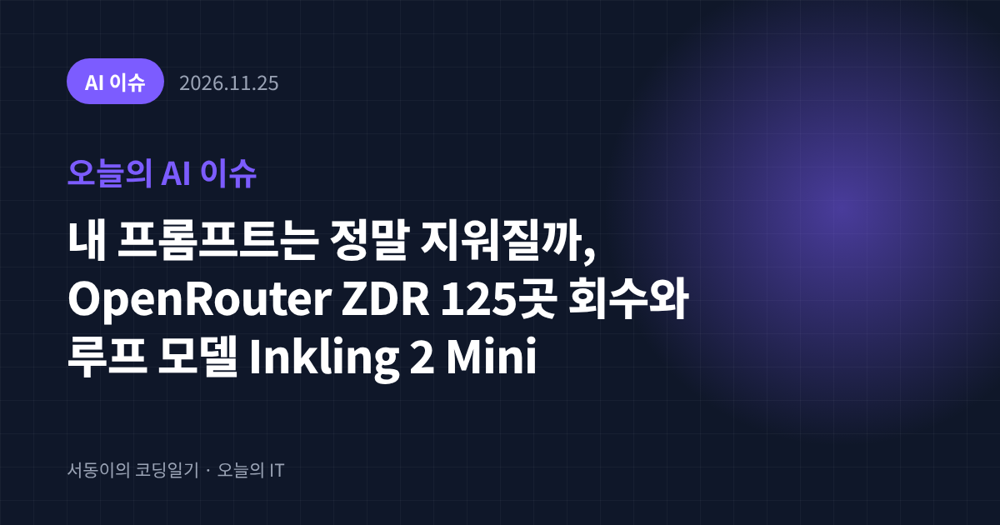

# 오늘의 AI 이슈 (2026.11.25) - OpenRouter ZDR 125곳 회수, 루프 모델 Inkling 2 Mini, 의료 오픈 모델 LingSante

> 🤖 **AI 이슈** · 2026-11-25 · 📝 [티스토리에서 보기](https://dongseodong.tistory.com/62)



오늘은 AI를 **쓰는 사람** 입장에서 꼭 알아야 할 소식 세 가지를 골랐어요. 내 프롬프트가 정말 지워지고 있는지에 대한 경고, 작은 모델이 큰 모델을 따라잡는 새로운 설계 방식, 그리고 의료처럼 민감한 분야에 공개된 거대 모델이에요. 하나씩 **무슨 일이 있었는지, 왜 그런지, 나는 뭘 하면 되는지** 순서로 깊게 볼게요.

TL;DR · 한눈에 보기

1 OpenRouter가 데이터 정책을 지키지 않은 정황이 나온 **공급자 3곳을 퇴출** 하고, **125개 엔드포인트** 의 ZDR(데이터 미보관) 자격을 회수했어요.

2 Thinking Machines의 **Inkling 2 Mini** 는 가운데 층을 세 번 반복하는 "루프" 구조로, 24층짜리 가중치로 48층 분량의 계산을 해요. 어제 GLM-5.4에 이어 **루프 구조가 이틀 연속** 화제예요.

3 앤트그룹 inclusionAI가 **560B 의료 특화 오픈 웨이트 모델 LingSante** 를 MIT 라이선스로 공개했어요. 단, 진단·처방에 쓰면 안 된다고 못 박았어요.

목차

[1. OpenRouter, 공급자 3곳 퇴출하고 ZDR 125곳 회수](#s1)

[2. Inkling 2 Mini: 같은 층을 여러 번 도는 "루프 모델"](#s2)

[3. LingSante: 560B 의료 오픈 모델, 어디까지 써도 될까](#s3)

[그 밖의 소식](#s9)

[정리](#s-sum)

## 01 OpenRouter, 공급자 3곳 퇴출하고 ZDR 125곳 회수

### 무슨 일이 있었나

OpenRouter는 여러 AI 모델 공급자를 하나의 API로 묶어 주는 중개 서비스예요. 개발자는 키 하나로 수백 개 모델을 부를 수 있고, OpenRouter가 요청을 실제로 처리할 공급자(inference provider)를 골라 줘요.

11월 22일 OpenRouter는 블로그에서, 보안 연구자들이 **일부 공급자가 데이터를 유출당했거나 약속한 데이터 정책을 지키지 않았다** 는 사실을 알려 왔다고 밝혔어요. 연구자들은 AI 공급망에 "카나리아 토큰"(몰래 심어 둔 추적용 미끼 데이터)을 흘려보내서, 그 데이터가 어디로 새어 나가는지 추적하는 방식으로 이 문제를 찾아냈어요.

| 조치          | 내용                                                                                        |
|---------------|---------------------------------------------------------------------------------------------|
| 공급자 퇴출   | 문제가 확인된 공급자 3곳을 OpenRouter에서 제외                                              |
| ZDR 자격 회수 | 엔드포인트 125개의 "데이터 미보관(ZDR)" 자격 박탈. 연구자가 지목한 곳 + 예방 차원 제외 포함 |
| 고객 통지     | 영향을 받았을 수 있는 고객 전원에게 개별 통지                                               |
| 재발 방지     | 연구자들의 테스트를 상시 점검으로 전환, 요청·응답이 제3자로 전달되는지 네트워크 경로 검증   |
| 복귀 조건     | 회수된 엔드포인트는 보증과 검증을 거쳐야 ZDR 자격 회복                                      |

OpenRouter는 **자사 시스템이 뚫린 것은 아니라고** 강조했어요. 문제는 그 뒤에서 실제로 모델을 돌리는 공급자 쪽이었고, Atlas Cloud, GMI Cloud, MiniMax, Novita, Phala, Together 등이 각자 보안 공지를 냈어요. 이 가운데 Together는 올해 6~7월에 있었던 프롬프트 유출에 대한 공지예요.

### 배경: ZDR이 뭐길래

**ZDR(Zero Data Retention)** 은 "요청과 응답을 처리만 하고 저장하지 않는다"는 약속이에요. 회사 코드나 고객 정보를 프롬프트에 넣는 개발자에게는 이 약속이 곧 보안 정책이에요. OpenRouter는 데이터 보관 수준을 세 단계로 나눠요.

| 등급                          | 데이터 처리                     | 학습 사용  |
|-------------------------------|---------------------------------|------------|
| ZDR                           | 저장하지 않음                   | 안 함      |
| Safety Retention              | 어뷰징 탐지 목적에 한해 보관    | 안 함      |
| 일반 (data_collection: allow) | 공급자가 비일시적으로 저장 가능 | 할 수 있음 |

문제는 이 약속을 **중개자가 직접 검증하기 어렵다** 는 점이에요. 계약서에 "저장 안 함"이라고 적혀 있어도, 실제 서버에서 로그가 어디로 흘러가는지는 밖에서 보이지 않거든요. 이번 사건은 그 빈틈을 카나리아 토큰이라는 실측으로 드러낸 사례예요.

### 영향 받는 곳

OpenRouter의 ZDR 라우팅을 믿고 민감한 데이터를 보내던 팀이라면, **지금 쓰는 모델이 여전히 ZDR 엔드포인트로 가는지** 다시 확인해야 해요. 125개가 빠졌으니, 예전엔 ZDR로 가던 모델이 지금은 아예 호출이 안 되거나 다른 공급자로 넘어갔을 수 있어요.

### 대응 방안: 요청 단위로 ZDR 강제하기

STEP 1

계정 Privacy 설정에서 ZDR 전용 켜기

STEP 2

요청마다 provider.zdr: true 넣기

STEP 3

data_collection: deny로 학습 차단

STEP 4

ZDR 엔드포인트 목록 주기적으로 확인

OpenRouter 문서에 따르면 요청의 **provider** 객체에 아래처럼 넣으면 ZDR 엔드포인트로만 라우팅돼요. 계정 설정과 OR 조건으로 동작하기 때문에, 요청에 넣는다고 계정 단위 강제가 풀리지는 않아요.

▶ ZDR 엔드포인트로만 보내기 (요청 본문)

```
{
  "model": "openai/gpt-5-mini",
  "input": "Hello",
  "provider": {
    "zdr": true,
    "data_collection": "deny"
  }
}
```

▶ Python에서 매 요청에 강제하기 (OpenAI 호환 SDK)

```
import os
from openai import OpenAI

client = OpenAI(
    base_url="https://openrouter.ai/api/v1",
    api_key=os.environ["OPENROUTER_API_KEY"],  # 키는 환경 변수로만
)

resp = client.chat.completions.create(
    model="openai/gpt-5-mini",
    messages=[{"role": "user", "content": "사내 코드 리뷰해 줘"}],
    # OpenRouter 전용 옵션은 extra_body로 전달
    extra_body={"provider": {"zdr": True, "data_collection": "deny"}},
)
print(resp.choices[0].message.content)
```

▶ 지금 ZDR 자격이 있는 엔드포인트 목록 확인

```
curl -s https://openrouter.ai/api/v1/endpoints/zdr | jq '.data | length'
```

⚠ 주의

ZDR 필터는 **모델 추론 엔드포인트에만** 적용돼요. 웹 검색 같은 플러그인·도구 호출에는 적용되지 않으니, 민감한 데이터가 플러그인으로 넘어가지 않도록 따로 확인하세요. 또 Google Vertex 엔드포인트는 10월 18일부터 Safety Retention이 필수예요.

💡 왜 중요할까

AI API는 이제 **공급망 보안** 의 문제예요. 중개자 → 공급자 → 실제 GPU 서버로 이어지는 사슬 중 한 곳만 약속을 어겨도 데이터가 새요. "ZDR이라고 써 있으니 안전하다"가 아니라 **요청 단위로 강제하고, 목록을 주기적으로 검증** 하는 습관이 필요해졌어요.

[출처 · OpenRouter 공지 ↗](https://openrouter.ai/blog/announcements/data-processing-incidents-on-inference-providers/) [출처 · ZDR 문서 ↗](https://openrouter.ai/docs/guides/features/zdr.md) [출처 · Provider Routing 문서 ↗](https://openrouter.ai/docs/guides/routing/provider-selection.md)

------------------------------------------------------------------------

## 02 Inkling 2 Mini: 같은 층을 여러 번 도는 "루프 모델"

### 무슨 일이 있었나

Thinking Machines가 **Inkling 2 Mini** 를 공개했어요. 핵심은 "루프(looped)" 구조예요. 모델은 24개 층으로 되어 있는데, **가운데 12개 층을 토큰마다 세 번 반복** 해서 돌려요. 그래서 저장하는 가중치는 24층 분량인데, 실제 계산은 48층짜리 모델만큼 해요.

저장하는 가중치

24층

실제로 하는 계산

48층 분량

### 배경: 왜 같은 층을 반복할까

보통 모델을 똑똑하게 만들려면 층을 더 쌓아요. 그런데 층이 늘면 가중치도 늘고, 메모리도 그만큼 필요해요. 루프 구조는 **"생각은 더 오래 하되, 기억할 것은 늘리지 않는"** 방식이에요. 같은 층을 여러 번 통과시키면서 중간 표현을 다듬는 거죠.

어디를 반복하느냐도 실험했대요. Thinking Machines에 따르면 **가운데 층을 반복한 쪽이 마지막 층을 반복한 쪽보다 28개 평가 중 27개에서 나았어요.** 여기에 전문가 혼합(MoE) 구조에서 학습 중 전문가의 3분의 2를 덜어내고 남은 것을 다시 학습시켜 크기를 줄였어요.

| 항목                | Inkling 2 Mini (보도 기준)         |
|---------------------|------------------------------------|
| 파라미터            | 264억(26.4B), MoE, 양자화          |
| 디스크 크기         | 약 20GB                            |
| 권장 메모리         | Apple Silicon 기준 32GB 이상       |
| DeepSWE v1.1 (코딩) | 48.2%                              |
| Vals Index v2.2     | 46.5%                              |
| 라이선스            | Apache 2.0 오픈 웨이트 (보도 기준) |

### 얼마나 효율적인가

Artificial Analysis 평가에서는 Qwen3.8-27B와 지능 지수가 비슷하면서, **활성 파라미터는 약 5분의 1, 연산량은 약 2.8분의 1** 이었다고 해요. 벤치마크 과제 하나당 평균 비용도 크게 차이 났어요.

Qwen3.8-27B **\$3.53**

Inkling 2 Mini **\$0.59**

Artificial Analysis 기준, 벤치마크 과제 1건당 평균 비용. 약 6배 차이예요.

데모도 인상적이에요. M5 Pro, 48GB 메모리 MacBook Pro에서 **인터넷 없이** 몇 분 만에 플레이 가능한 비행 시뮬레이터를 만들었대요. 다만 복잡한 지시나 어려운 추론에서는 아직 약하다는 평가도 함께 나왔어요.

### 이틀 연속 이어지는 흐름: 루프 구조

어제 소개한 Z.ai의 **GLM-5.4** 도 "Loop Transformer" 구조를 내세웠어요. 일부 계산을 반복해서 추론을 강화하는 방식이에요. 서로 다른 두 회사가 같은 주에 같은 방향을 택했다는 건 우연이 아니에요. 모델을 무작정 키우는 대신 **"같은 가중치로 더 오래 생각하기"** 가 새로운 경쟁 축이 되고 있다는 신호예요.

| 날짜  | 모델                             | 루프 방식                                               |
|-------|----------------------------------|---------------------------------------------------------|
| 11/23 | Z.ai GLM-5.4                     | Loop Transformer, 선택된 계산 반복, 100만 토큰 컨텍스트 |
| 11/24 | Thinking Machines Inkling 2 Mini | 가운데 12층을 3회 반복, 24층 가중치로 48층 계산         |

### 직접 해보기

로컬에서 돌려 보고 싶다면 메모리부터 확인하세요. 공식 모델 카드는 Apple Silicon에서 32GB 이상을 권장해요. 다운로드 경로는 공식 모델 카드 페이지에서 확인하는 게 안전해요.

▶ 내 Mac 메모리가 충분한지 먼저 확인

```
# 물리 메모리(GB)
echo $(( $(sysctl -n hw.memsize) / 1024 / 1024 / 1024 ))GB

# 남은 디스크 공간 (모델 파일 약 20GB)
df -h ~
```

💡 왜 중요할까

지금까지 "로컬 모델은 성능이 아쉽다"는 게 상식이었어요. 루프 구조는 **메모리는 그대로 두고 계산을 늘려** 이 격차를 줄이는 방법이에요. 노트북에서 돌아가는 코딩 에이전트가 현실이 되면, 사내 코드를 외부로 보내지 않아도 되니 위의 ZDR 같은 고민 자체가 줄어들어요.

[출처 · Thinking Machines ↗](https://thinkingmachines.ai/news/inkling-2-mini/) [출처 · 모델 카드 ↗](https://thinkingmachines.ai/model-card/inkling-2-mini/) [출처 · Artificial Analysis ↗](https://artificialanalysis.ai/articles/inkling-2-mini) [출처 · The Neuron ↗](https://www.theneuron.ai/news/thinking-machines-inkling-2-mini-looped-ai-memory/)

------------------------------------------------------------------------

## 03 LingSante: 560B 의료 오픈 모델, 어디까지 써도 될까

### 무슨 일이 있었나

앤트그룹의 inclusionAI가 11월 23일 의료 특화 오픈 웨이트 모델 **LingSante-3.1-flash** 를 Hugging Face에 공개했어요. 범용 모델 Ling-3.1-flash를 바탕으로 의료 데이터를 더해 학습했고, 라이선스는 MIT예요.

| 항목                 | 내용                                                                           |
|----------------------|--------------------------------------------------------------------------------|
| 전체 / 활성 파라미터 | 5,600억(560B) / 토큰당 250억(25B)                                              |
| 컨텍스트             | 100만 토큰                                                                     |
| 구조                 | 하이브리드 선형 MoE, 라우팅 전문가 512개 중 8개 + 공유 전문가 1개 활성         |
| 학습                 | 일반·의료 데이터 사전학습 → 의료 추론·도구 사용·검색 강화학습 → 다중 교사 증류 |
| 성적                 | InclusionMed 45.064점(23개 구성 중 5위), 전문가 행동 평가 2위                  |
| 라이선스             | MIT                                                                            |

### 배경: 의료 AI는 왜 "오픈"이 중요할까

병원과 연구소는 환자 데이터를 외부 API로 보내기 어려워요. 규제와 개인정보 문제 때문이에요. 그래서 **내부 서버에 직접 올릴 수 있는 오픈 웨이트 모델** 이 의료 분야에서 특히 수요가 커요. LingSante는 그 수요를 겨냥한 거대 모델이에요.

다만 모델 카드는 선을 분명히 그었어요. **의료기기가 아니며** , 진단·처방·치료 결정의 유일한 근거로 쓰면 안 된다고 해요. 권장 용도는 의학 문헌 정리, 전문가 검토를 전제로 한 문서 분석, 정보 추출, 도구를 쓰는 에이전트 연구예요.

| 해도 되는 것                            | 하면 안 되는 것             |
|-----------------------------------------|-----------------------------|
| 논문·가이드라인 요약과 비교             | 환자 진단을 단독으로 내리기 |
| 의무기록에서 정보 추출 (사람 검토 전제) | 약 처방이나 용량 결정       |
| 의료 에이전트 연구·평가                 | 응급 분류(트리아지) 판단    |

### 직접 해보기: SGLang으로 띄우기

모델 카드가 권장하는 방법은 SGLang이에요. 다만 규모가 커서 **H200 8장** (텐서 병렬 8 + 전문가 병렬 8) 같은 서버급 장비가 필요해요. GB300 4장이라면 --tp 4 --ep 4로 줄이면 된대요.

▶ SGLang 서버 실행 (모델 카드 기준, H200 x8)

```
docker pull lmsysorg/sglang:dev-ling-3.1-flash

docker run --gpus all --network host --ipc=host --rm \
  lmsysorg/sglang:dev-ling-3.1-flash \
  python3 -m sglang.launch_server \
    --model-path inclusionAI/LingSante-3.1-flash \
    --tp 8 --ep 8 \
    --speculative-algorithm NEXTN \
    --host 0.0.0.0 --port 30000
```

권장 샘플링 설정은 temperature 1.0, top_p 0.95, top_k 20이고, 추론 모드(enable_thinking)를 켜는 걸 권해요.

📌 모델 카드가 강조한 것

개인 건강 정보는 꼭 보호하고, 모델이 쓰는 도구 권한은 최소한으로, 실행은 사람이 승인하게 하라는 게 모델 카드의 권고예요. 긴 컨텍스트를 넣었다고 모든 내용을 빠짐없이 찾는다는 보장도 없어요.

💡 왜 중요할까

의료처럼 틀리면 안 되는 분야에서 **큰 오픈 모델 + 명확한 사용 한계** 를 함께 내놓는 게 표준이 되어 가고 있어요. 벤치마크 점수가 임상 효과를 증명하지는 않는다는 점까지 모델 카드에 적은 건, 앞으로 다른 특화 모델들이 따라야 할 좋은 선례예요.

[출처 · Hugging Face 모델 카드 ↗](https://huggingface.co/inclusionAI/LingSante-3.1-flash)

## 그 밖의 소식

[**OpenAI·Cisco, 리눅스 보안 런타임 Shirudo 공개** 패치 전까지 임시 방어막 · 오늘의 개발 이슈에서 자세히 ↗](https://openai.com/index/introducing-shirudo/)[**영국 NHS, AI 유방암 검진 대규모 시험** 3년간 여성 약 70만 명 대상 · Semafor ↗](https://www.semafor.com/article/11/23/2026/uk-starts-major-ai-breast-cancer-trial)[**구글 검색 AI 모드, 드라이브·월렛 연결** 선택형 개인화 답변, 월렛은 읽기 전용 · TechCrunch ↗](https://techcrunch.com/2026/11/23/google-searchs-ai-mode-can-now-tap-into-drive-and-wallet-for-more-personalized-responses/)[**미국, 싱가포르 Megaspeed 수출 블랙리스트** 엔비디아 칩 중국 반출 의혹 · BBC ↗](https://www.bbc.com/news/articles/cv98xpg5dg5zo)

## 정리

**OpenRouter:** 공급자 3곳 퇴출, ZDR 125곳 회수. ZDR은 요청 단위로 강제하고 주기적으로 검증해야 해요.

**Inkling 2 Mini:** 가운데 층을 반복하는 루프 구조로 작은 메모리에서 큰 모델급 계산. GLM-5.4에 이어 이틀 연속 같은 흐름이에요.

**LingSante:** 560B 의료 오픈 모델. 연구·문서 분석용이고 진단·처방에는 쓰면 안 돼요.

✦ 지금 해볼 것

☐ OpenRouter를 쓴다면 요청에 provider.zdr: true와 data_collection: deny 추가하기

☐ ZDR 엔드포인트 목록에서 지금 쓰는 모델이 남아 있는지 확인하기

☐ 32GB 이상 Mac이 있다면 Inkling 2 Mini 모델 카드 읽고 로컬 실행 계획 세워 보기

---

`#AI뉴스` `#OpenRouter` `#ZDR` `#데이터보안` `#InklingMini` `#ThinkingMachines` `#루프트랜스포머` `#LingSante` `#의료AI` `#오픈웨이트`
