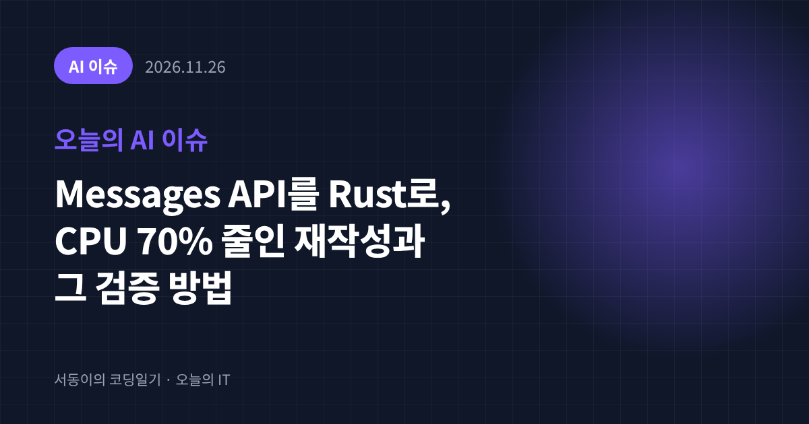

# 오늘의 AI 이슈 (2026.11.26) - Messages API를 Rust로 옮긴 Anthropic, 검증은 운영 트래픽 그림자 비교로

> 🤖 **AI 이슈** · 2026-11-26 · 📝 [티스토리에서 보기](https://dongseodong.tistory.com/68)



오늘은 **AI가 실제 업무를 얼마나 깊이 맡았는가** 를 보여 주는 소식 세 가지를 다룹니다. Anthropic은 Claude 에이전트로 자사 Messages API를 Python에서 Rust로 다시 쓴 과정을 공개했고, Claude 아티팩트를 데스크톱 앱으로 설치하는 기능이 베타로 나왔습니다. 마지막으로 Tidal이 완전 AI 생성 음원 약 2,900만 곡을 지우겠다고 밝힌 건을 봅니다.

TL;DR · 한눈에 보기

1 Anthropic이 Messages API를 Python에서 **Rust** 로 옮겼습니다. 요청당 CPU 약 **70% 감소** , 요청당 메모리 **80% 이상 감소** , 첫 토큰까지 걸리는 중앙값 시간 약 **20% 단축** 입니다. (2026년 11월 25일 Anthropic 엔지니어링 블로그)

2 핵심은 속도가 아니라 **검증 방법** 입니다. 기존 Python API를 정답지로 두고 실제 트래픽을 그림자 비교해, 일치율을 6.5%에서 **99.6%** 까지 끌어올렸습니다.

3 Claude 아티팩트를 Mac·Windows 앱으로 설치하는 기능이 베타로 열렸습니다. 권한은 **3단계** 이고, 업데이트할 때마다 다시 묻습니다. (2026년 11월 24일 공지)

목차

[1. Anthropic이 Messages API를 Rust로 다시 쓴 방법](#s1)

[2. 아티팩트를 데스크톱 앱으로: 권한 3단계](#s2)

[3. Tidal, 완전 AI 생성 음원 2,900만 곡 삭제 예고](#s3)

[자주 묻는 질문](#s-faq)

[정리](#s-sum)

## 01 Anthropic이 Messages API를 Rust로 다시 쓴 방법

**핵심:** Anthropic은 2023년 Python으로 만든 Messages API를 2026년 9월 Rust로 교체했습니다. 요청당 CPU 약 70%, 메모리 80% 이상이 줄었고, 기능 동결도 서비스 중단도 없었습니다.

### 왜 다시 썼나

API 트래픽이 2024년 초부터 2026년 가을까지 약 **1,800배** 늘었습니다. 요청 한 건을 처리할 때 Python 런타임이 가져가는 몫이 그만큼 커졌습니다. 2026년 3월에는 출력 파싱 부분만 Rust로 바꿔 CPU를 8~10% 줄였지만, 토큰 하나가 Python과 Rust 경계를 **세 번** 넘나드는 구조가 되어 효과가 제한적이었습니다. 그래서 9월에 전면 재작성으로 방향을 틀었습니다.

CPU 사용량 감소 **약 70%↓**

메모리 사용량 감소 **80% 이상↓**

첫 토큰까지 시간 단축 **약 20%↓**

출처: Anthropic 엔지니어링 블로그(2026-11-25). 메모리는 8~10월, 첫 토큰 시간은 9월 7~21일 Claude Code 요청 기준.

### 진짜 어려운 부분은 검증이었다

재작성에서 가장 큰 위험은 "겉보기에는 같은데 미묘하게 다른 동작"입니다. Anthropic은 **운영 중인 Python API를 정답지** 로 삼고, 실제 트래픽을 Rust 구현에 그림자처럼 흘려 결과를 비교했습니다. 기존 통합 테스트 약 700개로는 부족했습니다. 옮겨 온 테스트는 Python 구현에 묶여 있었고, 점검 결과 **100개가 넘는 단언문이 느슨해져** 있었습니다.

| 시점          | 상태                                                            |
|---------------|-----------------------------------------------------------------|
| 2026년 4월    | 테스트는 약 98% 통과. 그러나 실제 운영 입력은 약 4분의 1만 일치 |
| 2026년 5월 초 | 일치율 6.5%까지 하락                                            |
| 최종          | 일치율 99.6%                                                    |
| 2026년 9월    | 공개 트래픽이 Rust로 전환                                       |

숫자가 중간에 떨어진 이유는, 비교 범위를 넓힐수록 숨어 있던 차이가 드러났기 때문입니다. 불리언 옵션 20개만으로도 조합이 100만 가지를 넘고, 하나당 1초씩만 잡아도 모델 하나에 약 12일이 걸립니다. 프롬프트까지 바꾸기 전의 숫자입니다.

### 개인정보를 보지 않고 버그를 찾는 방법

고객의 요청과 응답은 열어 볼 수 없습니다. 그래서 차이가 생기면 **내용 대신 모양만** 기록했습니다. 어느 단계에서, 프롬프트의 어느 조각에서, 몇 번째 바이트부터 달라졌고 양쪽 길이가 얼마인지입니다. 같은 모양의 차이에는 지문(fingerprint)을 붙여 묶었습니다. 버그 하나가 비슷한 기록을 수십만 건 만들어 내기 때문입니다. 점검 스크립트는 10~30분마다 돌면서 **새로운 종류의 차이가 나왔을 때만** 담당 에이전트를 깨웠습니다.

📌 알아둘 점

모델 출력은 같은 입력에도 매번 다릅니다. 그래서 모델을 한 번만 실행하고 그 출력을 Rust 쪽에 다시 재생하는 방식으로, 모델 호출 앞뒤 단계가 정확히 일치하는지 확인했습니다.

### 내 프로젝트에 적용해 보기

핵심 아이디어는 "현재 운영 중인 구현을 정답지로 쓰는 그림자 비교"입니다. 전체를 다시 쓸 일이 없어도, 모듈 하나를 교체할 때 그대로 쓸 수 있습니다.

STEP 1

기존 구현을 정답지로 고정

STEP 2

실제 입력을 양쪽에 흘림

STEP 3

차이는 내용 대신 지문으로 기록

STEP 4

새 지문이 나올 때만 알림

▶ 그림자 비교의 최소 형태 (운영 트래픽에 영향 없이 기록만)

```
import hashlib, json, logging

def shadow_compare(payload, old_impl, new_impl):
    result = old_impl(payload)          # 응답은 항상 기존 구현 것을 사용
    try:
        candidate = new_impl(payload)
    except Exception as exc:            # 새 구현의 예외가 사용자에게 가면 안 됨
        logging.warning("shadow_error fp=%s", _fp(type(exc).__name__))
        return result

    if candidate != result:
        # 내용이 아니라 "차이의 모양"만 남긴다
        i = _first_diff(result, candidate)
        logging.warning(
            "shadow_diff fp=%s offset=%d len_old=%d len_new=%d",
            _fp(f"{i}"), i, len(result), len(candidate),
        )
    return result

def _fp(s: str) -> str:
    return hashlib.sha256(s.encode()).hexdigest()[:12]

def _first_diff(a: str, b: str) -> int:
    for i, (x, y) in enumerate(zip(a, b)):
        if x != y:
            return i
    return min(len(a), len(b))
```

▶ 새 지문만 골라 보기 (이미 본 지문은 걸러냄)

```
grep -o 'fp=[a-f0-9]*' app.log | sort -u > /tmp/fp.now
comm -13 /tmp/fp.seen /tmp/fp.now        # 처음 보는 차이만 출력
cp /tmp/fp.now /tmp/fp.seen
```

💡 왜 중요할까

재작성이 어려운 이유는 새 코드를 쓰는 일이 아니라, **옛 코드가 실제로 무엇을 하고 있었는지 아무도 전부 알지 못한다** 는 데 있습니다. Anthropic의 사례는 "운영 트래픽을 정답지로 쓰면 그 지식을 자동으로 복원할 수 있다"는 점을 보여 줍니다. 블로그는 동시에 한계도 적었습니다. 검증기는 출력이 같기만 하면 보상을 주므로 에이전트가 가장 값싼 방법으로 맞추려 들었고, 그것이 제대로 된 수정인지 판단하는 일은 사람 몫으로 남았습니다.

[출처 · Anthropic 엔지니어링 블로그 ↗](https://www.anthropic.com/research/migrating-api-to-rust)

------------------------------------------------------------------------

## 02 아티팩트를 데스크톱 앱으로: 권한 3단계

**핵심:** 2026년 11월 24일, Claude의 Mac·Windows 앱에서 아티팩트를 독립 앱으로 설치하는 기능이 베타로 열렸습니다. 아이콘과 창을 따로 갖고, 원본 아티팩트를 고치면 자동으로 업데이트됩니다.

| 권한 단계        | 할 수 있는 일                                          |
|------------------|--------------------------------------------------------|
| 기본             | 브라우저에서 할 수 있는 수준까지                       |
| 앱 권한          | 항상 위 창, 전역 단축키, 알림, 메뉴 막대·트레이 아이콘 |
| 전체 컴퓨터 접근 | 매번 묻지 않고 프로그램 실행, 파일 읽기·수정·삭제      |

### 권한을 볼 때 주의할 점

공지에 따르면 권한은 **지금 버전에만** 적용됩니다. 업데이트가 있을 때마다, 본인이 고친 경우에도 다시 묻습니다. 다만 앱의 일부를 외부 사이트에서 불러오는 경우, 그쪽 내용은 다시 묻지 않고 바뀔 수 있습니다. 전체 접근은 본인이 만든 앱, 또는 팀·엔터프라이즈에서는 같은 조직이 만든 앱에만 줄 수 있고, Anthropic이 설치 전에 앱을 심사하지는 않습니다.

| 조건         | 내용                                                          |
|--------------|---------------------------------------------------------------|
| 요금제       | 모든 요금제에서 베타                                          |
| 팀           | 기본 켜짐, 전체 접근은 꺼짐                                   |
| 엔터프라이즈 | 소유자가 켜야 사용 가능                                       |
| 불가         | HIPAA 대응 조직, 하이브리드 배포, Docs·Slides·Sheets 아티팩트 |
| 실행 조건    | 온라인 상태 + 로그인 필요                                     |

💡 팁

설치, 서명, API 키, 별도 로그인 없이 공유 메뉴의 "Install as app"만으로 설치됩니다. 대신 앱이 Claude에 보내는 요청은 **본인 요금제의 사용량** 에 포함됩니다.

[출처 · Claude 공지 · Install as app ↗](https://claude.com/resources/articles/install-as-app)

------------------------------------------------------------------------

## 03 Tidal, 완전 AI 생성 음원 2,900만 곡 삭제 예고

**핵심:** Pitchfork 보도에 따르면 음악 스트리밍 서비스 Tidal은 12월 9일 완전히 AI로 생성된 음원 약 2,900만 곡을 삭제하고, 이후 같은 종류의 업로드를 받지 않을 예정입니다. 사람이 만들고 AI의 도움을 받은 음악은 계속 허용합니다.

| 항목                             | 수치                     |
|----------------------------------|--------------------------|
| 삭제 예정 곡                     | 약 2,900만 곡 (12월 9일) |
| 최근 90일 업로드 중 전부 AI 생성 | 43%                      |
| 탐지 정확도 (Ircam Amplify)      | 99%                      |
| 오탐률                           | 1% (약 29만 곡에 해당)   |

### 개발자 관점에서 볼 지점

여기서 눈여겨볼 숫자는 99%가 아니라 **1%** 입니다. 2,900만 곡 규모에서 오탐률 1%는 사람이 만든 곡 약 29만 곡이 잘못 걸린다는 뜻입니다. 정확도가 높은 분류기라도 대상 규모가 커지면 오탐의 절대 수가 커진다는, 익숙한 문제가 그대로 드러납니다.

💡 왜 중요할까

자동 분류로 콘텐츠를 지우는 모든 서비스가 같은 설계 문제를 안고 있습니다. 임계값을 어디에 둘지, 잘못 걸린 사람이 어떻게 이의를 제기할지, 그 처리 비용을 누가 감당할지입니다. 정확도 지표 하나만 보고 "충분히 정확하다"고 말하기 어려운 이유입니다.

[출처 · Pitchfork 보도 ↗](https://pitchfork.com/)

## 자주 묻는 질문

### Q. Anthropic이 Messages API를 Rust로 옮긴 성능 결과는 어느 정도인가요?

2026년 11월 25일 Anthropic 엔지니어링 블로그 기준으로 요청당 CPU는 약 70% 줄었고, 요청당 메모리는 80% 이상 줄었습니다. 첫 토큰까지 걸리는 중앙값 시간은 약 20% 짧아졌습니다. 공개 트래픽이 Rust 구현으로 넘어간 시점은 2026년 9월입니다.

### Q. 대규모 재작성에서 동작이 같은지 어떻게 확인했나요?

운영 중인 Python API를 정답지로 두고 실제 트래픽을 Rust 구현에 그림자처럼 흘려 비교했습니다. 2026년 4월에는 테스트를 약 98% 통과하고도 운영 입력은 4분의 1만 일치했고, 5월 초 6.5%까지 떨어졌다가 최종적으로 99.6%에 도달했습니다. 고객 데이터를 보지 않기 위해 차이의 내용 대신 단계·위치·길이만 기록했습니다.

### Q. Claude 아티팩트를 설치한 앱은 내 컴퓨터에 어디까지 접근하나요?

2026년 11월 24일 공지 기준 권한은 3단계입니다. 기본은 브라우저에서 할 수 있는 수준이고, 앱 권한은 알림이나 전역 단축키 같은 기능을, 전체 컴퓨터 접근은 프로그램 실행과 파일 수정·삭제까지 허용합니다. 권한은 현재 버전에만 적용되며 업데이트할 때마다 다시 묻습니다.

## 정리

**Anthropic:** Messages API를 Rust로 재작성해 요청당 CPU 약 70%, 메모리 80% 이상 절감. 검증은 운영 트래픽 그림자 비교로 일치율 99.6% 달성.

**Claude 데스크톱 앱:** 아티팩트를 앱으로 설치하는 기능 베타. 권한 3단계이며 전체 접근은 본인·조직이 만든 앱에만.

**Tidal:** 12월 9일 완전 AI 생성 음원 약 2,900만 곡 삭제 예정. 탐지 정확도 99%, 오탐률 1%.

✦ 지금 해볼 것

☐ 교체 예정인 모듈이 있다면 그림자 비교 로그부터 붙여 보기

☐ 차이를 기록할 때 내용 대신 지문만 남기도록 설계하기

☐ 자동 분류로 무언가를 지우는 기능이 있다면 오탐 시 이의 제기 경로 점검하기

**참고 링크** : [Anthropic · Migrating our Messages API to Rust](https://www.anthropic.com/research/migrating-api-to-rust) · [Claude · Install as app](https://claude.com/resources/articles/install-as-app)

---

`#AI뉴스` `#Anthropic` `#Rust` `#MessagesAPI` `#성능최적화` `#재작성` `#그림자테스트` `#ClaudeCode` `#아티팩트` `#Tidal`
