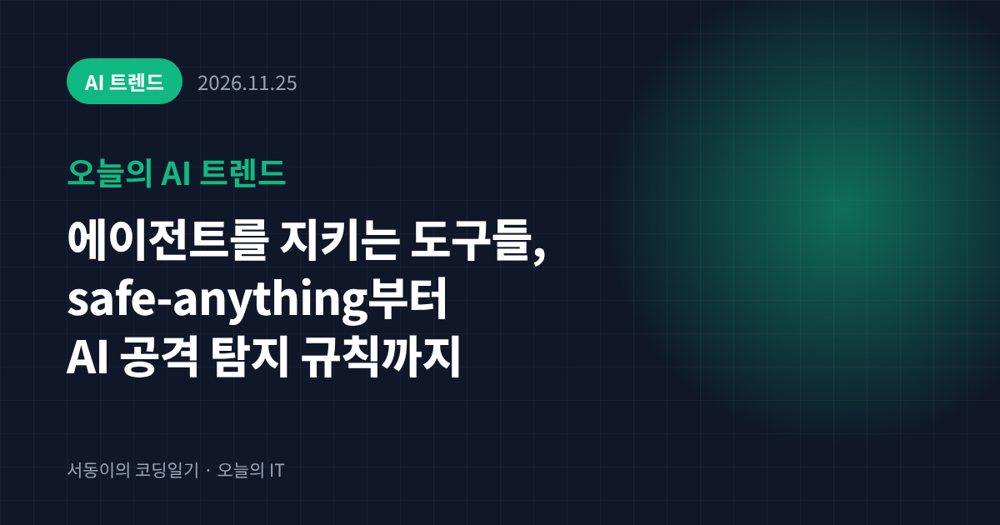

# 오늘의 AI 트렌드 (2026.11.25) - 에이전트를 지키는 도구들: safe-anything, AI 공격 탐지 규칙, songe

> 📈 **AI 트렌드** · 2026-11-25 · 📝 [티스토리에서 보기](https://dongseodong.tistory.com/63)



이번 주 GitHub에서 별이 빠르게 모인 AI 레포를 보면 분위기가 확 바뀌었어요. 지난주가 "에이전트에게 일을 맡기는 도구"였다면, 이번 주는 **"에이전트를 지키는 도구"** 가 올라왔어요. 내 에이전트 설정의 구멍을 찾는 스캐너, AI 공격 에이전트를 잡아내는 탐지 규칙, 그리고 내 컴퓨터 안에서만 조용히 학습하는 로컬 모델 엔진이에요. 셋 다 **설치 명령과 실제 쓰는 법** 까지 정리했어요.

TL;DR · 한눈에 보기

1 **safe-anything** : 명령 하나로 코드 취약점, 유출된 키, 의존성 CVE, 그리고 **AI 에이전트 설정의 위험** 까지 79개 규칙으로 잡아 주는 Rust 스캐너예요.

2 **agentic-attack-detections** : AI 에이전트로 해킹하는 프레임워크 25종을 잡는 탐지 규칙 모음이에요. 지표 580개, Sentinel·Splunk·Suricata 등 바로 쓸 수 있는 형식으로 나와요.

3 **songe** : 로컬 모델이 내 작업 방식을 보고, 내가 쉬는 동안 스스로 학습하는 엔진이에요. 데이터는 컴퓨터 밖으로 나가지 않아요.

| 레포                                         | ⭐ (11/25 기준) | 생성일 | 한 줄 요약                                |
|----------------------------------------------|-----------------|--------|-------------------------------------------|
| EL4CTEO/fast-anything                        | 3,773           | 11/21  | 느린 함수만 Rust로 포팅 (어제 소개)       |
| sybil-solutions/inference-optimisation-skill | 2,643           | 11/16  | 로컬 LLM 속도 튜닝 스킬 (어제 소개)       |
| iamajmeena/neonclipping                      | 2,554           | 11/19  | 링크로 9:16 숏폼 자동 생성                |
| pierridotite/mobile-agent-testers            | 2,035           | 11/16  | AI 테스터 20명이 폰 20대로 QA (어제 소개) |
| INK-Q/agy-fast                               | 1,402           | 11/19  | Google Antigravity용 MCP 가속 플러그인    |
| sous-labs/songe                              | 777             | 11/20  | 로컬 모델을 쉬는 시간에 학습              |
| erkamyaman/safe-anything                     | 657             | 11/22  | 코드·키·에이전트 설정 보안 스캐너         |
| ThreatDefence/agentic-attack-detections      | 651             | 11/20  | AI 공격 에이전트 탐지 규칙                |

📌 목록에서 뺀 레포

이번 주 별 순위에는 이름과 설명이 똑같은 "Gemini-Config-Checker-" 레포가 여러 개 올라와 있어요. GitHub 검색으로 33개가 나오고, 그중 15개가 넘는 레포가 11월 15일 3분 사이에 서로 다른 계정에서 만들어졌어요. 이 레포들의 별은 451~454개로 거의 같아요. 같은 이름 중 가장 먼저(10월 3일) 만들어진 MatinSenPai/Gemini-Config-Checker는 별이 143개예요. 이런 이슈가 있어서 이 레포들은 오늘 목록에 넣지 않았어요.

목차

[1. safe-anything: 내 코드와 에이전트 설정의 구멍 찾기](#s1)

[2. agentic-attack-detections: AI가 공격할 때 남기는 흔적](#s2)

[3. songe: 쉬는 동안 학습하는 내 로컬 모델](#s3)

[4. 지난주부터 계속 뜨는 레포들](#s4)

[정리](#s-sum)

## 01 safe-anything: 내 코드와 에이전트 설정의 구멍 찾기

### 어떤 문제를 푸나

요즘 코드는 사람과 에이전트가 같이 써요. 그런데 에이전트에게 준 권한 설정이 잘못되면 그 자체가 보안 구멍이 돼요. 예를 들어 권한 확인을 끄는 설정, 미리 허용해 둔 Bash, 버전을 고정하지 않은 MCP 서버, 훅 안에 들어 있는 **curl \| sh** 같은 것들이죠. safe-anything은 **코드, 비밀 키, 인프라 설정, 의존성, 에이전트 설정** 을 한 번에 훑는 스캐너예요.

| 영역          | 잡아내는 것 (예)                                                                                                      |
|---------------|-----------------------------------------------------------------------------------------------------------------------|
| 코드          | SQL·명령 인젝션, XSS, eval, SSRF, 경로 조작, 안전하지 않은 역직렬화. 9개 언어 + SQL                                   |
| 비밀 키       | AWS·GitHub·OpenAI·Anthropic 키, 커밋된 .env, NEXT_PUBLIC\_·VITE\_ 뒤에 숨은 비밀 (출력에선 항상 가려짐)               |
| 인프라        | Docker, GitHub Actions(pull_request_target, write-all), Kubernetes, Terraform, nginx                                  |
| 의존성        | lockfile의 모든 버전을 OSV.dev와 대조, 가장 가까운 수정 버전 안내                                                     |
| 에이전트 설정 | bypassPermissions, 미리 허용된 Bash, 고정 안 된 npx MCP 서버, 평문 MCP 토큰, ~/.ssh를 읽는 스킬, 보이지 않는 유니코드 |

### 동작 원리

저장소를 병렬로 한 번 훑으면서(ripgrep이 쓰는 ignore 크레이트) 파일마다 한 번만 읽고, 해당하는 규칙을 컴파일된 정규식으로 돌려요. 패턴만으로 판단이 어려운 곳은 파싱해요. MCP 설정은 주석 있는 JSON으로, Dockerfile은 스테이지별로, lockfile은 형식별로요. **코드를 실행하지 않고** , 네트워크 호출은 의존성 확인(OSV.dev에 패키지 이름과 버전만 전송)뿐이에요.

### 얼마나 잘 찾나

OWASP Juice Shop (1,195개 파일) **67건**

DVWA (233개 파일) **63건**

anthropics/skills (392개 파일) **6건**

pallets/flask (231개 파일) **2건**

expressjs/express (216개 파일) **0건**

README 측정값(Apple M4, --offline, 11/22). 의도적으로 취약하게 만든 Juice Shop·DVWA에서는 많이, 잘 관리된 express에서는 0건이 나왔어요. 스캔 시간은 0.03~0.13초.

오탐도 솔직하게 적었어요. Juice Shop에서 2~3건, DVWA에서 약 4건이 오탐이었고, 가장 시끄러운 규칙은 변수로 HTML을 만드는 innerHTML 검사래요. 그리고 **"깨끗하게 나왔다 = 안전하다"가 아니라 "79개 규칙에 안 걸렸다"** 는 뜻이라고 분명히 밝혀요.

### 직접 써보기

STEP 1

설치 후 프로젝트 폴더에서 한 번 스캔

STEP 2

에이전트에 MCP로 연결

STEP 3

CI에 붙여 PR마다 자동 검사

▶ 1단계: 설치하고 스캔

```
cargo install safe-anything    # 또는: npx safe-anything .
safe-anything .

# 자주 쓰는 옵션
safe-anything . --severity medium  # low 결과 숨기기
safe-anything . --offline          # 네트워크 없이 (의존성 검사 생략)
safe-anything . --sarif            # GitHub 코드 스캐닝 형식
```

▶ 2단계: Claude Code / Codex에 MCP 서버로 연결

```
claude mcp add safe-anything -- safe-anything mcp
codex mcp add safe-anything -- safe-anything mcp
```

▶ 3단계: GitHub Actions에 붙이기

```
- uses: erkamyaman/safe-anything@v1.0.2
  with:
    fail-on: high
- uses: github/codeql-action/upload-sarif@v4
  if: always()
  with:
    sarif_file: safe-anything.sarif
```

💡 팁

high 이상 문제가 있으면 종료 코드 1로 끝나서, pre-commit이나 CI 체크로 그대로 쓸 수 있어요. 특정 줄을 무시하려면 주석에 **safe-anything:ignore** 를 적으면 돼요.

💡 왜 중요할까

남이 만든 스킬이나 MCP 서버를 설치하기 전에 **한 번 스캔하는 습관** 이 필요해진 시대예요. 에이전트 설정 파일은 "에이전트가 무엇을 해도 되는지"를 정하는 파일이라, 코드만큼이나 검사해야 해요.

[출처 · GitHub · safe-anything ↗](https://github.com/erkamyaman/safe-anything)

------------------------------------------------------------------------

## 02 agentic-attack-detections: AI가 공격할 때 남기는 흔적

### 무엇인가

이제 공격자도 AI 에이전트를 써요. 목표만 주면 에이전트가 계획을 세우고, 실제 해킹 도구를 돌리고, 목표에 닿을 때까지 계속하는 "에이전트 공격 프레임워크"가 여럿 나와 있어요. 이 레포는 그런 프레임워크를 잡아내는 **탐지 규칙, 헌팅 쿼리, 침해 지표(IOC)** 를 MIT 라이선스로 공개해요.

| 프레임워크   | 정체 (README 기준)                                                                       |
|--------------|------------------------------------------------------------------------------------------|
| ARTEX        | Go로 된 계획·작업 에이전트 + 웹 콘솔. 여러 위협 그룹이 M365, Okta, AWS 등을 노릴 때 사용 |
| Cairn        | Claude Code·Codex 같은 코딩 에이전트를 Kali 컨테이너 안에서 조종하는 Python 엔진         |
| HexStrike    | AI 비서에게 보안 도구 약 150개를 인증 없는 API로 넘겨주는 MCP 서버                       |
| Hermes Agent | 정상 범용 에이전트를 승인 끄고 탈옥 스킬을 붙여 공격 콘솔로 바꾼 사례                    |

11월 25일 기준으로 25개 공개 프레임워크를 추적하고, **인터넷에 노출된 공격 콘솔** 의 수도 날짜별로 기록하고 있어요. 다만 콘솔이 노출됐다고 실제 공격이 있었다는 증거는 아니라고 선을 그었어요.

### 어떤 형식으로 나오나

| 보안 장비                      | 쓰는 법                                                                   |
|--------------------------------|---------------------------------------------------------------------------|
| Microsoft Sentinel             | 배포 버튼 한 번에 분석 규칙(비활성 상태), 헌팅 쿼리, 지표 워치리스트 생성 |
| Splunk                         | 릴리스의 앱(.tgz) 하나에 모든 프레임워크 검색과 대시보드                  |
| Elastic                        | ndjson 하나 가져오기 (모두 비활성 상태로 들어옴)                          |
| Suricata · Zeek · YARA · Sigma | frameworks/\*/ 아래 규칙 파일을 그대로 추가                               |
| WAF (Cloudflare, AWS, Azure)   | waf/ 폴더의 사용자 에이전트·프로브 차단 규칙                              |

### 1분 만에 해보기

Suricata가 있다면 레포에 들어 있는 샘플 트래픽으로 바로 확인할 수 있어요. 이 캡처는 실제 침입 기록이 아니라, 프레임워크 소스 코드와 공개 보고서를 바탕으로 만든 테스트 트래픽이에요.

▶ ARTEX 규칙을 샘플 캡처에 돌려 보기

```
git clone https://github.com/ThreatDefence/agentic-attack-detections
cd agentic-attack-detections
mkdir -p out
suricata -r frameworks/artex/tests/artex-sample.pcap \
  -S frameworks/artex/suricata/artex.rules -l out -k none
cat out/fast.log   # "TD ARTEX ..." 경고가 보이면 성공
```

📌 참고

Sentinel·Elastic 규칙은 일부러 **꺼진 상태** 로 들어와요. 내 환경의 인덱스·테이블 이름에 맞춘 뒤 하나씩 켜야 오탐 폭탄을 피할 수 있어요.

💡 왜 중요할까

AI 에이전트는 사람보다 훨씬 빠르게, 지치지 않고 공격을 반복해요. 그래서 방어하는 쪽도 **"에이전트 특유의 흔적"** (정해진 사용자 에이전트, 프로브 경로, 서명 없는 JWT 같은)을 잡는 규칙이 필요해졌어요. 오늘 소개한 safe-anything이 "내 에이전트가 뚫리지 않게", 이 레포는 "남의 에이전트가 들어오는 걸 알아채게" 해 주는 셈이에요.

[출처 · GitHub · agentic-attack-detections ↗](https://github.com/ThreatDefence/agentic-attack-detections)

------------------------------------------------------------------------

## 03 songe: 쉬는 동안 학습하는 내 로컬 모델

### 무엇인가

songe는 로컬 모델을 **내 작업 방식에 맞게 계속 학습시키는 엔진** 이에요. 평소처럼 opencode, pi 같은 에이전트로 로컬 모델을 쓰면, songe가 중간에서 모델의 행동 뒤에 무슨 일이 있었는지(도구 결과, 에러, 내 다음 메시지)를 기록해요. 그리고 내가 자리를 비우면 그걸로 모델을 가르쳐요.

### 동작 원리: 두 종류의 "꿈"

|             | Quick Dream                                    | Deep Dream                                     |
|-------------|------------------------------------------------|------------------------------------------------|
| 걸리는 시간 | 몇 분                                          | 1시간 이상                                     |
| 하는 일     | 내가 말하거나 보여준 선호를 모델 지시문에 추가 | 교훈으로 연습 문제를 만들고 작은 어댑터를 학습 |
| 되돌리기    | 선호 하나만 빼거나 전체 취소                   | 이전 버전 아무 데나 복귀                       |

학습은 "교사-학생" 방식이에요. 교훈을 본 원래 모델이 교사, 장면만 본 같은 모델 + 어댑터가 학생이 돼요(온폴리시 증류). 새 버전은 **내가 반응했던 순간들에서 확실히 더 잘하고, 원래 잘하던 걸 망치지 않을 때만** 쓰여요. 실제 대화는 학습에 직접 쓰지 않고, 모델이 그 교훈으로 만든 연습 장면만 써요.

STEP 1

에이전트 → songe(127.0.0.1:7613) → 모델 서버

STEP 2

작업 중: 교정, 에러, 재시도 기록

STEP 3

자리 비움: 연습 생성 → 학습 → 검사

STEP 4

더 나을 때만 새 버전 교체

### 설치하기

▶ uv 또는 pipx로 설치 (Python 3.11+)

```
uv tool install songe        # 또는: pipx install songe
songe init                   # 모델 서버와 에이전트를 찾아 설정을 보여 주고 한 번 묻습니다
```

▶ 자주 쓰는 명령

```
songe                # 지금 무엇을 하는지
songe open           # 브라우저 대시보드
songe sleep          # 지금 바로 Deep Dream 시작
songe undo MODEL     # 한 버전 되돌리기
songe pause          # 학습 멈추기
songe forget         # 기록된 대화 삭제 (학습된 버전은 유지)
```

| 구분      | 지원                                       | 끝까지 테스트된 것            |
|-----------|--------------------------------------------|-------------------------------|
| 모델 서버 | LM Studio, vLLM, Ollama, llama.cpp, mlx-lm | LM Studio(macOS), vLLM(Linux) |
| 에이전트  | opencode, pi, OpenAI 호환 도구             | opencode, pi                  |
| 학습      | Apple Silicon(MLX), NVIDIA·AMD(PyTorch)    | Apple Silicon, NVIDIA         |

📌 참고

GPU가 없는 컴퓨터에서도 서빙과 기록은 되지만 학습은 안 돼요. 계정·텔레메트리·클라우드가 없고, songe는 도구를 직접 실행하지 않는다고 해요. 메모리와 배터리 여유가 있을 때만 돌고, 사용자가 돌아오면 바로 멈춰요.

💡 왜 중요할까

지금까지 "내 스타일을 기억하는 AI"는 클라우드 서비스의 메모리 기능에 기대야 했어요. songe는 그걸 **내 컴퓨터 안에서, 모델 가중치 수준으로** 하려는 시도예요. 오늘 AI 이슈에서 다룬 루프 모델처럼 로컬 모델이 똑똑해질수록, 이런 개인화 학습의 가치도 같이 커져요.

[출처 · GitHub · songe ↗](https://github.com/sous-labs/songe)

## 04 지난주부터 계속 뜨는 레포들

어제 자세히 다룬 세 레포는 하루 만에 별이 또 수백 개씩 늘었어요. 일시적인 화제가 아니라 **지난주부터 계속 뜨는 중** 이에요.

| 레포                         | 11/24 | 11/25 | 하루 증가 |
|------------------------------|-------|-------|-----------|
| fast-anything                | 3,402 | 3,773 | +371      |
| inference-optimisation-skill | 2,381 | 2,643 | +262      |
| mobile-agent-testers         | 1,630 | 2,035 | +405      |

특히 mobile-agent-testers가 가장 빠르게 늘었어요. "AI로 테스트하기"가 실제로 써 볼 만한 단계에 왔다고 느끼는 개발자가 많다는 뜻이에요. 지난주 흐름이 **"에이전트에게 맡기고 검증하기"** 였다면, 이번 주는 거기에 **"에이전트 자체를 안전하게"** 가 더해졌어요.

> 에이전트에게 권한을 줄수록, 그 권한을 검사하는 도구도 함께 필요해요.

## 정리

**safe-anything:** 코드·키·인프라·의존성·에이전트 설정을 79개 규칙으로 0.1초 안에 스캔. MCP와 CI로 바로 붙일 수 있어요.

**agentic-attack-detections:** AI 공격 에이전트 25종의 흔적을 Sentinel·Splunk·Suricata 등에서 잡는 규칙과 지표 580개.

**songe:** 로컬 모델이 내 교정과 에러에서 배우고, 쉬는 동안 학습하며, 더 나을 때만 교체돼요.

✦ 지금 해볼 것

☐ 내 프로젝트 폴더에서 npx safe-anything . 한 번 돌려 보기

☐ ~/.claude 설정과 .mcp.json에 고정 안 된 npx 서버나 평문 토큰이 없는지 확인하기

☐ 로컬 모델을 쓴다면 songe init으로 어떤 설정이 바뀌는지 미리 보기

---

`#AI트렌드` `#깃허브트렌드` `#safe-anything` `#AI에이전트보안` `#MCP보안` `#ClaudeCode` `#위협탐지` `#Suricata` `#songe` `#로컬LLM`
