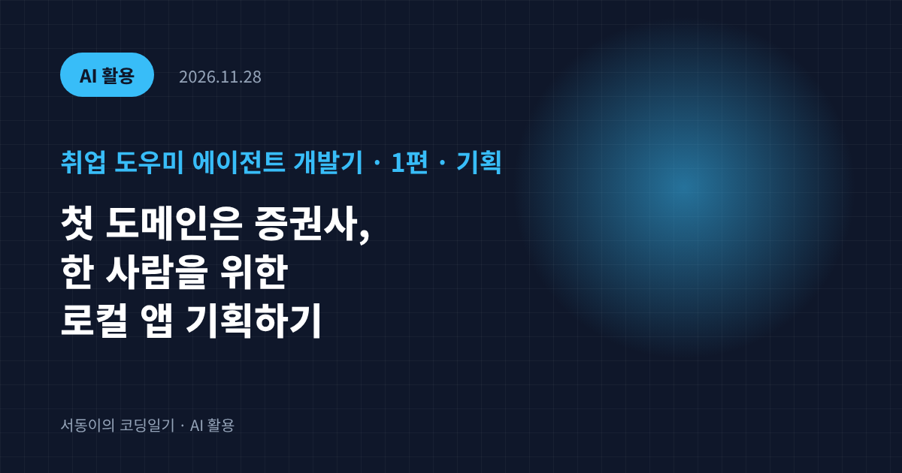
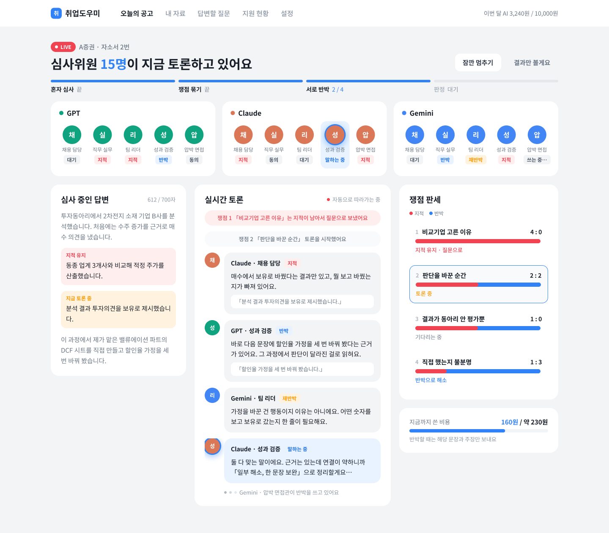
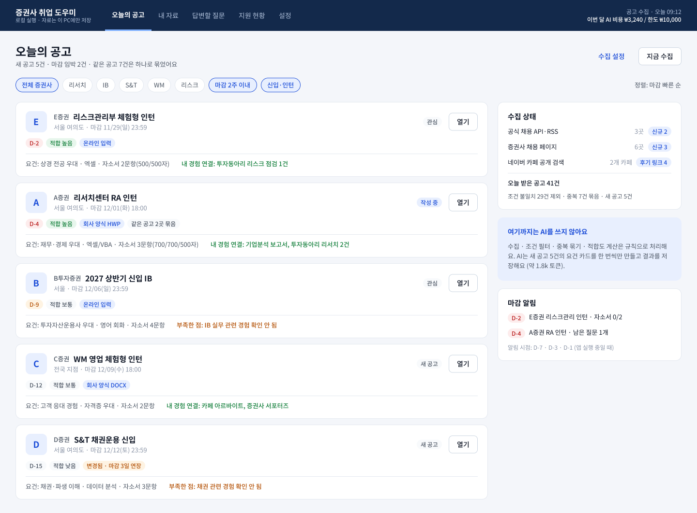
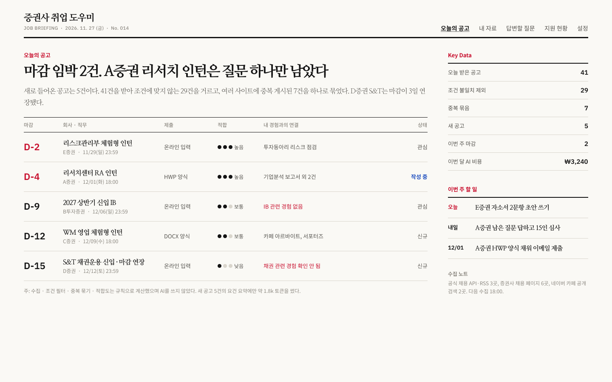
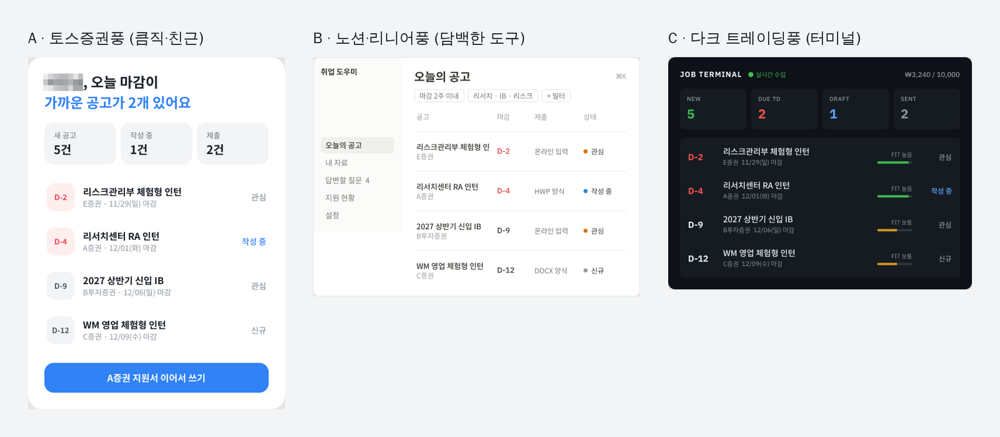
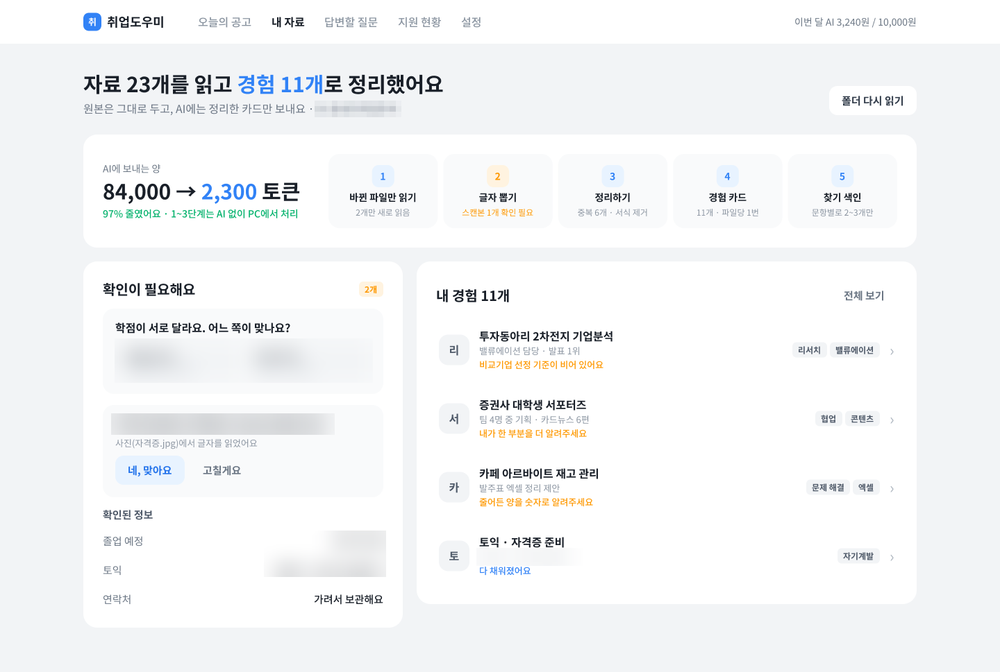
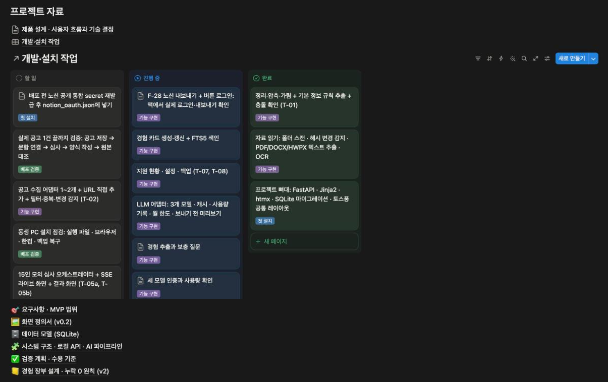

# 취업 도우미 에이전트 개발기 1편 · 기획 (Figma, Notion)

> 🧪 **AI 활용** · 2026-11-28 · 📝 [티스토리에서 보기](https://dongseodong.tistory.com/73)



**증권사 취업을 준비하는 동생을 위해 PC에서 도는 취업 도우미 앱을 만들고 있습니다.** 이 글은 그 첫 단계인 기획 기록입니다.

이 글 한눈에 보기

1 **왜:** 흩어진 취업 자료에서 경험을 매번 다시 찾는 일을 줄이려고, 첫 도메인 증권사부터 시작했습니다.

2 **화면:** 피그마로 먼저 그렸고, 디자인 두 번을 버린 끝에 토스증권풍으로 정했습니다.

3 **준비물:** 노션 문서 5개, 작업 16개, 그리고 "자동화하지 않을 것" 목록을 먼저 만들었습니다.

📚 취업 도우미 에이전트 개발기 시리즈

1편 · 기획 **왜 만들었고, 화면과 문서를 어떻게 준비했나** 지금 읽는 글

2편 · 설계 [로컬 앱 구조, 토큰 예산, 15인 심사, 개인정보 규칙](https://dongseodong.tistory.com/74)

3편 · 개발 [PR 12개로 돌아본 이틀과 막혔던 부분](https://dongseodong.tistory.com/75)

단독① [토큰 절약 vs 누락 0](https://dongseodong.tistory.com/76)

단독② [스택 PR이 main에 안 들어간 이유](https://dongseodong.tistory.com/77)

단독③ [윈도우에서만 터진 asyncio.run 오류](https://dongseodong.tistory.com/78)

단독④ [맥에서 Windows 한국어 OCR 테스트하기](https://dongseodong.tistory.com/79)

단독⑤ [앱에서 AI 구독을 쓰는 방법: 공식 CLI 호출](https://dongseodong.tistory.com/80)

목차

[1. 왜 시작했나: 큰 서비스에서 작은 베타로](#s1)

[2. 앱이 하는 일 구상](#s2)

[3. 화면은 코드보다 먼저 피그마로](#s3)

[4. 디자인 삽질: 한눈에 읽히는 화면을 찾기까지](#s4)

[5. 개발 전 산출물: 노션 문서 5개와 작업 16개](#s5)

[6. 기획 단계에서 정한 선](#s6)

## 01 왜 시작했나: 큰 서비스에서 작은 베타로

**한 줄 요약:** 넓은 서비스를 완성하기 전에, 실제 사용자 한 명이 당장 쓸 수 있는 작은 앱부터 만들기로 했습니다.

### 원래 하던 것: CareerLens AI

원래 진행하던 프로젝트는 **CareerLens AI** 라는 취업 서비스였습니다. 직무를 아직 정하지 못한 취준생이 경험을 정리하고, 직무를 탐색하고, 공고를 추천받고, 자소서와 면접을 준비하고, 일정까지 관리하는 흐름을 한 번에 담으려는 서비스였습니다. 하고 싶은 것은 분명했지만 범위가 너무 넓어서, 누군가 실제로 써 보기까지는 시간이 오래 걸릴 구조였습니다.

### 우선순위를 바꾼 날

2026년 11월 27일에 우선순위를 바꿨습니다. CareerLens는 잠시 보류하고, **증권사 취업을 준비하는 동생 한 명이 쓸 로컬 Windows 앱** 을 사이드 프로젝트 겸 베타로 먼저 만들기로 했습니다.

| 항목      | CareerLens AI                  | 취업 도우미 에이전트 (베타) |
|-----------|--------------------------------|-----------------------------|
| 사용자    | 직무를 정하지 못한 취준생 전반 | 증권사를 준비하는 한 사람   |
| 도메인    | 모든 직무                      | 증권사부터 시작             |
| 실행 방식 | 웹 서비스                      | 사용자 PC에서 도는 로컬 앱  |
| 목표      | 넓은 기능 완성                 | 바로 써 보고 피드백 받기    |

계산은 단순했습니다. 실제로 쓸 사람이 있는 작은 앱을 먼저 만들면 무엇이 정말 필요한지 빨리 알 수 있습니다. 그리고 나중에 CareerLens를 다시 시작할 때 문서 정제, 경험 정리, 모의 심사 같은 부분은 그대로 가져다 쓸 수 있습니다. 그래서 레포도 CareerLens와 따로 새로 만들었습니다. 배포 방식과 의존성이 다르고, 무엇보다 실제 사용자의 자료가 다른 프로젝트와 섞이지 않게 하기 위해서입니다.

💡 첫 도메인을 하나로 좁힌 이유

"취업 도우미"는 어느 직무에나 붙일 수 있는 이름이지만, 공고 수집 규칙, 지원서 양식, 심사 기준은 업계마다 다릅니다. 처음부터 모든 업계를 다루면 어느 쪽도 깊게 맞추기 어렵습니다. 그래서 앱 이름은 넓게 두고, 실제 내용은 증권사 한 도메인에 맞춰 먼저 완성한 뒤 다른 업계로 넓히기로 했습니다.

## 02 앱이 하는 일 구상

**한 줄 요약:** 취업 자료 폴더를 읽어 경험을 정리하고, 공고와 자소서와 지원 현황까지 한 앱에서 다루는 것이 목표입니다.

| 기능         | 설명                                                                                     |
|--------------|------------------------------------------------------------------------------------------|
| 내 자료 정리 | PC의 취업 자료 폴더를 읽어서 경험을 빠짐없이 정리합니다.                                 |
| 공고         | 증권사 공고를 모으고 걸러서, 공고마다 요건 카드를 만듭니다.                              |
| 자소서       | 문항별로 답변을 쓰고, **15인 AI 모의 심사** (GPT·Claude·Gemini × 5가지 역할)를 받습니다. |
| 지원서 양식  | 회사별 지원서 양식을 채우는 일을 돕습니다.                                               |
| 지원 현황    | 어디에 언제 지원했고 결과가 어떤지 관리합니다.                                           |

### 실행 구조

구조는 단순하게 잡았습니다. 실행 파일을 열면 내 PC 안(127.0.0.1)에 FastAPI 서버가 뜨고, 기본 브라우저에 앱 화면이 열립니다. 데이터는 SQLite 파일 하나에 저장합니다. 인터넷에 서버를 따로 둘 필요가 없고, 자료가 사용자 PC 밖으로 나가지 않는다는 점이 가장 큰 장점입니다.

① 실행 파일 열기

더블클릭 한 번으로 시작합니다.

② 로컬 서버

내 PC(127.0.0.1)에서만 접속되는 FastAPI 서버가 뜹니다.

③ 브라우저 화면

기본 브라우저에 앱 화면이 자동으로 열립니다.

④ SQLite 파일

모든 데이터는 파일 하나에 저장됩니다.

📌 SQLite도 따로 설치해야 하나?

기획하면서 실제로 나온 질문입니다. 답은 "따로 설치할 것이 없다"입니다. SQLite는 파이썬에 기본으로 들어 있는 라이브러리라 실행 파일 안에 같이 묶이고, 데이터는 파일 하나로 생깁니다. 백업도 그 파일 하나를 복사하면 끝납니다.

## 03 화면은 코드보다 먼저 피그마로

**한 줄 요약:** 코드를 쓰기 전에 화면 8개를 피그마로 먼저 그려서 흐름을 확인했습니다.

화면을 먼저 눈으로 확인하고 싶어서, Claude에게 피그마 파일을 직접 만들어 화면을 그려 달라고 했습니다. Claude가 피그마 연동으로 파일을 만들고 아래 8개 화면을 그렸습니다.

| 화면           | 하는 일                                         |
|----------------|-------------------------------------------------|
| 내 자료        | 폴더에서 읽은 파일과 정리된 경험을 봅니다.      |
| 오늘의 공고    | 새로 올라온 공고와 마감이 가까운 공고를 봅니다. |
| 공고 상세      | 공고 요건 카드와 내 경험의 연결을 봅니다.       |
| 답변할 질문    | 자소서 문항에 하나씩 답합니다.                  |
| 15인 심사 결과 | 모의 심사위원들의 평가를 봅니다.                |
| 양식 채우기    | 지원서 양식을 채웁니다.                         |
| 지원 현황      | 지원 이력과 결과를 관리합니다.                  |
| 설정           | 폴더, AI 연결, 노션 연결을 설정합니다.          |

### 라이브 심사장

모의 심사는 재미있게 만들고 싶었습니다. 그래서 **라이브 심사장** 화면을 추가했습니다. 심사위원 15명이 지적과 반박을 실시간으로 주고받는 대화창, 쟁점별로 지적과 반박이 얼마나 팽팽한지 보여 주는 줄다리기 막대, 지금까지 쓴 토큰을 보여 주는 실시간 미터가 들어갑니다.



피그마 v0.2의 라이브 심사장: 15명이 지적과 반박을 주고받는 화면 (가짜 데이터)

## 04 디자인 삽질: 한눈에 읽히는 화면을 찾기까지

**한 줄 요약:** 말로 디자인 방향을 설명하면 계속 빗나갔고, 레퍼런스 하나를 골라 주자 바로 맞았습니다.

### 시도 1: 기본 SaaS 스타일 (v0.1)

처음 나온 화면은 둥근 카드, 얇은 테두리, 파스텔 배지가 반복되는 스타일이었습니다. 정보는 다 들어 있었지만 카드와 배지가 비슷한 무게로 흩어져 있어서, 무엇부터 봐야 하는지 한눈에 들어오지 않았습니다. 매일 열어 볼 화면인데 가독성이 떨어진다고 판단했습니다.



피그마 v0.1: 둥근 카드와 파스텔 배지가 반복되는 기본 SaaS 스타일 (가짜 데이터)

### 시도 2: 증권 리서치 리포트 스타일

증권사 앱이니 증권 리서치 리포트처럼 가 보자는 방향으로 다시 그렸습니다. 명조 헤드라인, 괘선 표, 흑백에 증권 빨강과 파랑을 쓴 스타일입니다. 분위기는 살았지만 글자가 작고 괘선과 숫자가 빽빽해서, 오히려 읽기가 더 어려워졌습니다.



두 번째 시도: 증권 리서치 리포트 스타일 (가짜 데이터)

### 시도 3: 레퍼런스를 나란히 놓고 고르기

두 번 빗나가자 Claude가 방식을 바꾸자고 했습니다. 말로 방향을 짐작하니까 자꾸 빗나간다며, 평소 좋아하는 앱을 물어본 것입니다. 그리고 **토스증권풍, 노션·리니어풍, 다크 트레이딩앱풍** 세 가지를 작게 나란히 그려서 고르게 했습니다. 고민 없이 토스증권풍을 골랐습니다.



세 가지 후보를 나란히 그려 받은 비교 화면. 여기서 토스증권풍을 골랐습니다.

### 결과: v0.2 토스증권풍

| 요소        | v0.2에서 정한 것                                               |
|-------------|----------------------------------------------------------------|
| 배경과 카드 | 회색 배경 위에 테두리 없는 흰 덩어리, 모서리 둥글기 20         |
| 색          | 파랑 `#3182F6` 하나를 중심으로 사용                            |
| 첫 줄       | "오늘 마감이 가까운 공고가 2개 있어요" 같은 큰 문장형 헤드라인 |
| 질문 화면   | 토스 송금 화면처럼 한 화면에 질문 하나만                       |



피그마 v0.2 토스증권풍 「내 자료」 화면 (가짜 데이터, 일부 값은 흐리게 처리)

피그마의 변수 이름과 앱 CSS 토큰 이름도 같게 맞춰 뒀습니다. 나중에 화면을 코드로 옮길 때 "피그마의 이 색이 코드의 어느 변수인지" 헷갈리지 않게 하기 위해서입니다.

💡 배운 점

AI에게 디자인 방향을 말로 설명하는 것보다 **레퍼런스 하나를 찍어 주는 것이 훨씬 빠릅니다.** "깔끔하게", "읽기 쉽게"는 사람마다 떠올리는 그림이 다르지만, "토스증권처럼"은 바로 같은 그림을 떠올리게 합니다. 고를 후보를 작게 여러 개 나란히 그려 달라고 하는 것도 좋은 방법이었습니다.

## 05 개발 전 산출물: 노션 문서 5개와 작업 16개

**한 줄 요약:** 노션에 「프로젝트 본부」 페이지를 두고, 그 아래에 개발 전 문서 5개와 작업 DB를 만들었습니다.

코드를 쓰기 전에 무엇을, 어디까지, 어떤 기준으로 만들지 먼저 문서로 정했습니다. 문서는 모두 Claude와 대화하면서 함께 썼고, 피그마 v0.2도 본부 페이지에 임베드해 두었습니다.

| 문서                                   | 담은 내용                                                          |
|----------------------------------------|--------------------------------------------------------------------|
| 요구사항 · MVP 범위                    | 기능 F-01~F-22를 MVP / 다음 / 나중으로 구분 (이후 F-28까지 늘어남) |
| 화면 정의서 v0.2                       | 화면별 목적, 요소, 데이터, 동작                                    |
| 데이터 모델                            | SQLite 테이블 19개                                                 |
| 시스템 구조 · 로컬 API · AI 파이프라인 | 문서 정제 5단계, 질문당 토큰 상한, 15인 심사 단계                  |
| 검증 계획 · 수용 기준                  | 무엇이 되면 "완성"인지에 대한 기준                                 |



노션 「프로젝트 본부」의 작업 보드와 개발 전 문서 목록

### 작업 DB와 커밋 규칙

노션 작업 DB에는 작업 16개를 등록했습니다. 첫 설치 3개, 기능 구현 11개, 배포 검증 2개입니다. 그리고 커밋과 PR 제목에는 **기능 ID(F-xx)와 화면 ID(T-xx)** 를 적기로 정했습니다.

▶ 커밋 제목 규칙 예시

```
F-01~03 취업 폴더 읽기, 텍스트 추출, 개인정보 가리기
T-01 내 자료 화면을 피그마 v0.2에 맞춰 다시 짜기
F-28 경험 장부 노션 내보내기
```

이렇게 해 두면 PR 하나를 열었을 때 노션의 어느 요구사항, 어느 화면과 연결되는지 바로 찾을 수 있습니다. 문서와 코드가 서로를 가리키게 만드는 가장 싼 방법이었습니다.

### MVP 범위와 이후에 붙일 것

요구사항 문서에서 기능을 MVP / 다음 / 나중으로 나눈 이유는, 처음부터 모든 것을 만들지 않고 실제로 써 볼 수 있는 범위부터 끝내기 위해서입니다. 지금 MVP는 **내 자료 읽기, 경험 장부, 공고, 자소서와 15인 심사** 까지이고, 아래 기능은 MVP 이후에 붙일 예정입니다.

| 이후에 붙일 것        | 하려는 일                                                                                                                                                                                       |
|-----------------------|-------------------------------------------------------------------------------------------------------------------------------------------------------------------------------------------------|
| 문서 양식 직접 채우기 | 회사가 HWP 같은 문서 파일로 이력서를 내라고 하는 경우, 그 양식 파일에 서비스가 직접 내용을 채워 줍니다. kordoc 같은 한국어 문서 오픈소스를 붙이는 것을 검토하고 있습니다.                       |
| 로컬 AI 연결          | Claude Code를 로컬 모델로 돌리는 오픈소스 claude-code-local과, 오픈소스 AI 검색 엔진 Vane(예전 이름 Perplexica)을 엮어서, 일부 단계를 구독 없이 PC 안에서 처리하는 방법을 시험해 볼 계획입니다. |
| 다른 도메인           | 증권사에서 흐름이 자리를 잡으면, 공고 규칙과 심사 기준을 바꿔 다른 업계로 넓힙니다.                                                                                                             |

이런 기능이 나중에 들어와도 구조를 크게 바꾸지 않도록, 설계 단계에서 붙일 자리를 미리 열어 두었습니다. 그 이야기는 2편에서 다룹니다.

## 06 기획 단계에서 정한 선

**한 줄 요약:** 편해 보여도 약관이나 계정 정지 위험이 있거나 되돌릴 수 없는 일은 자동화하지 않기로 했습니다.

처음 떠올린 기능에는 자동 제출, 로그인 자동화, 캡차 우회, 회원 전용 카페 본문 수집이 모두 들어 있었습니다. 기획 단계에서 하나씩 따져 보고 아래처럼 정했습니다.

| 원했던 기능  | 결정                                                                                                                | 이유                                                         |
|--------------|---------------------------------------------------------------------------------------------------------------------|--------------------------------------------------------------|
| 로그인 유지  | 앱 전용 브라우저에 사용자가 한 번 로그인해 두면 계속 씁니다. 본인 인증이 나오면 멈추고 사용자에게 넘깁니다.         | 본인 인증은 본인이 해야 하는 단계입니다.                     |
| 자동 제출    | 앱이 다 채우고 검사까지 한 뒤, 최종 미리보기에서 사용자가 "제출"을 한 번 누르면 사이트의 제출 버튼은 앱이 누릅니다. | 지원서는 되돌릴 수 없어서 마지막 한 번은 사람이 확인합니다.  |
| 카페 글 수집 | 사용자가 연 글에서 "저장"을 누를 때만 보관합니다.                                                                   | 자동 대량 수집은 카페 약관 위반과 계정 정지 위험이 있습니다. |
| 캡차         | **우회하지 않습니다.** 캡차가 뜨면 앱이 멈추고, 사용자가 풀면 이어서 진행합니다.                                    | 캡차는 자동화를 막으려고 있는 장치입니다.                    |

🔥 자동화의 기준

이 표를 정리하면서 기준이 하나로 모였습니다. **되돌릴 수 없는 일과 본인만 해야 하는 일은 사람이 하고, 그 앞뒤의 반복 작업은 앱이 한다** 는 것입니다. 이 기준은 이후 AI 연결 방식이나 노션 연결을 정할 때도 그대로 적용했습니다.

## 정리

**핵심 1.** 넓은 서비스를 잠시 멈추고, 실제 사용자 한 명이 쓸 로컬 앱을 첫 도메인 증권사로 먼저 만들기로 했습니다.

**핵심 2.** 화면은 코드보다 먼저 피그마로 그렸고, 디자인 방향은 말 대신 레퍼런스로 정했습니다.

**핵심 3.** 노션에 문서 5개와 작업 16개를 먼저 만들고, 커밋 제목에 기능·화면 ID를 적어 문서와 코드를 연결했습니다.

**핵심 4.** 되돌릴 수 없는 일과 본인만 해야 하는 일은 자동화하지 않는다는 선을 기획 단계에서 정했습니다.

다음 2편에서는 이 기획을 바탕으로 개발 착수 전에 고민한 설계, 즉 로컬 앱 구조, 토큰 예산, 15인 심사 자리 배치, 개인정보 규칙을 정리합니다.

## 자주 묻는 질문

### 취업 도우미 에이전트는 어떤 앱입니까?

취업 자료 폴더를 읽어 경험을 빠짐없이 정리하고, 공고 정리, 자소서 작성과 15인 AI 모의 심사, 지원서 양식 채우기, 지원 현황 관리를 한 곳에서 하는 로컬 Windows 앱입니다. 사용자 PC 안에서 FastAPI 서버와 SQLite 파일로 동작하고, 첫 도메인은 증권사입니다.

### 왜 웹 서비스가 아니라 로컬 앱으로 만들었습니까?

취업 자료에는 연락처, 학력 같은 개인정보가 많이 들어 있어서 자료가 사용자 PC 밖으로 나가지 않는 구조를 택했습니다. 실행 파일을 열면 127.0.0.1에서만 접속되는 서버가 뜨고 브라우저에 화면이 열리는 방식이라, 따로 서버를 운영할 필요도 없습니다.

### AI에게 디자인을 맡길 때 무엇이 가장 효과적이었습니까?

말로 방향을 설명하는 것보다 레퍼런스를 정해 주는 것이 가장 효과적이었습니다. 이 프로젝트에서는 기본 SaaS 스타일과 리포트 스타일을 버린 뒤, 세 가지 후보를 작게 나란히 그려 받아 토스증권풍을 고르자 한 번에 방향이 맞았습니다.

---

`#취업도우미에이전트` `#사이드프로젝트` `#기획` `#피그마` `#노션` `#ClaudeCode` `#AI활용` `#로컬앱` `#증권사취업`
