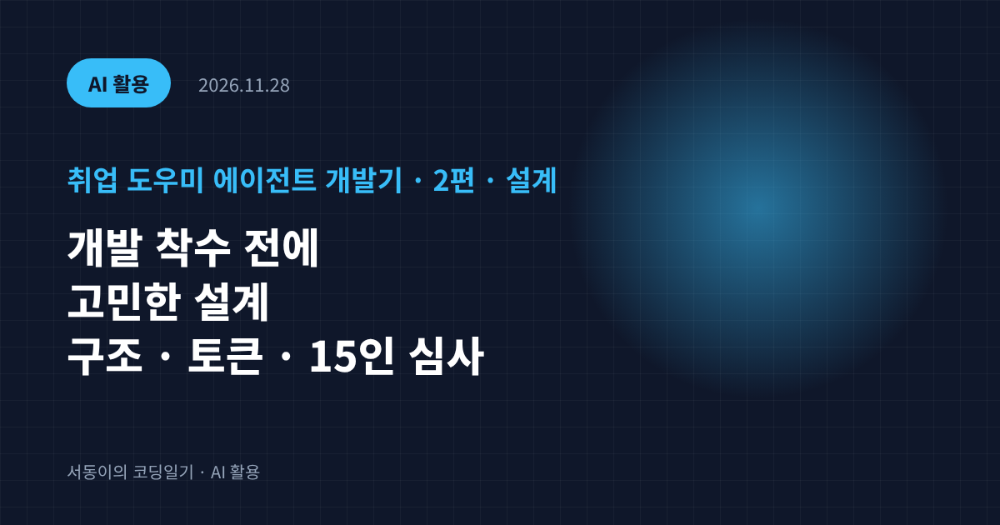
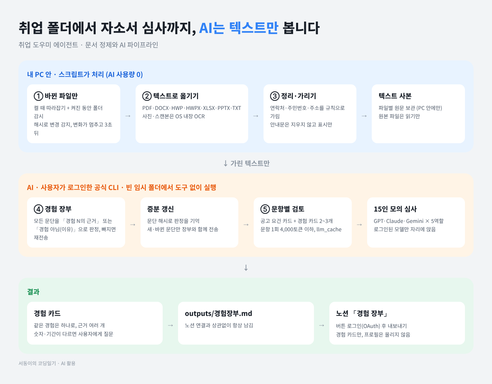

# 취업 도우미 에이전트 개발기 2편 · 설계 (FastAPI, SQLite)

> 🧪 **AI 활용** · 2026-11-28 · 📝 [티스토리에서 보기](https://dongseodong.tistory.com/74)



**코드를 쓰기 전에 정한 설계를 정리한 글입니다.** 일부는 개발 중에 바뀌었고, 그 이야기는 3편에서 이어집니다.

이 글 한눈에 보기

1 **왜 로컬 앱:** 취업 자료, 개인정보, AI 구독이 모두 사용자 PC에 있어서입니다.

2 **토큰 예산:** 파일 읽기와 정리는 스크립트가 하고, AI에는 문항당 4,000토큰 이하만 보냅니다.

3 **15인 심사:** 로그인된 모델 수에 맞춰 15석을 나눠 앉히고, 4단계로 심사합니다.

📚 취업 도우미 에이전트 개발기 시리즈

1편 · 기획 [왜 만들었고, 화면과 문서를 어떻게 준비했나](https://dongseodong.tistory.com/73)

2편 · 설계 **로컬 앱 구조, 토큰 예산, 15인 심사, 개인정보 규칙** 지금 읽는 글

3편 · 개발 [PR 12개로 돌아본 이틀과 막혔던 부분](https://dongseodong.tistory.com/75)

단독① [토큰 절약 vs 누락 0](https://dongseodong.tistory.com/76)

단독② [스택 PR이 main에 안 들어간 이유](https://dongseodong.tistory.com/77)

단독③ [윈도우에서만 터진 asyncio.run 오류](https://dongseodong.tistory.com/78)

단독④ [맥에서 Windows 한국어 OCR 테스트하기](https://dongseodong.tistory.com/79)

단독⑤ [앱에서 AI 구독을 쓰는 방법: 공식 CLI 호출](https://dongseodong.tistory.com/80)

목차

[1. 왜 웹 서비스가 아니라 로컬 앱인가](#s0)

[2. 로컬 앱 구조: 실행 파일 하나로 서버와 화면까지](#s1)

[3. 문서 정제 5단계: AI 앞에 스크립트를 세우기](#s2)

[4. 토큰 예산: 문항당 4,000토큰](#s3)

[5. 15인 모의 심사: 자리 배치 설계](#s4)

[6. 개인정보와 원본 폴더 규칙](#s5)

[7. 정제는 언제 하나: 켤 때 따라잡기와 폴더 감시](#s6)

[8. 작업 방식: 맥에서 개발하고 윈도우에서 실행](#s7)

## 01 왜 웹 서비스가 아니라 로컬 앱인가

**한 줄 요약:** 이 앱이 하는 일 대부분이 "사용자 PC 안에 있는 것"을 다루기 때문에, 처음부터 사용자 PC에서 도는 로컬 앱으로 정했습니다.

원래 하던 CareerLens AI는 웹 서비스로 구상했습니다. 그런데 이번 앱이 해야 하는 일을 하나씩 적어 보니, 대부분이 사용자 PC 안에 있는 자료와 프로그램을 써야 하는 일이었습니다.

| 해야 하는 일   | 웹 서비스라면                                                   | 로컬 앱이라면                                                                                |
|----------------|-----------------------------------------------------------------|----------------------------------------------------------------------------------------------|
| 취업 폴더 읽기 | 파일을 매번 서버로 올려야 하고, 폴더가 바뀌어도 알 수 없습니다. | 폴더를 직접 읽고, 바뀌는 순간 감시로 알아챕니다.                                             |
| 개인정보       | 연락처, 학력이 담긴 원본이 서버에 쌓입니다.                     | 원본은 PC 밖으로 나가지 않고, 가린 텍스트만 AI로 보냅니다.                                   |
| AI 사용        | API 키 요금을 운영자가 내거나 사용자에게 받아야 합니다.         | 사용자가 PC에 로그인해 둔 공식 CLI를 불러 써서 사용자의 구독 한도 안에서 씁니다.             |
| 지원서 작성    | 사이트 로그인 상태를 서버가 들고 있어야 합니다.                 | 앱 전용 브라우저에 사용자가 직접 로그인해 두고, 본인 인증과 캡차는 사용자가 직접 처리합니다. |
| 운영           | 서버 비용, 계정, 보안 관리가 필요합니다.                        | 서버가 없습니다. 데이터는 SQLite 파일 하나이고 백업은 파일 복사입니다.                       |

물론 단점도 있습니다. 사용자 PC 환경(OS, 인코딩, 포트)에 따라 동작이 달라질 수 있고, 업데이트도 실행 파일을 다시 나눠 줘야 합니다. 그래서 2편 뒷부분의 세 OS CI와 빈 포트 찾기 같은 장치를 처음부터 넣었습니다. 사용자가 한 명이고 자료가 민감한 지금 단계에서는 이 단점보다 장점이 크다고 판단했습니다.

💡 정리하면

"사용자 PC에 있는 자료를, 사용자 PC에 있는 계정으로, 사용자 PC 밖으로 내보내지 않고 처리합니다." 이 한 문장이 로컬 앱을 고른 이유이고, 이 글의 나머지 설계도 모두 여기서 출발합니다.

## 02 로컬 앱 구조: 실행 파일 하나로 서버와 화면까지

**한 줄 요약:** 사용자는 실행 파일만 더블클릭하고, 서버와 브라우저 화면과 DB는 앱이 알아서 준비합니다.

사용자가 개발자가 아니기 때문에 "서버를 켠다", "주소를 입력한다" 같은 단계가 있으면 안 됩니다. 그래서 첫 PR의 앱 뼈대부터 아래 세 가지를 넣었습니다.

| 기능               | 하는 일                                               | 없으면 생기는 문제                                      |
|--------------------|-------------------------------------------------------|---------------------------------------------------------|
| 빈 포트 찾기       | 쓸 수 있는 포트를 골라 서버를 띄웁니다.               | 다른 프로그램이 포트를 쓰고 있으면 앱이 아예 안 뜹니다. |
| 브라우저 자동 열기 | 서버가 준비되면 기본 브라우저로 앱 화면을 엽니다.     | 사용자가 주소를 직접 입력해야 합니다.                   |
| 중복 실행 방지     | 이미 켜져 있으면 새로 띄우지 않고 기존 화면을 엽니다. | 두 번 누르면 서버 두 개가 같은 DB 파일을 동시에 씁니다. |

아래는 이 흐름을 이해하기 쉽게 줄인 예시 코드입니다. 실제 코드와는 다르지만 생각의 순서는 같습니다.

▶ 로컬 앱 시작 흐름 (설명용 예시)

```
import socket, threading, webbrowser
import uvicorn

def free_port(preferred: int) -> int:
    """원하는 포트를 먼저 시도하고, 쓰는 중이면 OS가 빈 포트를 고르게 합니다."""
    for port in (preferred, 0):
        with socket.socket() as s:
            try:
                s.bind(("127.0.0.1", port))
                return s.getsockname()[1]
            except OSError:
                continue
    raise RuntimeError("포트를 찾지 못했습니다")

def main():
    if already_running():          # 잠금 파일 등으로 중복 실행 확인
        open_existing_window()
        return
    port = free_port(47615)
    url = f"http://127.0.0.1:{port}"
    threading.Timer(1.0, lambda: webbrowser.open(url)).start()
    uvicorn.run("app.main:app", host="127.0.0.1", port=port)  # 내 PC에서만 접속
```

서버를 `127.0.0.1`에만 붙이는 것이 중요합니다. `0.0.0.0`으로 띄우면 같은 와이파이에 있는 다른 기기에서도 접속할 수 있게 되는데, 취업 자료를 다루는 앱에서는 그럴 이유가 없습니다.

### DB: SQLite 테이블 19개

데이터는 SQLite 파일 하나에 테이블 19개로 나눠 담았습니다. 읽어 들인 파일과 문단, 경험, 공고, 자소서, 심사, 지원 현황, 그리고 아래에서 설명할 AI 호출 캐시(`llm_cache`)까지 모두 이 파일 하나에 들어갑니다. 설치할 것이 없고 백업은 파일 복사 한 번이면 되기 때문에, 한 사람이 쓰는 로컬 앱에는 이보다 맞는 선택이 없다고 판단했습니다.

## 03 문서 정제 5단계: AI 앞에 스크립트를 세우기

**한 줄 요약:** 파일을 읽고 정리하는 일은 스크립트가 하고, AI는 정리된 텍스트만 받습니다.

취업 자료 폴더에는 PDF, 워드, 한글 파일, 사진이 섞여 있습니다. 이걸 그대로 AI에 보내면 비용도 크고, 같은 파일을 매번 다시 읽게 됩니다. 그래서 AI에 보내기 전에 다섯 단계를 거치게 설계했습니다.

1단계 · 바뀐 파일만

파일 해시를 비교해서 새로 생기거나 바뀐 파일만 읽습니다.

2단계 · 텍스트 추출

PDF·DOCX·HWPX에서 글자를 뽑고, 사진과 스캔본은 OCR로 읽습니다.

3단계 · 정리

머리말, 서식, 반복 문구를 정리하고 연락처를 가립니다.

4단계 · 경험 카드

정리된 텍스트에서 경험을 뽑아 카드로 만듭니다.

5단계 · 검색 색인

자소서 문항과 관련된 경험을 빨리 찾도록 색인을 만듭니다.



문서 정제와 AI 파이프라인 한눈에 보기

여기서 1~3단계는 **AI를 전혀 쓰지 않습니다.** 해시 비교, 텍스트 추출, 정규식 정리는 스크립트가 더 빠르고 정확하며 비용도 들지 않습니다. AI가 필요한 것은 "이 문단이 어떤 경험인가"를 판단하는 4단계부터입니다.

▶ 1단계: 해시로 바뀐 파일만 고르기 (설명용 예시)

```
import hashlib
from pathlib import Path

def sha256(path: Path) -> str:
    h = hashlib.sha256()
    with path.open("rb") as f:
        for chunk in iter(lambda: f.read(1 << 20), b""):
            h.update(chunk)
    return h.hexdigest()

def changed_files(root: Path, known: dict[str, str]) -> list[Path]:
    """known: DB에 저장해 둔 {상대경로: 해시}. 새 파일이거나 해시가 다르면 다시 읽습니다."""
    out = []
    for p in root.rglob("*"):
        if p.is_file() and not p.name.startswith("~$"):   # 워드 임시 파일 제외
            rel = str(p.relative_to(root))
            if known.get(rel) != sha256(p):
                out.append(p)
    return out
```

📌 이 단계는 나중에 바뀝니다

처음 설계에서 3단계 "정리"는 동의서 문구나 중복 문단을 **지우는** 단계였습니다. 개발 도중 "경험이 하나라도 빠지면 이 앱은 쓸 이유가 없다"는 원칙을 세우면서, 지우지 않고 "AI에 안 보냄" 표시만 하는 방식으로 바꿨습니다. 이 이야기는 [3편](https://dongseodong.tistory.com/75)과 단독 글 [「토큰 절약 vs 누락 0」](https://dongseodong.tistory.com/76)에서 자세히 다룹니다.

## 04 토큰 예산: 문항당 4,000토큰

**한 줄 요약:** 자소서 문항 하나를 검토할 때 AI에는 공고 요건 카드와 관련 경험 카드 2~3개만 보내고, 기본 상한을 4,000토큰으로 잡았습니다.

자소서를 쓸 때마다 취업 폴더 전체를 AI에 보내면 문항 하나에도 수만 토큰이 듭니다. 그래서 문항마다 필요한 것만 골라 보내기로 했습니다.

| 보내는 것            | 이유                                                |
|----------------------|-----------------------------------------------------|
| 공고 요건 카드       | 이 회사, 이 직무가 무엇을 원하는지 짧게 정리한 카드 |
| 관련 경험 카드 2~3개 | 검색 색인으로 문항과 가장 가까운 경험만 고름        |
| 문항과 현재 답변     | 검토 대상                                           |

### 같은 질문은 두 번 하지 않기: llm_cache

AI 호출 결과는 `llm_cache` 테이블에 저장합니다. 입력이 완전히 같으면 AI를 다시 부르지 않고 저장된 답을 씁니다. 캐시 키에는 프롬프트 버전도 넣었습니다. 프롬프트를 고치면 버전을 올려서, 예전 프롬프트로 받은 답이 섞이지 않게 하기 위해서입니다.

▶ 캐시 키 만들기 (설명용 예시)

```
import hashlib, json

PROMPT_VERSION = "experience-v3"   # 프롬프트를 바꾸면 이 값을 올립니다

def cache_key(model: str, task: str, payload: dict) -> str:
    raw = json.dumps(
        {"v": PROMPT_VERSION, "model": model, "task": task, "in": payload},
        ensure_ascii=False, sort_keys=True,
    )
    return hashlib.sha256(raw.encode("utf-8")).hexdigest()
```

### 공고도 규칙 먼저

공고 역시 같은 원칙입니다. 수집한 공고는 규칙으로 먼저 거르고, 같은 공고가 여러 사이트에 올라온 경우 하나로 묶은 뒤, **새 공고만** AI로 요약합니다.

💡 규칙 먼저, AI는 최후 보루

이름, 전화번호, 이메일, 날짜처럼 형식이 정해진 것은 정규식이 AI보다 정확하고 비용도 들지 않습니다. AI는 규칙이 놓친 부분, 즉 "이 문장이 어떤 경험을 말하는가"처럼 의미를 판단해야 하는 곳에만 씁니다. 이 앱의 거의 모든 설계가 이 원칙을 따릅니다.

## 05 15인 모의 심사: 자리 배치 설계

**한 줄 요약:** GPT·Claude·Gemini가 각각 5가지 역할을 맡는 15석을 기본으로 하고, 로그인된 모델만 앉히고 빈 자리는 남은 모델이 나눠 맡습니다.

자소서 모의 심사는 이 앱에서 가장 재미있는 기능입니다. 세 모델이 서로 다른 관점의 심사위원 역할 5가지를 나눠 맡아 총 15명이 답변을 평가하고, 서로 지적하고 반박합니다. 모델마다 강점과 말투가 달라서, 한 모델에게 15번 묻는 것보다 다양한 시각이 나온다는 생각이었습니다.

문제는 사용자가 세 모델을 모두 쓰지 않을 수도 있다는 점입니다. 그래서 자리 배치를 고정하지 않고, **로그인된 모델 수에 따라 15석을 나눠 앉히도록** 설계했습니다.

| 로그인된 모델 수 | 자리 배치 |
|------------------|-----------|
| 3개              | 5 · 5 · 5 |
| 2개              | 8 · 7     |
| 1개              | 15        |

▶ 15석 나누기 (설명용 예시)

```
def seat_plan(models: list[str], seats: int = 15) -> dict[str, int]:
    """로그인된 모델끼리 15석을 최대한 고르게 나눕니다. 앞 모델이 1석씩 더 가져갑니다."""
    if not models:
        return {}
    base, extra = divmod(seats, len(models))
    return {m: base + (1 if i < extra else 0) for i, m in enumerate(models)}

seat_plan(["gpt", "claude", "gemini"])  # {'gpt': 5, 'claude': 5, 'gemini': 5}
seat_plan(["claude", "gemini"])         # {'claude': 8, 'gemini': 7}
seat_plan(["claude"])                   # {'claude': 15}
```

### 심사는 4단계로 진행합니다

15명에게 한꺼번에 의견을 받으면 비슷한 지적이 겹치고 비용도 커집니다. 그래서 심사를 네 단계로 나눴습니다.

| 단계          | 하는 일                                                                                                          | 비용을 줄이는 방법                                                                                      |
|---------------|------------------------------------------------------------------------------------------------------------------|---------------------------------------------------------------------------------------------------------|
| 1\. 혼자 심사 | 15명이 각자 답변을 읽고 지적을 최대 3개씩 냅니다. 근거가 없으면 빈 목록을 냅니다.                                | 공고 요건 카드, 답변, 경험 카드 2~3개는 모두 같게 두고 역할 지시만 맨 뒤에 둬서 프롬프트 캐시를 탑니다. |
| 2\. 쟁점 묶기 | 같은 문장을 가리키는 지적끼리 묶어 쟁점을 만듭니다.                                                              | 로컬 규칙으로 먼저 묶고, 애매한 것만 저가 모델에 한 번 묻습니다.                                        |
| 3\. 서로 반박 | 쟁점마다 지적한 쪽과 다른 모델의 심사위원 2명이 반박합니다.                                                      | 전체 답변 대신 해당 문장과 주장, 관련 경험 카드만 보냅니다.                                             |
| 4\. 판정      | 원문을 인용한 반박이 있으면 해소, 일부면 partly, 없으면 유지합니다. 빈 사실이면 사용자에게 보낼 질문을 만듭니다. | 판정은 로컬 규칙으로 하고, 수정 제안만 저가 모델에 한 번 맡깁니다.                                      |

1편에 넣은 라이브 심사장 화면의 진행 막대(혼자 심사 → 쟁점 묶기 → 서로 반박 → 판정)가 바로 이 네 단계입니다.

설계는 세 모델을 기준으로 유지하되, 지금은 로그인된 모델만 참여합니다. 나중에 사용자가 구독을 추가하면 코드 변경 없이 자리가 다시 나뉩니다. 실제로 현재는 여러 사정으로 Claude 한 모델만 연결된 상태인데, 이 설계 덕분에 15석이 모두 Claude로 채워져 그대로 동작합니다. AI를 어떻게 연결했는지는 단독 글 [「앱에서 AI 구독을 쓰는 방법」](https://dongseodong.tistory.com/80)에서 다룹니다.

### 나중에 붙일 것을 위해 열어 둔 곳

1편에서 정리한 것처럼 MVP 이후에 붙일 기능이 꽤 있습니다. 그래서 바뀔 가능성이 큰 곳은 처음부터 한 겹 감싸 두었습니다.

| 감싼 곳   | 지금                                                                                                                                      | 나중에 붙일 것                                                                                        |
|-----------|-------------------------------------------------------------------------------------------------------------------------------------------|-------------------------------------------------------------------------------------------------------|
| AI 모델   | `complete(purpose, model, messages, json_schema)` 하나로 GPT·Claude·Gemini 호출을 감쌌습니다. 캐시 조회와 사용량 기록도 이 안에서 합니다. | claude-code-local과 Vane(예전 이름 Perplexica)을 엮은 로컬 AI도 같은 함수 뒤에 하나 더 붙이면 됩니다. |
| 문서 읽기 | PDF, DOCX, HWPX 등 형식마다 텍스트 추출기를 따로 둡니다.                                                                                  | kordoc 같은 한국어 문서 오픈소스를 추출기나 양식 채우기 쪽에 붙일 수 있습니다.                        |
| 공고 수집 | 공식 채용 API·RSS, 증권사 채용 페이지처럼 출처마다 수집 어댑터를 따로 두도록 설계했습니다.                                                | 도메인을 넓힐 때 수집기와 규칙만 추가합니다.                                                          |

## 06 개인정보와 원본 폴더 규칙

**한 줄 요약:** 연락처·주소·주민번호는 AI에 보내지 않고, 원본 폴더의 기존 파일은 읽기만 합니다.

취업 자료에는 개인정보가 많습니다. 이 부분은 편의보다 안전을 앞에 두고 규칙을 먼저 정했습니다.

| 규칙           | 내용                                                                                                                                    |
|----------------|-----------------------------------------------------------------------------------------------------------------------------------------|
| AI로 보내는 것 | 연락처, 주민번호, 주소를 가린 텍스트만 보냅니다.                                                                                        |
| 가리는 방법    | AI가 아니라 규칙(정규식)으로 먼저 가립니다. 가리기 전 텍스트가 AI로 가는 일이 없게 하기 위해서입니다.                                   |
| 원본 파일      | 앱은 원본을 **읽기만** 합니다.                                                                                                          |
| 새 파일        | 앱이 만드는 파일(메모, 사진 등)은 새 파일로만 저장하고, 이름이 겹치면 (2), (3)처럼 번호를 붙입니다. 기존 파일은 절대 덮어쓰지 않습니다. |
| 레포와 캡처    | 실제 자료와 개인정보는 레포와 캡처에 넣지 않습니다. 테스트와 캡처는 모두 비슷하게 꾸민 가짜 데이터로만 합니다.                          |

▶ 규칙으로 먼저 가리기 (설명용 예시)

```
import re

PATTERNS = {
    "전화번호": re.compile(r"01[016789][-.\s]?\d{3,4}[-.\s]?\d{4}"),
    "이메일":   re.compile(r"[\w.+-]+@[\w-]+\.[\w.-]+"),
    "주민번호": re.compile(r"\d{6}[-\s]?[1-4]\d{6}"),
}

def mask(text: str) -> str:
    for label, pat in PATTERNS.items():
        text = pat.sub(f"[{label}]", text)
    return text

mask("연락처 010-1234-5678, test@example.com")
# '연락처 [전화번호], [이메일]'
```

## 07 정제는 언제 하나: 켤 때 따라잡기와 폴더 감시

**한 줄 요약:** 앱을 켤 때 밀린 파일을 따라잡고, 켜져 있는 동안은 폴더를 지켜보다가 변화가 멈추면 처리합니다. AI 단계는 모아서 한 번에 부릅니다.

"폴더에 파일을 넣으면 정제는 언제 하는가?"라는 질문에 시점을 단계별로 다르게 잡는 것으로 답했습니다.

| 상황                | 동작                                                                                                                                                          |
|---------------------|---------------------------------------------------------------------------------------------------------------------------------------------------------------|
| 앱을 켤 때          | 꺼져 있던 동안 바뀐 파일만 해시로 찾아 처리합니다.                                                                                                            |
| 켜져 있는 동안      | 폴더를 지켜보다가 변화가 멈추고 **3초** 뒤에 읽습니다. 워드는 저장하면서 임시 파일을 만들었다 지우기 때문에, 바로 읽으면 반쯤 저장된 파일을 읽을 수 있습니다. |
| AI를 쓰지 않는 단계 | 바로 처리합니다.                                                                                                                                              |
| AI를 쓰는 단계      | 폴더가 **90초** 동안 잠잠해지면 모아서 한 번에 처리합니다. 파일 열 개를 연달아 넣어도 AI는 한 번만 부릅니다.                                                  |
| 화면                | 열려 있는 화면은 저절로 새로고침합니다. 메모를 쓰는 중이면 끝날 때까지 기다립니다.                                                                            |

▶ 잠잠해지면 한 번만 실행하기 (설명용 예시)

```
import threading

class Debounce:
    """마지막 호출 뒤 delay초 동안 새 호출이 없을 때만 fn을 한 번 실행합니다."""
    def __init__(self, delay: float, fn):
        self.delay, self.fn, self._t = delay, fn, None
        self._lock = threading.Lock()

    def __call__(self):
        with self._lock:
            if self._t:
                self._t.cancel()
            self._t = threading.Timer(self.delay, self.fn)
            self._t.start()

read_files   = Debounce(3,  extract_changed_text)   # AI 없음: 3초
update_ledger = Debounce(90, ask_ai_to_update)       # AI 사용: 90초 모아서 한 번
```

## 08 작업 방식: 맥에서 개발하고 윈도우에서 실행

**한 줄 요약:** 개발은 맥에서, 실행은 윈도우에서 하기 때문에 처음부터 세 OS에서 테스트를 돌리기로 했습니다.

개발하는 쪽은 맥이고 실제 사용자 PC는 윈도우입니다. 그래서 설계 단계에서 다음을 정했습니다.

| 결정                                                | 이유                                                                                                     |
|-----------------------------------------------------|----------------------------------------------------------------------------------------------------------|
| GitHub Actions에서 Windows·macOS·Linux 세 OS 테스트 | 맥에서 통과해도 윈도우에서 깨질 수 있습니다.                                                             |
| OCR은 OS 내장 기능 사용                             | 윈도우에서는 Windows 내장 OCR, 맥에서는 macOS 내장 Vision을 써서 맥에서도 앱을 띄워 볼 수 있게 했습니다. |
| 한글 확인은 윈도우 기준                             | 실제 사용 환경과 같은 곳에서 확인해야 의미가 있습니다.                                                   |
| 레포에 CLAUDE.md 규칙                               | Claude와 작업할 때 지켜야 할 규칙(개인정보, 원본 파일, 커밋 규칙)을 레포에 적어 두었습니다.              |

이 결정은 실제로 효과가 있었습니다. 맥과 리눅스에서는 보이지 않고 윈도우에서만 나는 버그를 이 CI 덕분에 잡았습니다. 그 이야기는 단독 글 [「윈도우에서만 터진 asyncio.run 오류」](https://dongseodong.tistory.com/78)와 [「맥에서 Windows 한국어 OCR 테스트하기」](https://dongseodong.tistory.com/79)에서 다룹니다.

## 정리

**핵심 1.** 실행 파일 하나로 127.0.0.1 서버, 브라우저 화면, SQLite DB까지 준비되게 하고, 빈 포트·자동 열기·중복 실행 방지를 첫 PR부터 넣었습니다.

**핵심 2.** 문서 정제 5단계 중 1~3단계는 AI 없이 처리하고, 자소서 문항당 AI 전송량은 기본 4,000토큰 이하로 잡았습니다.

**핵심 3.** 15인 심사는 로그인된 모델 수에 따라 자리를 다시 나누도록 설계해서, 모델이 하나뿐이어도 동작합니다.

**핵심 4.** 개인정보는 규칙으로 먼저 가리고, 원본 파일은 읽기만 하고, 테스트와 캡처는 가짜 데이터로만 합니다.

다음 3편에서는 이 설계로 실제 개발을 시작한 이틀, PR 12개 동안 무엇을 만들고 어디서 막혔는지를 정리합니다.

## 자주 묻는 질문

### 로컬 FastAPI 앱을 127.0.0.1에만 띄우는 이유는 무엇입니까?

127.0.0.1은 지금 이 PC 자신만 가리키는 주소라서, 서버를 여기에만 붙이면 같은 네트워크의 다른 기기에서 접속할 수 없습니다. 0.0.0.0으로 띄우면 같은 와이파이의 다른 기기에서도 접속할 수 있게 되므로, 개인 취업 자료를 다루는 이 앱에서는 127.0.0.1만 사용합니다.

### AI 호출 비용은 어떻게 줄였습니까?

파일 해시로 바뀐 파일만 다시 읽고, 텍스트 추출과 개인정보 가리기는 AI 없이 스크립트로 처리합니다. 자소서 문항 하나를 검토할 때는 공고 요건 카드와 관련 경험 카드 2~3개만 보내 기본 4,000토큰 이하로 맞추고, 같은 입력은 llm_cache에 저장된 답을 다시 씁니다.

### AI 모델이 하나만 연결돼 있어도 15인 심사가 동작합니까?

동작합니다. 15석을 로그인된 모델 수로 나누도록 설계해서 세 모델이면 5·5·5, 두 모델이면 8·7, 한 모델이면 15석을 모두 그 모델이 맡습니다. 나중에 모델을 추가하면 코드 변경 없이 자리가 다시 나뉩니다.

---

`#취업도우미에이전트` `#FastAPI` `#SQLite` `#토큰절약` `#LLM설계` `#개인정보` `#로컬앱` `#ClaudeCode` `#AI활용`
