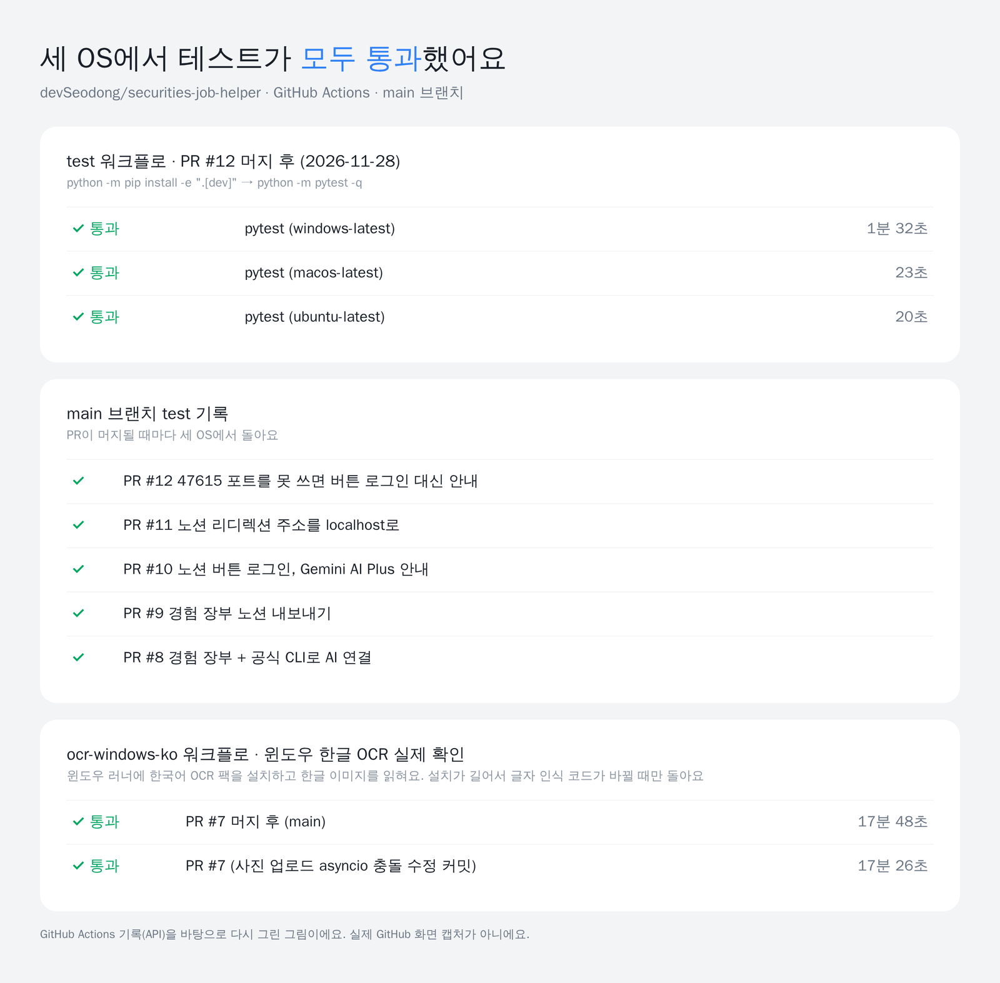
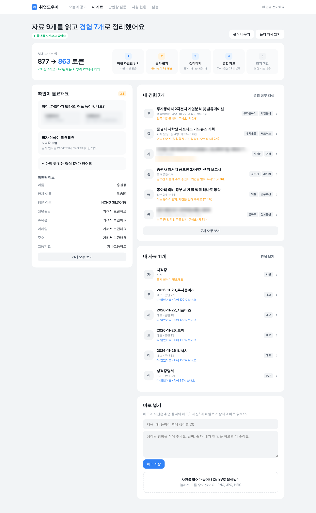

# 취업 도우미 에이전트 개발기 3편 · 개발 (Notion OAuth, GitHub Actions)

> 🧪 **AI 활용** · 2026-11-28 · 📝 [티스토리에서 보기](https://dongseodong.tistory.com/75)


**이틀 동안 PR 12개를 머지하며 만든 것과 막혔던 부분을 정리한 글입니다.** 기술적으로 길어지는 주제는 단독 글로 따로 씁니다.

이 글 한눈에 보기

1 **만든 것:** 자료 읽기, OCR, 경험 장부, 노션 내보내기. 테스트는 20개에서 130개 이상으로 늘었습니다.

2 **뒤집은 설계:** "경험이 하나도 빠지면 안 된다"는 원칙으로, 토큰을 아끼려 문단을 지우던 방식을 버렸습니다.

3 **막힌 곳:** 노션 OAuth 주소 거부, 포트 충돌, 스택 PR 머지 사고, 윈도우에서만 나는 오류를 차례로 풀었습니다.

📚 취업 도우미 에이전트 개발기 시리즈

1편 · 기획 [왜 만들었고, 화면과 문서를 어떻게 준비했나](https://dongseodong.tistory.com/73)

2편 · 설계 [로컬 앱 구조, 토큰 예산, 15인 심사, 개인정보 규칙](https://dongseodong.tistory.com/74)

3편 · 개발 **PR 12개로 돌아본 이틀과 막혔던 부분** 지금 읽는 글

단독 · 기술 토큰 절약 vs 누락 0 · 스택 PR 함정 · 윈도우 전용 asyncio 오류 · 윈도우 CI 한국어 OCR · 공식 CLI로 AI 연결예정

목차

[1. PR 12개 한눈에 보기](#s1)

[2. 실제 자료 한 부로 시작하기](#s2)

[3. 설계를 뒤집은 순간: 누락 0](#s3)

[4. 경험 장부: 이 앱의 핵심](#s4)

[5. 메모·사진 바로 넣기와 폴더 감시](#s5)

[6. 앱 화면이 피그마와 너무 달랐던 문제](#s6)

[7. 노션 연결: 내부 통합에서 버튼 로그인(OAuth)으로](#s7)

[8. 그 밖에 막혔던 부분 (단독 글로 이어집니다)](#s8)

[9. 아직 확인하지 못한 것과 다음 할 일](#s9)

## 01 PR 12개 한눈에 보기

**한 줄 요약:** 앱 뼈대에서 시작해 자료 읽기, 누락 0 전환, OCR, 경험 장부, 노션 연동 순서로 쌓았습니다.

| PR | 내용 | 테스트 |
|----|----|----|
| \#1 | 앱 뼈대: FastAPI 로컬 앱(빈 포트, 브라우저 자동 열기, 중복 실행 방지), SQLite 19개 테이블, 15인 심사 자리 배치, CLAUDE.md 규칙 | 20개 |
| \#2 | F-01~03 취업 폴더 읽기(해시로 변경 감지), PDF·DOCX·HWPX 텍스트 추출, 개인정보 가리기 | 51개 |
| \#3 | F-04 기본 정보 규칙 추출, 파일끼리 값이 다르면 사용자가 고르기, 이름 가리기 | 61개 |
| \#4 | **누락 0 전환** : 정제는 지우지 않고 표시만, 파일별 텍스트 사본, 옛 HWP·XLSX·PPTX·TXT·MD 지원 추가 | 74개 |
| \#5 | F-26·27 빠른 메모와 사진 넣기 → 취업 폴더에 실제 파일로 저장 | 86개 |
| \#6 | 내 자료 화면(T-01)을 피그마에 맞춰 다시 짜기, 폴더 자동 감시 | 90개 |
| \#7 | OCR: Windows 내장 OCR(맥은 Vision)로 사진·스캔 PDF 읽기, 윈도우 CI에서 한글 확인 | \- |
| \#8 | F-05 경험 장부, 공식 CLI로 AI 연결 | \- |
| \#9 | F-28 경험 장부 노션 내보내기 (내부 통합 방식) | 124개 |
| \#10 | 노션 버튼 로그인(OAuth) | 130개 |
| \#11 | 노션 리디렉션 주소를 localhost로 변경 | \- |
| \#12 | 47615 포트를 못 쓰면 버튼 로그인 대신 안내 | \- |

테스트 수가 늘어난 흐름을 그래프로 보면 아래와 같습니다. 기능 하나를 붙일 때마다 테스트를 함께 늘렸습니다.

\#1

20개

\#2

51개

\#3

61개

\#4

74개

\#5

86개

\#6

90개

\#9

124개

\#10

130개



GitHub Actions 기록을 바탕으로 다시 그린 테스트 결과. Windows·macOS·Linux에서 모두 통과했습니다.

## 02 실제 자료 한 부로 시작하기

**한 줄 요약:** 실제 지원서 한 부로 기능을 시험하되, 레포와 테스트에는 비슷하게 꾸민 가짜 자료만 넣었습니다.

처음 손에 있던 샘플은 이미 제출한 지원서 PDF 한 부였습니다. 한 부뿐이었지만 다 쓴 지원서라 쓸모가 많았습니다. 텍스트 추출, 기본 정보 표 구조, 경험 문장, 개인정보 가리기를 한 번에 시험해 볼 수 있었습니다.

원칙은 분명히 정했습니다. **개인정보가 많은 원본은 레포에 넣지 않습니다.** 테스트는 비슷하게 꾸민 가짜 자료로만 하고, 블로그와 PR에 올리는 캡처도 가짜 데이터로만 찍었습니다.

| 결과 | 내용 |
|----|----|
| 개인정보 | AI로 보낼 텍스트에 휴대폰, 주소, 이메일, 생년월일이 하나도 남지 않았습니다. |
| 기본 정보 추출 | 학력, 자격증, 어학 같은 기본 정보 22개 항목을 AI 없이 규칙만으로 추출했습니다. |
| 토큰 | 동의서·서약 문구를 빼서 보낼 분량을 2,704 → 1,963토큰(약 27% 감소)으로 줄였습니다. |

마지막 줄의 "문구를 빼서 줄였다"는 부분이 곧 문제가 됩니다.

## 03 설계를 뒤집은 순간: 누락 0

**한 줄 요약:** 토큰을 아끼려고 문단을 지우던 설계를, "하나도 지우지 않고 표시만 한다"로 바꿨습니다.

PR \#3까지 만들고 화면을 보니, 앱이 하는 일은 "확인된 정보를 나열하는 정도"였습니다. 토큰을 아끼려고 동의서 문구와 중복 문단을 아예 지우게 해 둔 상태이기도 했습니다.

그때 원래 의도를 다시 정리했습니다. 취업 폴더에서 필요한 것만 빼 오는 것이 아니라, **폴더 전체를 컨텍스트로 갖고 모든 경험을 빠짐없이 체계화** 해서 계속 돌려 쓰는 것이 목표였습니다. 사용자가 매일 보는 자료라 놓치고 있는 경험을 AI가 예상하지 못한 곳에서 찾아 줄 것이라 믿고 폴더 권한까지 주는 것인데, 경험이 하나라도 빠지면 이 앱을 쓸 이유가 없습니다.

| 항목 | 바꾸기 전 | 바꾼 뒤 (PR \#4) |
|----|----|----|
| 정제 | 동의서·중복 문단을 지움 | 지우지 않고 "AI에 안 보냄" 표시만 함 |
| 원문 | 정리된 텍스트만 남김 | 원문 전체를 저장, 파일별 텍스트 사본 |
| 사용자 조작 | 없음 | 파일별로 빠진 문단을 펼쳐 보고 다시 넣기, "원문 그대로 보내기" 스위치 |
| 토큰 절약 | 입력을 잘라서 | 안 바뀐 파일은 다시 안 읽고, 자소서에는 원문 대신 정리된 장부를 씀 |

🔥 토큰 절약과 누락 0은 부딪힙니다

어디서 아끼고 어디서는 절대 아끼지 않을지를 정하는 것이 이 앱 설계의 핵심이었습니다. 처음 한 번 폴더 전체를 읽는 비용은 감수하고, 그 뒤로는 캐시와 증분 갱신으로 아끼는 쪽을 택했습니다. 이 결정 과정은 단독 글 「토큰 절약 vs 누락 0」에서 자세히 다룹니다.

## 04 경험 장부: 이 앱의 핵심

**한 줄 요약:** 폴더의 모든 문단을 AI가 "어떤 경험의 근거" 또는 "경험 아님(이유)" 중 하나로 반드시 판정하고, 빠진 문단은 다시 보냅니다.

누락 0을 지키기 위해 만든 것이 **경험 장부** (F-05)입니다. 동작은 아래 순서입니다.

1 · 모든 문단 판정

문단마다 「경험 N의 근거」 또는 「경험 아님(이유)」 둘 중 하나로 반드시 판정합니다.

2 · 빠진 문단 재전송

AI 답에서 빠진 문단은 다시 보내고, 두 번 빠지면 「분류 못 함」으로 화면에 띄웁니다.

3 · 같은 경험 합치기

자소서 v1, v2, 이력서에 같은 경험이 나오면 카드 하나로 합치고 근거를 여러 개 답니다.

4 · 충돌은 묻기

숫자나 기간이 파일마다 다르면 사용자에게 묻습니다.

화면에는 "문단 26개 중 26개 확인"처럼 몇 개를 확인했는지 보여 줍니다. 사용자가 누락이 없다는 것을 숫자로 확인할 수 있게 하기 위해서입니다.

▶ 문단 판정 결과 형태 (설명용 예시, 가짜 데이터)

```
{
  "paragraphs": [
    {"id": "p-014", "verdict": "evidence", "experience": "E-3",
     "fact": "투자동아리에서 기업분석 발표를 맡음"},
    {"id": "p-015", "verdict": "not_experience",
     "reason": "개인정보 수집 동의 문구"}
  ],
  "experiences": [
    {"id": "E-3", "title": "투자동아리 기업분석 발표",
     "evidence": ["자소서_v1.docx#p-014", "이력서.pdf#p-031"]}
  ]
}
```

### 증분 갱신: 바뀐 문단만 다시

매번 폴더 전체를 다시 판정하면 비용이 너무 큽니다. 그래서 판정 결과를 **문단 내용의 해시** 로 저장했습니다. 다음 갱신 때는 새 문단과 바뀐 문단만 기존 장부와 함께 보내고, AI가 새 경험인지, 기존 카드에 사실이 더해진 것인지, 충돌인지를 판단합니다.

▶ 판정이 필요한 문단만 고르기 (설명용 예시)

```
import hashlib

def para_hash(text: str) -> str:
    norm = " ".join(text.split())          # 공백 차이는 같은 문단으로 봅니다
    return hashlib.sha256(norm.encode("utf-8")).hexdigest()

def needs_verdict(paragraphs: list[str], judged: set[str]) -> list[str]:
    """judged: 이미 판정한 문단 해시 모음. 처음 보는 문단만 AI로 보냅니다."""
    return [p for p in paragraphs if para_hash(p) not in judged]
```

| 상황 | 처리 |
|----|----|
| 근거 파일이 지워짐 | 경험 카드는 지우지 않고 「근거 파일 없음」만 표시합니다. |
| 프롬프트를 고침 | 버전을 올려서 예전 판정 캐시와 섞이지 않게 합니다. |
| 동작 확인 | 실제 Claude로 가짜 자료를 돌려 장부가 만들어지는 것을 확인했습니다. |

## 05 메모·사진 바로 넣기와 폴더 감시

**한 줄 요약:** 앱 화면에서 쓴 메모와 넣은 사진을 취업 폴더에 실제 파일로 저장해서, 폴더와 장부가 항상 같이 맞춰지게 했습니다.

앱 화면에 메모장을 하나 두고, 바로 입력하면 AI 컨텍스트에도 들어가고 폴더에도 TXT로 저장되게 했습니다. 사진도 끌어다 놓거나 붙여 넣으면 취업 폴더에 저장됩니다(F-26, F-27).

| 입력 | 저장 위치            |
|------|----------------------|
| 메모 | `메모/날짜_제목.txt` |
| 사진 | `사진/`              |

앱에서 넣은 파일도 사용자가 폴더에 직접 넣은 파일과 똑같이 처리되기 때문에, 원본 폴더와 장부가 따로 놀 일이 없습니다. 그리고 2편에서 정한 대로 앱은 새 파일만 만들고 기존 파일은 절대 고치거나 덮어쓰지 않습니다. 이름이 겹치면 (2), (3) 번호를 붙입니다.

PR \#6에서는 폴더 자동 감시를 붙였습니다. 앱을 켤 때 밀린 파일을 따라잡고, 켜져 있는 동안은 변화가 멈추고 3초 뒤에 읽고, AI 단계는 90초 동안 잠잠해지면 모아서 한 번에 부릅니다. 자세한 설계는 2편 7장에 있습니다.

## 06 앱 화면이 피그마와 너무 달랐던 문제

**한 줄 요약:** 기능을 붙이느라 급하게 만든 화면을 피그마 구조에 맞춰 다시 짰고, 세부 디자인은 나중에 한 번에 다듬기로 했습니다.

개발 중간에 받은 캡처를 보고 "이거 실제 화면이 아니지? 피그마 느낌이랑 너무 다르고 보기 힘들다"고 물었습니다. 실제 앱 화면이 맞았습니다. 기능을 붙이는 데 집중하느라 피그마를 따르지 않고 목록과 표로 급하게 만든 상태였습니다.



피그마에 맞춰 다시 짠 실제 앱의 「내 자료」 화면. 아직 초벌 단계입니다. (가짜 데이터, 일부 값은 흐리게 처리)

PR \#6에서 피그마의 T-01(내 자료) 화면을 옆에 두고 다시 짰습니다. 캡처에 바로 코멘트를 달아 "이 부분은 빼도 될 것 같다"고 전하는 방식으로 다듬었고, 헤드라인 밑 설명과 폴더 경로 줄을 뺐습니다. 다만 지금 화면은 어디까지나 **초벌** 입니다. 개발 단계에서는 기능과 흐름을 먼저 완성하고, 색, 간격, 글자 크기 같은 디자인은 기능을 다 붙인 뒤 한 번에 다듬기로 했습니다. 화면을 조금씩 고치면 기능이 바뀔 때마다 다시 고쳐야 해서, 한 번에 보는 편이 결과도 일관되고 시간도 덜 든다고 판단했습니다.

💡 배운 점

AI와 개발할 때 "피그마를 따른다"는 원칙은 한 번 말해 두는 것으로 끝나지 않았습니다. 기능 구현에 집중하는 동안에는 화면이 쉽게 뒤로 밀립니다. 화면 작업을 할 때는 해당 피그마 화면을 함께 지정해 주는 것이 가장 확실했습니다.

## 07 노션 연결: 내부 통합에서 버튼 로그인(OAuth)으로

**한 줄 요약:** 시크릿을 붙여 넣는 내부 통합 방식이 너무 번거로워서, 「노션으로 로그인」 버튼 하나로 끝나는 공개 통합(OAuth)으로 바꿨습니다.

### 경험 장부 노션 내보내기 (PR \#9)

내 자료 화면의 「노션으로 내보내기」를 누르면 사용자 노션에 「경험 장부」 페이지를 만들고, 다음부터는 같은 페이지의 내용을 새로 바꿉니다. 페이지 링크가 유지되기 때문에 즐겨찾기해 두고 계속 볼 수 있습니다.

| 규칙      | 내용                                                          |
|-----------|---------------------------------------------------------------|
| 올리는 것 | 경험 카드만 올리고 프로필(연락처 등)은 올리지 않습니다.       |
| 로컬 사본 | 노션 연결과 상관없이 `outputs/경험장부.md`는 항상 남깁니다.   |
| 토큰 보관 | 노션 토큰은 Windows 자격 증명 관리자(keyring)에만 저장합니다. |

노션 API의 제약도 처리했습니다.

| 제약                                | 대응                                 |
|-------------------------------------|--------------------------------------|
| 한 번에 추가할 수 있는 블록 수 제한 | 100블록씩 나눠 보냅니다.             |
| 텍스트 하나의 길이 제한             | 2,000자를 넘는 글은 나눠서 넣습니다. |
| 사용자가 페이지를 휴지통으로 보냄   | 새 페이지를 만듭니다.                |

▶ 노션 제약에 맞춰 나누기 (설명용 예시)

```
def chunks(items, size=100):
    for i in range(0, len(items), size):
        yield items[i:i + size]

def split_text(text: str, limit: int = 2000) -> list[str]:
    return [text[i:i + limit] for i in range(0, len(text), limit)] or [""]

for batch in chunks(blocks):                       # 100블록씩
    notion.blocks.children.append(page_id, children=batch)
```

### 버튼 로그인으로 전환 (PR \#10)

처음 방식은 사용자가 노션에서 「내부 통합」을 직접 만들고, 시크릿을 앱에 붙여 넣고, 올릴 페이지에 통합을 연결하는 것이었습니다. 개발자에게는 익숙한 과정이지만, 실제 사용자에게는 너무 번거로웠습니다.

그래서 설정 화면에 **「노션으로 로그인」 버튼** 을 넣었습니다. 버튼을 누르면 노션 권한 화면이 열리고, 페이지를 골라 허용하면 끝납니다. 공개 통합(OAuth) 방식이고, 토큰이 만료되면 refresh token으로 다시 받습니다. 예전 「직접 넣기」 방식은 예비로 남겼습니다.

1 · 버튼

설정에서 「노션으로 로그인」을 누릅니다.

2 · 권한 화면

노션 공식 화면에서 사용자가 자기 계정으로 로그인하고 페이지를 고릅니다.

3 · 콜백

노션이 `localhost`의 앱 콜백 주소로 돌아옵니다.

4 · 토큰 저장

앱이 코드를 토큰으로 바꿔 keyring에 저장합니다.

공개 통합의 client ID와 secret은 깃에서 제외한 설정 파일이나 환경 변수로만 넣고, 레포에는 절대 커밋하지 않습니다.

### 자주 나온 질문: 다른 PC에서도 그 사람 노션으로 연결되는가

개발하면서 직접 헷갈렸던 부분이라 정리해 둡니다.

| 질문 | 답 |
|----|----|
| 실행 파일에 client ID/secret을 넣으면, 사용자 PC에서도 사용자 노션으로 연결되는가? | 됩니다. client ID/secret은 "이 앱이 누구인지"만 알려 줄 뿐, 어느 노션에 연결될지는 정하지 않습니다. 사용자가 자기 계정으로 로그인하고, `localhost`는 언제나 "지금 이 PC"를 가리키므로 사용자 PC의 앱으로 돌아옵니다. |
| 사용자 계정으로 통합을 다시 만들어야 하는가? | 아닙니다. 통합 하나를 다른 사용자도 그대로 씁니다. 다만 통합의 설치 범위가 「모든 워크스페이스」(공개)여야 다른 계정이 권한 화면에서 막히지 않습니다. |

⚠ 보안 메모

개발 중에 secret이 대화에 한 번 노출된 적이 있습니다. 그래서 실제 배포용 실행 파일을 만들 때는 secret을 새로 발급해서 쓰기로 했습니다. 키나 secret이 채팅, 로그, 캡처에 한 번이라도 나왔다면 다시 발급하는 것이 원칙입니다.

### 노션이 127.0.0.1 리디렉션을 거부 (PR \#11)

공개 통합의 리디렉션 주소에 `http://127.0.0.1:47615/settings/notion/callback`을 넣자, 노션이 **"리디렉션 URI는 IP 주소를 사용할 수 없습니다"** 라는 메시지와 함께 거절했습니다.

해결은 간단했습니다. 콜백 주소만 `localhost`로 바꿨습니다. 앱 화면은 그대로 127.0.0.1에서 열리고, 노션 로그인 뒤 돌아올 때만 localhost를 씁니다.

▶ 콜백 주소만 localhost로 (설명용 예시)

```
APP_HOST = "127.0.0.1"                       # 앱 화면과 서버 바인딩
OAUTH_PORT = 47615                            # 노션에 등록한 고정 포트
REDIRECT_URI = f"http://localhost:{OAUTH_PORT}/settings/notion/callback"

auth_url = (
    "https://api.notion.com/v1/oauth/authorize"
    f"?client_id={CLIENT_ID}&response_type=code&owner=user"
    f"&redirect_uri={quote(REDIRECT_URI, safe='')}"
)
```

### 포트 충돌 안내 (PR \#12)

리디렉션 주소는 노션에 미리 등록해야 해서 47615 포트로 고정입니다. 그런데 사용자 PC에서 다른 프로그램이 이 포트를 쓰고 있으면, 앱은 2편에서 만든 "빈 포트 찾기"로 다른 포트에 뜹니다. 그러면 노션 로그인 뒤 돌아올 곳이 없습니다.

그래서 앱은 47615를 먼저 쓰고, 못 쓰면 노션 로그인 화면을 아예 열지 않고 「직접 넣기」로 연결하라고 안내하게 했습니다. 로그인 화면까지 갔다가 실패하는 것보다, 처음부터 갈 수 있는 길을 알려 주는 편이 사용자에게 덜 혼란스럽다고 판단했습니다.

## 08 그 밖에 막혔던 부분 (단독 글로 이어집니다)

**한 줄 요약:** 아래 네 가지는 기술적으로 할 이야기가 많아서 각각 단독 글로 자세히 씁니다.

| 문제 | 무슨 일이 있었나 | 결론 |
|----|----|----|
| 스택 PR 머지 사고 | PR \#5를 \#4 위에 쌓아 올렸는데, \#5가 main이 아니라 \#4 브랜치로 머지돼서 메모·사진 기능이 main에 들어가지 않았습니다. | \#6의 대상을 main으로 바꿔 한 번에 반영했습니다. 아래 PR이 먼저 머지되면 위 PR의 base를 main으로 바꿔야 합니다. |
| 윈도우에서만 나는 사진 드래그 오류 | FastAPI async 라우트 안에서 Windows OCR이 `asyncio.run`을 다시 부르면서 충돌했습니다. 맥·리눅스에서는 보이지 않았습니다. | OCR을 이벤트 루프 밖 스레드에서 실행해서 해결했습니다. |
| 맥에서 Windows OCR 테스트 | 개발 맥에는 Windows OCR이 없습니다. | GitHub Actions 윈도우 러너에 한국어 OCR 언어 팩을 설치해 실제 한글 이미지를 읽혔습니다. 오래 걸려서 별도 워크플로로 분리했습니다. |
| AI 연결 방식 | 구독 계정으로 연결하려 했는데, 약관을 확인하니 외부 앱이 claude.ai 로그인을 받거나 토큰을 보관하는 것은 허용되지 않았습니다. | 사용자가 직접 로그인한 공식 CLI(`claude -p`)를 앱이 불러 쓰는 방식으로 바꿨습니다. |

## 09 아직 확인하지 못한 것과 다음 할 일

**한 줄 요약:** 실제 노션 로그인, 사용자 윈도우 PC에서의 첫 실행, 실행 파일 배포는 아직 검증 전입니다.

있는 그대로 적어 둡니다.

| 항목 | 상태 |
|----|----|
| 실제 노션 로그인과 내보내기 | 아직 검증 전입니다. 테스트는 가짜 노션으로만 했고, 개발 환경에서는 노션 서버 접속이 막혀 있어서 실제 흐름은 맥에서 직접 확인해야 합니다. |
| 사용자 윈도우 PC에서 실행 | 아직입니다. |
| 실행 파일(PyInstaller) 배포 | 아직입니다. |
| UI 전체 다듬기 | 기능을 다 붙인 뒤 한 번에 할 예정입니다. |

✦ 지금 해볼 것

☐ 실제 노션 로그인과 경험 장부 내보내기 확인

☐ 사용자 윈도우 PC에서 첫 실행

☐ 공고 수집과 15인 모의 심사 구현

☐ UI 전체 다듬기

## 정리

**핵심 1.** 이틀 동안 PR 12개를 머지했고, 테스트는 20개에서 130개 이상으로 늘었습니다.

**핵심 2.** "경험 누락 0"을 위해 정제는 지우지 않고 표시만 하도록 바꾸고, 모든 문단을 판정하는 경험 장부를 해시 기반 증분 갱신으로 만들었습니다.

**핵심 3.** 노션은 버튼 로그인(OAuth)으로 바꿨고, IP 리디렉션 거부는 localhost로, 고정 포트 충돌은 안내 화면으로 해결했습니다.

**핵심 4.** 약관, 요금제, 외부 서비스 규칙 같은 현실 제약은 코드보다 먼저 확인해야 한다는 것을 여러 번 배웠습니다.

다음 글부터는 단독 기술 글로, 먼저 이 앱에서 가장 큰 설계 결정이었던 「토큰 절약 vs 누락 0」을 다룹니다.

## 자주 묻는 질문

### 노션 OAuth 리디렉션 주소에 127.0.0.1을 쓸 수 있습니까?

2026년 11월 이 프로젝트에서 노션 공개 통합에 `http://127.0.0.1:47615/...`을 등록하려 하자 "리디렉션 URI는 IP 주소를 사용할 수 없습니다"라는 메시지로 거절됐습니다. 같은 경로를 `http://localhost:47615/...`로 바꾸자 등록됐고, 앱 화면은 그대로 127.0.0.1에서 열고 노션 로그인 뒤 돌아올 때만 localhost를 쓰는 방식으로 해결했습니다.

### 경험 장부는 어떻게 경험 누락을 막습니까?

폴더의 모든 문단을 AI가 「경험 N의 근거」 또는 「경험 아님(이유)」 중 하나로 반드시 판정하게 하고, 답에서 빠진 문단은 다시 보냅니다. 두 번 빠지면 「분류 못 함」으로 화면에 띄우고, 화면에는 "문단 26개 중 26개 확인"처럼 확인한 개수를 보여 줍니다.

### 로컬 앱에 노션 client ID와 secret을 넣으면 다른 사람 PC에서도 동작합니까?

동작합니다. client ID와 secret은 앱이 누구인지만 알려 주고, 어느 노션에 연결될지는 각 사용자가 자기 계정으로 로그인해 정합니다. 다만 통합 설치 범위가 「모든 워크스페이스」(공개)여야 다른 계정이 권한 화면에서 막히지 않고, secret은 레포에 커밋하지 말고 설정 파일이나 환경 변수로만 넣어야 합니다.

---

`#취업도우미에이전트` `#ClaudeCode` `#FastAPI` `#NotionAPI` `#OAuth` `#OCR` `#GitHubActions` `#사이드프로젝트` `#AI활용`
