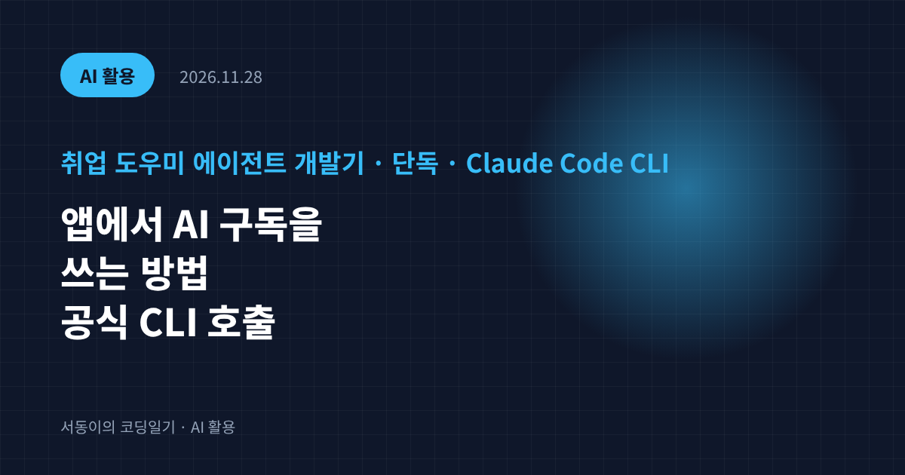

# 취업 도우미 에이전트 개발기 · 앱에서 AI 구독을 쓰는 방법 (Claude Code CLI)

> 🧪 **AI 활용** · 2026-11-28 · 📝 [티스토리에서 보기](https://dongseodong.tistory.com/80)



**내가 만든 로컬 앱에서 사용자의 AI 구독을 쓰려고, 앱 안 로그인 대신 공식 CLI를 불러 쓰는 방식으로 바꾼 과정을 정리한 글입니다.**

이 글 한눈에 보기

1 **처음 계획:** API 키 대신, 사용자가 이미 쓰는 구독 계정에 앱 안에서 로그인해 연결하려 했습니다.

2 **바꾼 이유:** 약관을 확인해 보니 외부 앱이 claude.ai 로그인을 받거나 그 토큰을 보관하는 방식은 허용되지 않았습니다.

3 **최종 방식:** 사용자가 공식 CLI(Claude Code, Gemini CLI)에 직접 로그인하고, 앱은 그 프로그램에 글만 넘깁니다.

📚 취업 도우미 에이전트 개발기 시리즈

1편 · 기획 [왜 만들었고, 화면과 문서를 어떻게 준비했나](https://dongseodong.tistory.com/73)

2편 · 설계 [로컬 앱 구조, 토큰 예산, 15인 심사, 개인정보 규칙](https://dongseodong.tistory.com/74)

3편 · 개발 [PR 12개로 돌아본 이틀과 막혔던 부분](https://dongseodong.tistory.com/75)

단독① [토큰 절약 vs 누락 0](https://dongseodong.tistory.com/76)

단독② [스택 PR이 main에 안 들어간 이유](https://dongseodong.tistory.com/77)

단독③ [윈도우에서만 터진 asyncio.run 오류](https://dongseodong.tistory.com/78)

단독④ [맥에서 Windows 한국어 OCR 테스트하기](https://dongseodong.tistory.com/79)

단독⑤ **앱에서 AI 구독을 쓰는 방법: 공식 CLI 호출** 지금 읽는 글

목차

[1. 세 가지 선택지](#s1)

[2. 공식 CLI를 앱에서 부르는 구조](#s2)

[3. 로그인도 버튼 하나로](#s3)

[4. Gemini는 요금제를 확인해야 합니다](#s4)

[5. 이 방식의 장단점](#s5)

## 01 세 가지 선택지

**한 줄 요약:** 앱이 AI를 쓰는 방법은 API 키, 앱 안 로그인, 공식 CLI 호출 세 가지였습니다.

이 앱은 경험 장부 만들기와 15인 모의 심사에 AI를 씁니다. 처음에는 API 키를 쓰지 않고, 사용자가 이미 결제해 쓰고 있는 구독 계정으로 연결하기로 정했습니다. API 키는 구독과 별도로 요금이 나가기 때문입니다.

| 방식                        | 요금             | 확인한 내용                                                                                             | 결정     |
|-----------------------------|------------------|---------------------------------------------------------------------------------------------------------|----------|
| ① 공식 CLI를 앱이 불러 쓰기 | 구독 한도 안에서 | 사용자가 본인 구독으로 공식 Claude Code에 로그인해 쓰는 것은 허용되고, 사용량도 구독 한도에서 나갑니다. | **채택** |
| ② 앱 안에서 직접 로그인     | 구독 한도 안에서 | 외부 앱이 claude.ai 로그인을 받거나 그 토큰을 보관하는 것은 약관상 허용되지 않습니다.                   | 제외     |
| ③ API 키                    | 구독과 별도 요금 | 사용 자체는 문제없지만 추가 비용이 듭니다.                                                              | 제외     |

⚠ 약관은 직접 확인이 필요합니다

위 내용은 2026년 11월에 이 프로젝트를 진행하면서 확인한 기준입니다. 약관과 요금제는 바뀔 수 있으니, 비슷한 앱을 만든다면 반드시 최신 약관을 직접 확인해야 합니다.

## 02 공식 CLI를 앱에서 부르는 구조

**한 줄 요약:** 앱은 로그인 정보를 전혀 만지지 않고, 이미 로그인된 CLI 프로그램에 프롬프트를 넘기고 답만 받습니다.

1 · 설치와 로그인

사용자 PC에 Claude Code와 Gemini CLI를 설치하고, 사용자가 직접 로그인합니다.

2 · 앱이 호출

앱이 `claude -p --output-format json` 같은 명령으로 프롬프트를 넘깁니다.

3 · 답 받기

CLI가 JSON으로 답을 돌려주면 앱이 읽어 화면에 씁니다.

▶ CLI 호출 어댑터 (설명용 예시)

```
import json, subprocess, tempfile

def complete_with_claude_cli(prompt: str, timeout: int = 300) -> dict:
    """이미 로그인된 Claude Code CLI에 프롬프트를 넘기고 JSON 답을 받습니다."""
    with tempfile.TemporaryDirectory() as empty_dir:      # 빈 임시 폴더에서 실행
        result = subprocess.run(
            ["claude", "-p", "--output-format", "json"],
            input=prompt, text=True, encoding="utf-8",
            capture_output=True, cwd=empty_dir, timeout=timeout,
            # 실제 코드에서는 도구 사용을 끄는 옵션도 함께 줍니다.
            # 옵션 이름은 설치된 버전의 `claude --help`로 확인합니다.
        )
    if result.returncode != 0:
        raise RuntimeError(result.stderr.strip()[:300])
    return json.loads(result.stdout)
```

Gemini CLI도 같은 모양으로 감쌌습니다(`gemini --output-format json`). [2편](https://dongseodong.tistory.com/74)에서 소개한 `complete()` 함수 뒤에 이런 어댑터들이 붙어 있어서, 나머지 코드는 어느 모델이 답했는지 신경 쓰지 않습니다.

### 안전장치: 빈 폴더, 도구 없이

Claude Code는 원래 코딩 에이전트라서 파일을 읽고 쓰는 도구를 쓸 수 있습니다. 이 앱에서는 그럴 필요가 전혀 없고, 오히려 사용자의 취업 자료를 건드리면 안 됩니다. 그래서 CLI는 **빈 임시 폴더에서, 도구 없이** 실행합니다. AI는 앱이 넘긴 글만 보고 답만 돌려줍니다.

| 앱이 하지 않는 것     | 이유                                                     |
|-----------------------|----------------------------------------------------------|
| 로그인 정보·토큰 받기 | 로그인은 공식 CLI와 공식 로그인 페이지에서만 일어납니다. |
| 토큰 보관             | 앱은 인증 정보를 저장하지 않습니다.                      |
| CLI에 파일 접근 허용  | 빈 임시 폴더에서 도구 없이 실행합니다.                   |

## 03 로그인도 버튼 하나로

**한 줄 요약:** 설정 화면의 「Claude 로그인」 버튼을 누르면, 앱이 공식 CLI의 로그인 명령을 새 창에서 실행해 줍니다.

CLI 방식의 단점은 사용자가 터미널을 열고 명령을 쳐야 한다는 점입니다. 이 부분은 직접 낸 아이디어로 보완했습니다. "CLI라면 쉘 스크립트로 로그인 창을 열어 주는 것까지는 할 수 있지 않을까?"라는 생각이었습니다.

| 상황                 | 설정 화면에서 보이는 것                 | 누르면                                                                                    |
|----------------------|-----------------------------------------|-------------------------------------------------------------------------------------------|
| CLI가 설치 안 됨     | 「설치하기」 버튼                       | 설치 안내를 엽니다.                                                                       |
| 설치됨, 로그인 안 됨 | 「Claude 로그인」「Gemini 로그인」 버튼 | 앱이 새 창에서 공식 로그인 명령을 실행하고, CLI가 브라우저로 공식 로그인 페이지를 엽니다. |
| 로그인됨             | 연결됨 표시                             | \-                                                                                        |

이렇게 하면 사용자는 터미널을 몰라도 되고, 앱은 여전히 로그인 과정에 전혀 관여하지 않습니다.

## 04 Gemini는 요금제를 확인해야 합니다

**한 줄 요약:** Gemini CLI는 Google AI 요금제에 따라 지원 여부가 다르고, AI Plus는 지원 대상이 아니었습니다.

확인해 보니 Google AI 요금제 중 Gemini CLI를 구독으로 쓸 수 있는 것은 AI Pro 이상이었고, AI Plus는 지원 대상이 아니었습니다. 그래서 설정의 Gemini 항목에 "AI Plus는 Gemini CLI를 지원하지 않습니다. AI Pro 이상으로 올리면 쓸 수 있습니다"라는 안내를 넣었습니다.

구글이 무료·Plus 사용자를 위한 다른 CLI(Antigravity CLI)도 내놓았지만, 외부 앱이 그 CLI를 대신 불러 써도 되는지는 찾아본 자료마다 답이 엇갈렸습니다. 확실하지 않은 방식은 붙이지 않는다는 기준에 따라 연결하지 않았습니다.

### 모델이 일부만 연결돼도 동작하게

[2편](https://dongseodong.tistory.com/74)에서 설계한 15인 심사 자리 배치 덕분에, 로그인된 모델만 자리에 앉고 빈 자리는 남은 모델이 나눠 맡습니다. 세 모델이면 5·5·5, 두 모델이면 8·7, 한 모델이면 15석을 모두 맡습니다. 현재 이 앱은 Claude만으로도 그대로 동작합니다.

## 05 이 방식의 장단점

**한 줄 요약:** 약관과 비용 면에서는 가장 깔끔하지만, 사용자가 CLI를 설치해야 한다는 부담이 있습니다.

| 장점                                               | 단점                                                                                                                |
|----------------------------------------------------|---------------------------------------------------------------------------------------------------------------------|
| 구독 한도 안에서 쓰므로 추가 요금이 없습니다.      | 사용자 PC에 CLI 설치가 필요합니다.                                                                                  |
| 앱이 인증 정보를 만지지 않아 보안 부담이 적습니다. | 사용량이 금액이 아니라 한도로 걸리므로, 화면에 "이번 주기 사용량"을 보여 주고 한도에 가까우면 심사를 막아야 합니다. |
| 공식 도구라 약관상 허용된 방식입니다.              | CLI 버전이 바뀌면 출력 형식이나 옵션이 달라질 수 있습니다.                                                          |

💡 코드보다 약관을 먼저

이 결정에서 배운 것은, 약관과 요금제 같은 현실 제약을 코드보다 먼저 확인해야 한다는 점입니다. 처음 계획대로 앱 안 로그인을 먼저 만들었다면, 다 만든 뒤에 통째로 버려야 했을 것입니다.

## 정리

**핵심 1.** API 키는 별도 요금, 앱 안 로그인은 약관 문제가 있어서, 사용자가 로그인한 공식 CLI를 앱이 불러 쓰는 방식을 택했습니다.

**핵심 2.** CLI는 빈 임시 폴더에서 도구 없이 실행하고, 앱은 로그인 정보와 토큰을 받거나 보관하지 않습니다.

**핵심 3.** 로그인은 설정 화면 버튼으로 공식 CLI 로그인을 띄워 주고, Gemini는 요금제(AI Pro 이상)를 안내합니다.

## 자주 묻는 질문

### 내 앱에서 사용자의 Claude 구독을 쓸 수 있습니까?

2026년 11월 이 프로젝트에서 확인한 바로는, 외부 앱이 claude.ai 로그인을 받거나 토큰을 보관하는 방식은 허용되지 않았습니다. 대신 사용자가 본인 구독으로 공식 Claude Code CLI에 로그인하고, 앱은 `claude -p`로 그 CLI를 호출하는 방식을 택했습니다. 약관은 바뀔 수 있으니 최신 내용을 직접 확인해야 합니다.

### Gemini CLI는 어떤 요금제에서 쓸 수 있습니까?

이 프로젝트에서 확인했을 때 구독으로 Gemini CLI를 쓸 수 있는 요금제는 Google AI Pro 이상이었고, AI Plus는 지원 대상이 아니었습니다. 요금제 구성은 바뀔 수 있으니 Gemini CLI 공식 안내를 확인하는 것이 좋습니다.

### 앱에서 CLI를 부를 때 보안상 주의할 점은 무엇입니까?

이 앱은 CLI를 빈 임시 폴더에서 도구 없이 실행해서, AI가 사용자 파일을 읽거나 고칠 수 없게 했습니다. 또 앱은 로그인 정보와 토큰을 받거나 저장하지 않고, 로그인은 공식 CLI와 공식 로그인 페이지에서만 일어나게 했습니다.

## 참고 링크

[Anthropic · Consumer Terms ↗](https://www.anthropic.com/legal/consumer-terms)[Claude Code 문서 ↗](https://docs.anthropic.com/en/docs/claude-code/overview)[Gemini CLI · Plans ↗](https://geminicli.com/plans/)[Google Blog · AI Pro·Ultra에 Gemini CLI 제공 ↗](https://blog.google/technology/developers/gemini-cli-code-assist-higher-limits/)

---

`#ClaudeCode` `#GeminiCLI` `#CLI` `#AI구독` `#LLM연동` `#subprocess` `#약관` `#취업도우미에이전트` `#AI활용`
