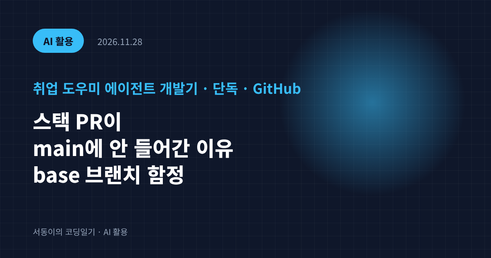

# 취업 도우미 에이전트 개발기 · 스택 PR이 main에 안 들어간 이유 (GitHub)

> 🧪 **AI 활용** · 2026-11-28 · 📝 [티스토리에서 보기](https://dongseodong.tistory.com/77)



**PR 두 개를 차례로 머지했는데 기능 하나가 main에 들어가지 않았던 일과, 그 원인인 스택 PR의 base 함정을 정리한 글입니다.**

이 글 한눈에 보기

1 **무슨 일:** PR \#5를 \#4 위에 쌓아 올렸고, \#4 다음 \#5를 머지했는데 \#5는 main이 아니라 \#4의 브랜치로 들어갔습니다.

2 **원인:** PR은 머지 순간의 base 브랜치로 들어갑니다. 아래 PR이 먼저 머지돼도 위 PR의 base가 자동으로 바뀌지 않는 경우가 있습니다.

3 **대처:** 다음 PR \#6의 base를 main으로 바꿔 한 번에 반영했고, 이후 머지 전에 base를 확인하는 규칙을 만들었습니다.

📚 취업 도우미 에이전트 개발기 시리즈

1편 · 기획 [왜 만들었고, 화면과 문서를 어떻게 준비했나](https://dongseodong.tistory.com/73)

2편 · 설계 [로컬 앱 구조, 토큰 예산, 15인 심사, 개인정보 규칙](https://dongseodong.tistory.com/74)

3편 · 개발 [PR 12개로 돌아본 이틀과 막혔던 부분](https://dongseodong.tistory.com/75)

단독① [토큰 절약 vs 누락 0](https://dongseodong.tistory.com/76)

단독② **스택 PR이 main에 안 들어간 이유** 지금 읽는 글

단독③ [윈도우에서만 터진 asyncio.run 오류](https://dongseodong.tistory.com/78)

단독④ [맥에서 Windows 한국어 OCR 테스트하기](https://dongseodong.tistory.com/79)

단독⑤ [앱에서 AI 구독을 쓰는 방법: 공식 CLI 호출](https://dongseodong.tistory.com/80)

목차

[1. 스택 PR이란](#s1)

[2. 무슨 일이 있었나](#s2)

[3. 왜 이렇게 되나](#s3)

[4. 어떻게 되살렸나](#s4)

[5. 다시 겪지 않으려고 정한 규칙](#s5)

## 01 스택 PR이란

**한 줄 요약:** 아직 머지되지 않은 PR의 브랜치 위에 다음 PR을 쌓아 올리는 방식입니다.

기능 A를 리뷰받는 동안 기다리지 않고, A 브랜치에서 새 브랜치를 따서 기능 B를 이어서 만드는 방식입니다. B의 PR은 base를 A 브랜치로 잡아야 B에서 새로 바뀐 부분만 보입니다.

▶ 스택 PR 구조

```
main
 └─ feat/a        ← PR #4 (base: main)
     └─ feat/b    ← PR #5 (base: feat/a)
         └─ feat/c ← PR #6 (base: feat/b)
```

Claude와 이틀 동안 PR 12개를 만들면서, 앞 PR이 머지되기 전에 다음 기능을 이어서 만드는 일이 많았기 때문에 자연스럽게 이 방식을 썼습니다.

## 02 무슨 일이 있었나

**한 줄 요약:** 메모·사진 넣기 기능(F-26, F-27)을 담은 PR \#5가 main이 아니라 \#4의 브랜치로 머지됐습니다.

| 순서 | 한 일                                                                  | 결과                                                       |
|------|------------------------------------------------------------------------|------------------------------------------------------------|
| 1    | PR \#4(누락 0 전환)를 base main으로 올림                               | \-                                                         |
| 2    | PR \#5(메모·사진 넣기)를 \#4 브랜치 위에 쌓아 올림 (base = \#4 브랜치) | \-                                                         |
| 3    | \#4 머지                                                               | main에 \#4 반영                                            |
| 4    | \#5 머지                                                               | **\#5는 여전히 base가 \#4 브랜치** 라서 그 브랜치로 들어감 |

GitHub 화면에는 두 PR 모두 "Merged"로 표시됐기 때문에 바로 눈치채기 어려웠습니다. main에서 메모·사진 넣기 기능이 보이지 않는 것을 보고 나서야 알게 됐습니다.

## 03 왜 이렇게 되나

**한 줄 요약:** PR은 "머지 버튼을 누르는 순간의 base 브랜치"로 들어가고, 아래 PR이 머지됐다고 위 PR의 base가 항상 바뀌는 것은 아닙니다.

GitHub에는 아래 PR이 머지된 뒤 그 브랜치가 **삭제되면** , 그 브랜치를 base로 삼던 열린 PR들의 base를 자동으로 바꿔 주는 기능(PR retargeting)이 있습니다. 반대로 말하면 브랜치가 삭제되지 않고 남아 있으면, 위 PR은 여전히 그 브랜치를 base로 가리킵니다.

| 아래 PR 머지 후            | 위 PR의 base                                                 |
|----------------------------|--------------------------------------------------------------|
| 아래 PR 브랜치가 삭제됨    | GitHub이 기본 브랜치(main)로 자동 변경                       |
| 아래 PR 브랜치가 남아 있음 | 그대로 아래 PR 브랜치. 이 상태로 머지하면 그 브랜치로 들어감 |

📌 레포 설정 확인

레포 Settings의 "Automatically delete head branches"를 켜 두면, PR이 머지될 때 브랜치가 자동으로 지워지고 위 PR들의 base도 함께 바뀝니다. 이번 일은 이 설정을 확인하지 않고 스택 PR을 쓴 것이 출발점이었습니다.

## 04 어떻게 되살렸나

**한 줄 요약:** 다음 PR \#6에 \#5의 커밋이 그대로 들어 있어서, \#6의 base를 main으로 바꿔 한 번에 반영했습니다.

스택 PR은 위 PR이 아래 PR의 커밋을 모두 품고 있습니다. \#6은 \#5 위에 쌓여 있었으니, \#6의 base만 main으로 바꾸면 \#5의 변경까지 한꺼번에 main에 들어갑니다.

▶ PR의 base 바꾸기

```
#  GitHub 웹: PR 제목 옆 "Edit" → base 브랜치를 main으로 변경
#  GitHub CLI:
gh pr edit 6 --base main

#  바꾼 뒤 diff를 꼭 다시 봅니다. #5의 변경이 함께 보이면 정상입니다.
gh pr diff 6 --name-only
```

만약 위에 쌓인 PR이 없었다면, main에서 새 브랜치를 따서 \#4 브랜치에 들어간 \#5의 커밋을 가져오는 방법도 있습니다.

▶ 위 PR이 없을 때: 커밋을 main으로 옮기기

```
git fetch origin
git switch -c fix/merge-f26-f27 origin/main
git cherry-pick <#5의 첫 커밋>^..<#5의 마지막 커밋>
git push -u origin fix/merge-f26-f27
gh pr create --base main --title "F-26·27 main 반영"
```

## 05 다시 겪지 않으려고 정한 규칙

**한 줄 요약:** 머지 직전에 base를 확인하고, 아래 PR이 머지되면 위 PR을 main 기준으로 다시 맞춥니다.

✦ 지금 해볼 것

☐ 레포 설정에서 "Automatically delete head branches" 켜기

☐ 머지 버튼을 누르기 직전에 PR 상단의 base 브랜치가 main인지 확인

☐ 아래 PR이 머지되면 위 PR의 base를 main으로 바꾸고, 필요하면 rebase

☐ 머지 후 main의 커밋 로그에서 해당 기능 커밋이 보이는지 확인

▶ 아래 PR 머지 후 위 PR을 main 기준으로 정리하기

```
git fetch origin
git switch feat/b
# feat/a에 있던 커밋은 이미 main에 들어갔으니, feat/b만의 커밋을 main 위로 옮깁니다
git rebase --onto origin/main origin/feat/a feat/b
git push --force-with-lease
gh pr edit 5 --base main
```

💡 AI와 개발할 때 특히 조심할 점

AI와 작업하면 PR이 빠르게 여러 개 쌓입니다. 이번처럼 두 PR 모두 "Merged"로 보이는데 기능이 빠지는 일은 화면만 보고는 알기 어렵습니다. 머지 후 main에서 실제로 기능이 동작하는지, 또는 테스트가 그 기능을 포함해 도는지 확인하는 습관이 가장 확실한 안전장치였습니다.

## 정리

**핵심 1.** PR은 머지 순간의 base 브랜치로 들어갑니다. 스택 PR에서 아래 PR이 먼저 머지되면 위 PR의 base가 그대로 남을 수 있습니다.

**핵심 2.** 브랜치 자동 삭제를 켜 두면 GitHub이 위 PR의 base를 main으로 바꿔 줍니다.

**핵심 3.** 이미 잘못 들어갔다면 위 PR의 base를 main으로 바꾸거나, 커밋을 main 기준 새 브랜치로 옮겨 반영합니다.

## 자주 묻는 질문

### 스택 PR에서 아래 PR이 머지되면 위 PR은 자동으로 main을 향합니까?

아래 PR의 브랜치가 머지 후 삭제되면 GitHub이 위 PR의 base를 기본 브랜치로 자동 변경합니다. 브랜치가 남아 있으면 base도 그대로라서, 그 상태로 위 PR을 머지하면 main이 아니라 아래 PR의 브랜치로 들어갑니다.

### 이미 잘못된 브랜치로 머지된 PR은 어떻게 되살립니까?

그 커밋을 품은 다음 PR이 있으면 그 PR의 base를 main으로 바꿔 머지하면 됩니다. 없다면 main에서 새 브랜치를 만들고 해당 커밋을 cherry-pick해서 새 PR로 올립니다.

### PR의 base 브랜치는 어떻게 바꿉니까?

GitHub 웹에서는 PR 제목 옆 Edit을 눌러 base를 고를 수 있고, GitHub CLI에서는 `gh pr edit 번호 --base main`으로 바꿉니다. 바꾼 뒤에는 diff를 다시 확인해서 의도한 변경만 들어가는지 봐야 합니다.

## 참고 링크

[GitHub Changelog · Pull request retargeting ↗](https://github.blog/changelog/2020-05-19-pull-request-retargeting)[GitHub Docs · 브랜치 자동 삭제 ↗](https://docs.github.com/en/repositories/configuring-branches-and-merges-in-your-repository/configuring-pull-request-merges/managing-the-automatic-deletion-of-branches)

---

`#GitHub` `#PullRequest` `#스택PR` `#StackedPR` `#git` `#브랜치전략` `#rebase` `#취업도우미에이전트` `#AI활용`
