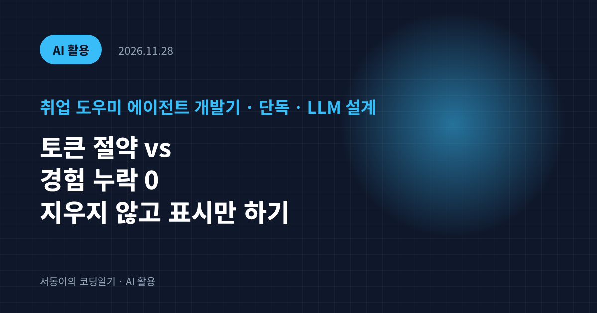

# 취업 도우미 에이전트 개발기 · 토큰 절약 vs 경험 누락 0 (LLM 설계)

> 🧪 **AI 활용** · 2026-11-28 · 📝 [티스토리에서 보기](https://dongseodong.tistory.com/76)



**토큰을 아끼려고 입력을 자르던 설계를, "경험은 하나도 빠뜨리지 않는다"는 원칙으로 뒤집은 기록입니다.**

이 글 한눈에 보기

1 **문제:** 토큰을 줄이려고 문단을 지웠더니, 정작 앱의 존재 이유인 "숨은 경험 찾기"가 약해졌습니다.

2 **해결:** 아무것도 지우지 않고 표시만 하고, 모든 문단을 AI가 반드시 판정하는 경험 장부를 만들었습니다.

3 **절약은 다른 곳에서:** 해시 기반 증분 갱신, 캐시, 장부 재사용, OCR은 스크립트로 처리했습니다.

📚 취업 도우미 에이전트 개발기 시리즈

1편 · 기획 [왜 만들었고, 화면과 문서를 어떻게 준비했나](https://dongseodong.tistory.com/73)

2편 · 설계 [로컬 앱 구조, 토큰 예산, 15인 심사, 개인정보 규칙](https://dongseodong.tistory.com/74)

3편 · 개발 [PR 12개로 돌아본 이틀과 막혔던 부분](https://dongseodong.tistory.com/75)

단독① **토큰 절약 vs 누락 0** 지금 읽는 글

단독② [스택 PR이 main에 안 들어간 이유](https://dongseodong.tistory.com/77)

단독③ [윈도우에서만 터진 asyncio.run 오류](https://dongseodong.tistory.com/78)

단독④ [맥에서 Windows 한국어 OCR 테스트하기](https://dongseodong.tistory.com/79)

단독⑤ [앱에서 AI 구독을 쓰는 방법: 공식 CLI 호출](https://dongseodong.tistory.com/80)

목차

[1. 처음 설계: 보내는 양 줄이기](#s1)

[2. 왜 뒤집었나: 경험 하나가 빠지면 쓸 이유가 사라짐](#s2)

[3. 바꾼 것 1: 지우지 않고 표시만 하기](#s3)

[4. 바꾼 것 2: 모든 문단을 반드시 판정하는 경험 장부](#s4)

[5. 그럼 토큰은 어디서 아끼나](#s5)

[6. 감수한 비용](#s6)

## 01 처음 설계: 보내는 양 줄이기

**한 줄 요약:** 처음에는 AI로 보내는 텍스트를 줄이는 것이 곧 좋은 설계라고 생각했습니다.

[2편](https://dongseodong.tistory.com/74)에서 정리한 것처럼, 처음 설계의 문서 정제 3단계는 머리말, 서식, 반복 문구, 동의서·서약 문구를 **지우는** 단계였습니다. 실제 지원서 한 부로 시험해 보니 효과도 분명했습니다.

| 항목           | 정제 전   | 정제 후                     |
|----------------|-----------|-----------------------------|
| AI로 보낼 분량 | 2,704토큰 | 1,963토큰 (약 27% 감소)     |
| 지운 것        | \-        | 동의서·서약 문구, 중복 문단 |

숫자만 보면 성공이었습니다. 그런데 PR \#3까지 만들고 실제 화면을 보니, 앱이 하는 일은 "이미 확인된 정보를 나열하는 정도"에 머물러 있었습니다.

## 02 왜 뒤집었나: 경험 하나가 빠지면 쓸 이유가 사라짐

**한 줄 요약:** 이 앱의 가치는 사용자가 놓친 경험을 찾아 주는 데 있고, 그러려면 AI가 폴더 전체를 봐야 합니다.

원래 의도를 다시 정리했습니다. 취업 폴더에서 필요한 부분만 빼 오는 것이 아니라, **폴더 전체를 컨텍스트로 갖고 모든 경험을 빠짐없이 체계화** 해서 자소서를 쓸 때마다 다시 꺼내 쓰는 것이 목표였습니다.

사용자가 매일 보는 자료라서 오히려 스스로 놓치는 경험이 있고, AI가 예상하지 못한 곳에서 그걸 찾아 주리라 믿기 때문에 폴더 권한까지 주는 것입니다. 그런데 "토큰 절약"이라는 이유로 문단을 지우면, 바로 그 예상하지 못한 곳이 사라집니다.

> 토큰을 아끼는 것은 수단이고, 경험을 빠뜨리지 않는 것은 목적입니다.

💡 AI는 합리적으로 보이는 쪽을 고릅니다

이 원칙을 처음부터 분명하게 말하지 않으면, AI와 설계할 때 "토큰 절약"처럼 합리적으로 보이는 선택이 기본값이 됩니다. 이 프로젝트에서도 원칙을 말로 정리해 준 뒤에야 설계 방향이 바뀌었습니다.

## 03 바꾼 것 1: 지우지 않고 표시만 하기

**한 줄 요약:** 정제는 "삭제"에서 "AI에 안 보냄 표시"로 바뀌었고, 원문은 전부 남깁니다.

| 항목        | 바꾸기 전               | 바꾼 뒤 (PR \#4)                                                      |
|-------------|-------------------------|-----------------------------------------------------------------------|
| 정제        | 동의서·중복 문단을 지움 | 지우지 않고 "AI에 안 보냄" 표시만 함                                  |
| 원문        | 정리된 텍스트만 남김    | 원문 전체를 저장하고, 파일별 텍스트 사본을 둠                         |
| 사용자 조작 | 없음                    | 파일별로 빠진 문단을 펼쳐 보고 다시 넣기, "원문 그대로 보내기" 스위치 |
| 지원 형식   | PDF·DOCX·HWPX           | 옛 HWP, XLSX, PPTX, TXT, MD 추가                                      |

▶ 문단에 표시만 남기기 (설명용 예시)

```
from dataclasses import dataclass

@dataclass
class Paragraph:
    file: str
    index: int
    text: str
    send_to_ai: bool = True      # 지우지 않고 이 값만 바꿉니다
    reason: str | None = None    # "동의서 문구", "중복" 등

def mark(p: Paragraph) -> Paragraph:
    if looks_like_consent(p.text):
        p.send_to_ai, p.reason = False, "동의서 문구"
    return p

# 사용자가 화면에서 "다시 넣기"를 누르면 send_to_ai만 True로 되돌립니다.
```

## 04 바꾼 것 2: 모든 문단을 반드시 판정하는 경험 장부

**한 줄 요약:** AI가 문단 하나라도 건너뛰면 다시 보내고, 두 번 빠지면 사람에게 보여 줍니다.

"누락 0"을 말로만 지키면 확인할 방법이 없습니다. 그래서 AI의 답이 모든 문단을 덮었는지 코드로 검사하게 했습니다.

1 · 판정 요청

문단마다 「경험 N의 근거」 또는 「경험 아님(이유)」 중 하나로 답하게 합니다.

2 · 빠진 문단 찾기

보낸 문단 ID와 답에 나온 ID를 비교합니다.

3 · 다시 보내기

빠진 문단만 한 번 더 보냅니다.

4 · 사람에게

두 번 빠지면 「분류 못 함」으로 화면에 띄웁니다.

▶ 판정 누락 검사 (설명용 예시)

```
def judge_all(paragraphs: dict[str, str], ask_ai, max_retry: int = 1):
    """paragraphs: {문단ID: 텍스트}. 모든 문단이 판정될 때까지 다시 보냅니다."""
    verdicts, pending = {}, dict(paragraphs)
    for _ in range(max_retry + 1):
        if not pending:
            break
        answer = ask_ai(pending)                 # {문단ID: 판정}
        verdicts.update({k: v for k, v in answer.items() if k in pending})
        pending = {k: t for k, t in pending.items() if k not in answer}
    for pid in pending:                          # 두 번 빠진 문단
        verdicts[pid] = {"verdict": "unclassified"}
    return verdicts

# 화면에는 "문단 26개 중 26개 확인"처럼 판정된 개수를 보여 줍니다.
```

같은 경험이 자소서 v1, v2, 이력서에 반복해서 나오면 카드 하나로 합치고 근거를 여러 개 답니다. 숫자나 기간이 파일마다 다르면 AI가 고르지 않고 사용자에게 묻습니다.

## 05 그럼 토큰은 어디서 아끼나

**한 줄 요약:** 입력을 자르는 대신 "같은 일을 두 번 하지 않는 것"으로 아낍니다.

| 아끼는 곳                    | 방법                                                                                     |
|------------------------------|------------------------------------------------------------------------------------------|
| 안 바뀐 파일                 | 파일 해시가 같으면 다시 읽지 않습니다.                                                   |
| 이미 판정한 문단             | 문단 내용 해시로 판정을 기억하고, 새 문단과 바뀐 문단만 기존 장부와 함께 보냅니다.       |
| 같은 입력                    | `llm_cache`에 저장된 답을 다시 씁니다. 프롬프트를 고치면 버전을 올려 섞이지 않게 합니다. |
| 자소서 쓸 때                 | 원문 대신 정리된 경험 장부를 씁니다.                                                     |
| 여러 파일을 한꺼번에 넣을 때 | 폴더가 90초 동안 잠잠해지면 모아서 한 번에 부릅니다.                                     |
| 사진과 스캔본                | AI가 이미지를 보는 대신 스크립트(OCR)가 텍스트로 옮깁니다.                               |

▶ 증분 갱신: 처음 보는 문단만 보내기 (설명용 예시)

```
import hashlib

def para_hash(text: str) -> str:
    return hashlib.sha256(" ".join(text.split()).encode("utf-8")).hexdigest()

def to_send(paragraphs: list[str], judged: set[str]) -> list[str]:
    return [p for p in paragraphs if para_hash(p) not in judged]

# 다음 갱신 때 AI는 (새 문단 + 기존 장부)를 받아
# 새 경험인지, 기존 카드에 사실이 더해진 건지, 충돌인지 판단합니다.
```

### 이미지는 AI가 아니라 스크립트가

이 부분은 직접 낸 아이디어였습니다. 파일을 하나하나 열어서 사진의 글자를 읽는 일은 스크립트가 하고, AI는 텍스트로 옮긴 결과만 보면 되지 않을까 하는 생각이었습니다. 그대로 채택했습니다.

| 상황                    | 처리                                                       |
|-------------------------|------------------------------------------------------------|
| 글자가 있는 사진·스캔본 | OS 내장 OCR로 텍스트 사본을 만듭니다. AI 사용량은 0입니다. |
| OCR이 자신 없는 줄      | 「글자 확인」 표시를 달아 사용자가 확인하게 합니다.        |
| 글자가 없는 사진        | 버리지 않고 "어떤 경험인지 메모해 주세요"라고 알립니다.    |

그 결과 AI에 이미지를 보내는 일이 없어져서 비용이 줄었고, 개인정보가 담긴 원본 이미지가 PC 밖으로 나갈 일도 없어졌습니다.

## 06 감수한 비용

**한 줄 요약:** 처음 한 번 폴더 전체를 읽는 비용은 아끼지 않기로 했습니다.

모든 문단을 판정하려면 처음 한 번은 폴더 전체를 AI가 읽어야 합니다. 이 비용은 줄이지 않고 감수했습니다. 대신 그다음부터는 바뀐 문단만 보내기 때문에, 자료가 쌓일수록 한 번에 드는 비용은 처음보다 훨씬 작아집니다.

🔥 이 글의 결론

토큰 절약과 누락 0은 부딪힙니다. 어디서 아끼고 어디서는 절대 아끼지 않을지를 먼저 정하는 것이 LLM 앱 설계의 핵심이었습니다. 이 앱에서는 **입력의 범위는 아끼지 않고, 반복과 중복을 아끼는 쪽** 을 택했습니다.

## 정리

**핵심 1.** 문단을 지워 토큰을 27% 줄였지만, 앱의 목적인 "놓친 경험 찾기"가 약해져서 설계를 뒤집었습니다.

**핵심 2.** 정제는 삭제 대신 "AI에 안 보냄" 표시만 하고, 모든 문단을 판정하는 경험 장부를 만들었습니다.

**핵심 3.** 토큰은 해시 기반 증분 갱신, 캐시, 장부 재사용, 스크립트 OCR로 아낍니다.

## 자주 묻는 질문

### LLM 앱에서 토큰을 줄이려면 입력을 잘라야 합니까?

꼭 그렇지는 않습니다. 이 프로젝트에서는 입력을 자르면 중요한 정보가 빠지는 문제가 생겨서, 대신 바뀐 파일과 바뀐 문단만 다시 보내는 증분 갱신, 같은 입력을 다시 쓰는 캐시, 원문 대신 정리된 결과를 쓰는 방식으로 비용을 줄였습니다.

### AI가 문단을 빠뜨리지 않았는지 어떻게 확인합니까?

보낸 문단 ID와 AI 답에 나온 문단 ID를 코드로 비교합니다. 빠진 문단은 한 번 더 보내고, 그래도 빠지면 「분류 못 함」으로 화면에 띄워 사람이 확인하게 합니다.

### 사진 속 글자도 AI로 읽어야 합니까?

이 앱에서는 Windows 내장 OCR(맥은 Vision) 같은 OS 기능으로 먼저 텍스트를 뽑고, AI는 그 텍스트만 읽습니다. AI 사용량이 들지 않고 원본 이미지가 PC 밖으로 나가지 않는다는 장점이 있습니다.

---

`#취업도우미에이전트` `#LLM설계` `#토큰절약` `#프롬프트캐시` `#증분갱신` `#해시` `#ClaudeCode` `#AI활용` `#RAG`
