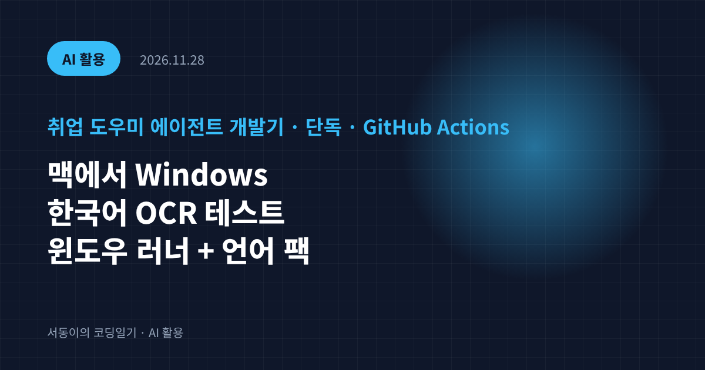
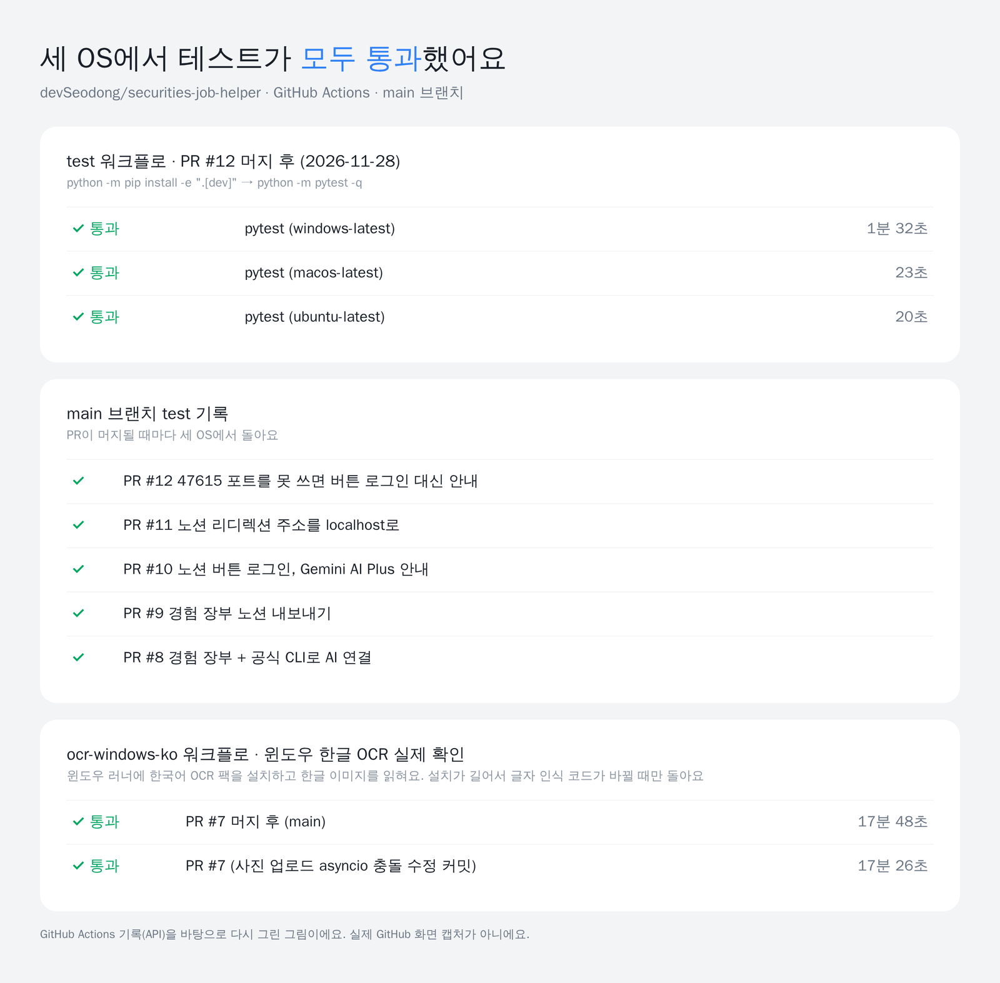

# 취업 도우미 에이전트 개발기 · 맥에서 Windows 한국어 OCR 테스트하기 (GitHub Actions)

> 🧪 **AI 활용** · 2026-11-28 · 📝 [티스토리에서 보기](https://dongseodong.tistory.com/79)



**맥으로 개발하면서, 실제 사용자 환경인 Windows의 한국어 OCR을 GitHub Actions로 확인한 방법을 정리한 글입니다.**

이 글 한눈에 보기

1 **문제:** 개발 맥에는 Windows 내장 OCR이 없고, GitHub의 윈도우 러너에는 한국어 OCR 언어 팩이 없습니다.

2 **방법:** 윈도우 러너에 한국어 OCR 팩을 설치하고 가짜 문구가 적힌 한글 이미지를 실제로 읽혀 봤습니다.

3 **최적화:** 설치가 17분 넘게 걸려서, 글자 인식 코드가 바뀔 때만 도는 별도 워크플로로 분리했습니다.

📚 취업 도우미 에이전트 개발기 시리즈

1편 · 기획 [왜 만들었고, 화면과 문서를 어떻게 준비했나](https://dongseodong.tistory.com/73)

2편 · 설계 [로컬 앱 구조, 토큰 예산, 15인 심사, 개인정보 규칙](https://dongseodong.tistory.com/74)

3편 · 개발 [PR 12개로 돌아본 이틀과 막혔던 부분](https://dongseodong.tistory.com/75)

단독① [토큰 절약 vs 누락 0](https://dongseodong.tistory.com/76)

단독② [스택 PR이 main에 안 들어간 이유](https://dongseodong.tistory.com/77)

단독③ [윈도우에서만 터진 asyncio.run 오류](https://dongseodong.tistory.com/78)

단독④ **맥에서 Windows 한국어 OCR 테스트하기** 지금 읽는 글

단독⑤ [앱에서 AI 구독을 쓰는 방법: 공식 CLI 호출](https://dongseodong.tistory.com/80)

목차

[1. 왜 이 테스트가 필요했나](#s1)

[2. 윈도우 러너에 한국어 OCR 팩 설치하기](#s2)

[3. 한글 이미지를 실제로 읽혀 보기](#s3)

[4. 느린 테스트는 따로 돌리기](#s4)

## 01 왜 이 테스트가 필요했나

**한 줄 요약:** 사진과 스캔본의 글자를 읽는 기능은 실제 사용 환경인 Windows에서 한글로 확인해야 의미가 있습니다.

이 앱은 사진이나 스캔 PDF의 글자를 OS 내장 OCR로 읽습니다. 윈도우에서는 Windows 내장 OCR(`Windows.Media.Ocr`), 맥에서는 macOS 내장 Vision을 씁니다. 맥에서도 앱을 띄워 사진을 넣어 볼 수는 있지만, 사용자 PC는 윈도우입니다.

그래서 처음 든 생각은 이것이었습니다. "우리는 맥인데, Windows 내장 OCR은 어떻게 테스트하지?"

| 환경                              | Windows OCR 사용 | 한국어 인식                |
|-----------------------------------|------------------|----------------------------|
| 개발 맥                           | 불가             | \-                         |
| GitHub Actions 윈도우 러너 (기본) | 가능             | 한국어 언어 팩이 없어 불가 |
| 윈도우 러너 + 한국어 OCR 팩 설치  | 가능             | **가능**                   |

## 02 윈도우 러너에 한국어 OCR 팩 설치하기

**한 줄 요약:** Windows의 "기능 추가(Features on Demand)"로 한국어 OCR 기능을 설치합니다.

Windows OCR은 설치된 언어의 OCR 기능만 쓸 수 있습니다. 한국어 OCR은 PowerShell의 `Add-WindowsCapability`로 설치할 수 있습니다. 정확한 기능 이름은 `Get-WindowsCapability`로 먼저 확인하는 것이 안전합니다.

▶ 한국어 OCR 기능 찾고 설치하기

```
#  설치할 수 있는 OCR 기능 목록에서 한국어 찾기
Get-WindowsCapability -Online | Where-Object Name -like 'Language.OCR*ko-KR*'

#  찾은 이름으로 설치 (예: Language.OCR~~~ko-KR~0.0.1.0)
Get-WindowsCapability -Online |
  Where-Object Name -like 'Language.OCR*ko-KR*' |
  Add-WindowsCapability -Online
```

### "install에서 멈춘 건가?" 싶었던 10분

처음 돌렸을 때 이 단계가 10분 넘게 끝나지 않아서 멈춘 줄 알았습니다. 확인해 보니 Windows Update 서버에서 언어 팩을 내려받는 중이라 원래 오래 걸리는 단계였습니다. 실제 기록을 보면 한국어 OCR 워크플로 전체가 17분 26초, 17분 48초 걸렸습니다. 평소 테스트(윈도우 1분 32초)와 비교하면 열 배가 넘습니다.



GitHub Actions 기록을 바탕으로 다시 그린 결과. 한국어 OCR 워크플로는 17분대, 평소 테스트는 1분대입니다.

## 03 한글 이미지를 실제로 읽혀 보기

**한 줄 요약:** 가짜 문구가 적힌 한글 이미지를 테스트 자료로 두고, OCR 결과에 그 문구가 들어 있는지 확인합니다.

테스트 이미지에는 실제 자료 대신 "투자동아리 기업분석 발표" 같은 가짜 문구를 넣었습니다. 테스트는 이 문구를 제대로 읽어 내는지만 확인합니다.

▶ 한국어 OCR 테스트 (설명용 예시)

```
import sys, pytest
from pathlib import Path
from app.ocr import ocr_image

ASSET = Path(__file__).parent / "assets" / "ocr_ko_sample.png"

@pytest.mark.skipif(sys.platform != "win32", reason="Windows OCR 전용")
@pytest.mark.ocr_ko
def test_windows_ocr_reads_korean():
    text = ocr_image(str(ASSET))
    assert "투자동아리" in text
    assert "기업분석" in text
```

### 막혔던 두 가지

| 문제                               | 원인                                                                                           | 해결                                                                                                                                            |
|------------------------------------|------------------------------------------------------------------------------------------------|-------------------------------------------------------------------------------------------------------------------------------------------------|
| CI에서 테스트 이미지가 없다고 나옴 | 이미지를 `.gitignore`된 `data/` 아래에 뒀습니다. 로컬에는 있지만 레포에는 올라가지 않았습니다. | 테스트 자료를 `tests/assets/`로 옮겼습니다.                                                                                                     |
| 윈도우에서 한글이 깨질 수 있음     | 윈도우의 기본 인코딩은 UTF-8이 아닐 수 있습니다.                                               | UTF-8을 명시하는 대비를 추가했습니다. 예를 들어 파일을 열 때 `encoding="utf-8"`을 쓰거나, CI 환경 변수에 `PYTHONUTF8=1`을 두는 방법이 있습니다. |

📌 테스트 자료도 개인정보 규칙을 따릅니다

OCR 테스트 이미지는 실제 자료를 찍은 것이 아니라 가짜 문구로 새로 만든 이미지입니다. 레포에 올라가는 모든 테스트 자료는 이 규칙을 따릅니다.

## 04 느린 테스트는 따로 돌리기

**한 줄 요약:** 한국어 OCR 확인은 별도 워크플로로 빼서, 글자 인식 코드가 바뀔 때만 돌게 했습니다.

17분짜리 단계를 모든 PR마다 돌리면 PR 하나 확인하는 데 너무 오래 걸립니다. 그래서 평소 PR에서는 세 OS의 빠른 테스트만 돌리고, 한국어 OCR 확인은 경로 필터를 건 별도 워크플로로 분리했습니다.

▶ .github/workflows/ocr-windows-ko.yml (설명용 예시)

```
name: ocr-windows-ko
on:
  pull_request:
    paths:
      - "app/ocr/**"            # 글자 인식 코드가 바뀔 때만
      - "tests/assets/ocr_*"
      - ".github/workflows/ocr-windows-ko.yml"
  workflow_dispatch: {}          # 필요하면 손으로 실행

jobs:
  ocr-ko:
    runs-on: windows-latest
    env:
      PYTHONUTF8: "1"
    steps:
      - uses: actions/checkout@v4
      - uses: actions/setup-python@v5
        with:
          python-version: "3.12"
      - name: 한국어 OCR 기능 설치 (오래 걸림)
        shell: pwsh
        run: |
          Get-WindowsCapability -Online |
            Where-Object Name -like 'Language.OCR*ko-KR*' |
            Add-WindowsCapability -Online
      - run: python -m pip install -e ".[dev]"
      - run: python -m pytest -q -m ocr_ko
```

| 워크플로       | 언제 도나                                  | 걸리는 시간                           |
|----------------|--------------------------------------------|---------------------------------------|
| test (세 OS)   | 모든 PR과 main 머지                        | 윈도우 1분 32초, 맥 23초, 리눅스 20초 |
| ocr-windows-ko | 글자 인식 코드가 바뀔 때, 또는 손으로 실행 | 17분대                                |

💡 이 워크플로가 실제로 잡아 준 것

이렇게 윈도우에서 실제 경로를 밟는 테스트를 두었기 때문에, 맥과 리눅스에서는 보이지 않던 사진 업로드 오류를 사용자보다 먼저 발견했습니다. 그 이야기는 단독 글 [「윈도우에서만 터진 asyncio.run 오류」](https://dongseodong.tistory.com/78)에 있습니다.

## 정리

**핵심 1.** 맥에서 Windows OCR을 확인할 수 없으니, GitHub Actions 윈도우 러너에 한국어 OCR 기능을 설치해 실제 한글 이미지를 읽혔습니다.

**핵심 2.** 테스트 이미지는 `.gitignore` 밖의 `tests/assets/`에 두고, 윈도우 인코딩 문제에 대비했습니다.

**핵심 3.** 설치가 17분 넘게 걸려서 경로 필터를 건 별도 워크플로로 분리했습니다.

## 자주 묻는 질문

### GitHub Actions 윈도우 러너에서 한국어 OCR을 쓸 수 있습니까?

기본 상태에서는 한국어 OCR 언어 기능이 없어서 바로 쓸 수 없습니다. PowerShell의 `Get-WindowsCapability`로 `Language.OCR*ko-KR*` 기능을 찾아 `Add-WindowsCapability`로 설치하면 Windows 내장 OCR로 한국어를 읽을 수 있습니다.

### 한국어 OCR 팩 설치는 얼마나 걸립니까?

이 프로젝트에서는 한국어 OCR 워크플로 전체가 17분 26초와 17분 48초 걸렸고, 대부분이 언어 기능을 내려받는 시간이었습니다. 그래서 모든 PR이 아니라 글자 인식 코드가 바뀔 때만 도는 별도 워크플로로 분리했습니다.

### CI에서 테스트 파일을 찾지 못하는 이유는 무엇입니까?

테스트 자료가 `.gitignore`에 포함된 폴더에 있으면 로컬에서는 보여도 레포에 올라가지 않아 CI에서는 없습니다. 이 프로젝트에서는 `data/` 아래에 있던 테스트 이미지를 `tests/assets/`로 옮겨 해결했습니다.

## 참고 링크

[Microsoft Learn · Windows.Media.Ocr ↗](https://learn.microsoft.com/en-us/uwp/api/windows.media.ocr)[Microsoft Learn · Language Features on Demand ↗](https://learn.microsoft.com/windows-hardware/manufacture/desktop/features-on-demand-language-fod)[GitHub Docs · paths 필터 ↗](https://docs.github.com/en/actions/writing-workflows/workflow-syntax-for-github-actions#onpushpull_requestpull_request_targetpathspaths-ignore)

---

`#GitHubActions` `#CI` `#WindowsOCR` `#한국어OCR` `#PowerShell` `#윈도우러너` `#파이썬` `#취업도우미에이전트` `#AI활용`
