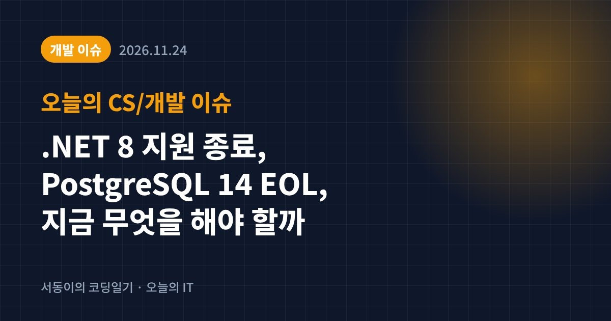

# 오늘의 CS/개발 이슈 (2026.11.24) - .NET 8 지원 종료, PostgreSQL 14 EOL, 지금 무엇을 해야 할까

> 🛠️ **개발 이슈** · 2026-11-24 · 📝 [티스토리에서 보기](https://dongseodong.tistory.com/61)

## 한눈에 보기

11월은 지원 종료(EOL)가 몰린 달이에요.

- 11/1: Alpine Linux 3.21, OpenSSL 3.6 EOL
- 11/7: Ruby on Rails 8.0 보안 지원 종료
- 11/10: **.NET 8, .NET 9** , PowerShell 7.4·7.5 지원 종료
- 11/12: **PostgreSQL 14** EOL
- 11/28: **Angular 20** LTS 종료 (예정)
- 12/1: Redis 8.0 EOL (예정), 12/31: PHP 8.2 보안 지원 종료 (예정)

먼저 EOL이 무슨 뜻인지 짚고, 영향이 큰 세 가지를 자세히 볼게요.

## EOL은 정확히 무슨 의미일까

EOL(End of Life) 이후에도 프로그램은 그대로 돌아갑니다. 문제는 **보안 패치가 더 이상 나오지 않는다** 는 거예요. 새 취약점이 발견돼도 고쳐지지 않으니 시간이 갈수록 위험해지고, 보안 심사나 클라우드 런타임 정책에서도 막히기 시작합니다. 그래서 "언젠가 올리자"가 아니라 일정을 잡아서 올려야 해요.

## 1. .NET 8 / .NET 9 지원 종료 (11월 10일)

### 왜 두 버전이 한꺼번에 끝났나

.NET은 짝수 버전이 LTS(3년 지원), 홀수 버전이 STS(지원 기간이 더 짧음)입니다. .NET 8은 2023년 11월에 나온 LTS라 3년을 채웠고, .NET 9는 STS라서 같은 날 함께 끝났어요. 다음 LTS는 .NET 10이고 2028년 11월까지 지원됩니다.

### 무엇을 하면 되나

1.  쓰고 있는 버전 확인: `dotnet --list-runtimes`, 프로젝트 파일의 `<TargetFramework>`
2.  `net8.0`을 `net10.0`으로 바꾸고 NuGet 패키지를 업데이트합니다.
3.  공식 문서의 '호환성이 깨지는 변경' 목록을 확인하고 테스트를 돌립니다.
4.  도커 베이스 이미지(`mcr.microsoft.com/dotnet/aspnet:8.0` 등)와 CI의 SDK 버전도 같이 올립니다.

클라우드 쪽도 따라옵니다. AWS Lambda는 dotnet8 런타임 지원 중단을 예고했어요(2027년 7월 29일부터 새 함수 생성 차단 예정, 확정 전 일정). PowerShell도 7.4·7.5가 같은 날 끝났으니 7.6 LTS로 옮기면 됩니다.

출처: [.NET 지원 정책](https://dotnet.microsoft.com/en-us/platform/support/policy/dotnet-core), [PowerShell 지원 수명 주기](https://learn.microsoft.com/en-us/powershell/scripting/install/powershell-support-lifecycle), [AWS Lambda 런타임](https://docs.aws.amazon.com/lambda/latest/dg/lambda-runtimes.html)

## 2. PostgreSQL 14 EOL (11월 12일)

### PostgreSQL의 지원 정책

PostgreSQL은 메이저 버전마다 약 5년간 지원합니다. 14는 2021년에 나왔고, 11월 12일 마지막 마이너 릴리스를 끝으로 지원이 끝났어요. 현재 지원되는 버전은 15부터 18까지입니다.

### 업그레이드 방법 세 가지

- **pg_dump / pg_restore** : 가장 단순하고 안전하지만, DB가 크면 다운타임이 길어요.
- **pg_upgrade** : 데이터 파일을 거의 그대로 옮겨서 빠릅니다. `--link` 옵션을 쓰면 더 빨라지지만 롤백이 어려워지니 백업이 필수예요. 먼저 `--check`로 사전 점검을 해보세요.
- **논리 복제** : 새 버전 서버를 띄워 복제하다가 전환합니다. 다운타임을 최소로 줄일 수 있지만 설정이 가장 복잡해요.

업그레이드 후에는 통계 정보가 비어 있을 수 있어서 `ANALYZE`를 꼭 돌려야 쿼리 성능이 돌아옵니다. AWS RDS 같은 관리형 DB를 쓴다면 콘솔의 메이저 버전 업그레이드 기능을 쓰면 돼요. 이 경우에도 미리 스냅샷을 떠두는 게 좋습니다.

출처: [PostgreSQL 버전 정책](https://www.postgresql.org/support/versioning/)

## 3. Angular 20 LTS 종료 (11월 28일 예정)

### Angular의 지원 주기

Angular는 메이저 버전마다 약 6개월의 활성 지원과 12개월의 LTS를 합쳐 총 18개월을 지원합니다. LTS 기간에는 치명적 버그와 보안 수정만 나와요. Angular 20은 이번 주 금요일(11/28)에 이 LTS가 끝납니다.

### 업그레이드 팁

- 메이저 버전을 건너뛰지 말고 **한 단계씩** 올리세요. 20에서 21로, 다시 22로 가는 식입니다.
- `ng update @angular/core@21 @angular/cli@21`을 쓰면 코드 마이그레이션 스크립트가 자동으로 같이 실행돼요.
- [Angular 업데이트 가이드](https://angular.dev/update-guide)에서 현재 버전과 목표 버전을 고르면 해야 할 일을 체크리스트로 보여줍니다.

출처: [Angular 릴리스 정책](https://angular.dev/reference/releases)

## 그 밖에 챙길 일정

- Ruby on Rails 8.0 보안 지원 종료(11/7), 8.1로 업그레이드 ([Rails 유지보수 정책](https://rubyonrails.org/maintenance))
- Alpine 3.21, OpenSSL 3.6 EOL(11/1): 컨테이너 베이스 이미지 점검 ([Alpine](https://alpinelinux.org/releases/), [OpenSSL](https://openssl-library.org/policies/releasestrat/index.html))
- Redis 8.0 EOL(12/1 예정) ([Redis](https://redis.io/docs/latest/operate/oss_and_stack/install/version-mgmt/))
- PHP 8.2 보안 지원 종료(12/31 예정) ([PHP](https://www.php.net/supported-versions.php))

전체 일정은 [endoflife.date 11월 타임라인](https://endoflife.date/timeline/2026/11/)에서 볼 수 있어요.

---

`#angular` `#EOL` `#NET10` `#NET8` `#pg_upgrade` `#PostgreSQL` `#개발이슈` `#버전업그레이드` `#보안패치` `#지원종료`
