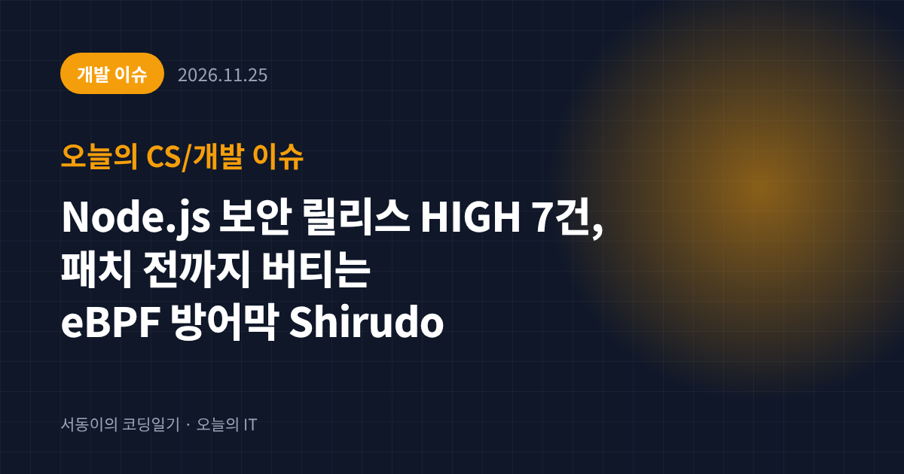

# 오늘의 CS/개발 이슈 (2026.11.25) - Node.js 보안 릴리스 HIGH 7건, 패치 전까지 버티는 eBPF 방어막 Shirudo

> 🛠️ **개발 이슈** · 2026-11-25 · 📝 [티스토리에서 보기](https://dongseodong.tistory.com/64)



오늘은 **"패치가 나왔는데 아직 못 올렸다"** 는, 모든 개발팀이 겪는 그 공백에 관한 이야기예요. 하나는 지금 당장 올려야 하는 Node.js 보안 릴리스, 다른 하나는 패치를 올리기 전까지 서버를 지켜 주겠다는 OpenAI와 Cisco의 새 오픈소스 런타임 Shirudo예요. 마지막으로 이번 주에 끝나는 지원 일정도 짚어 볼게요.

TL;DR · 한눈에 보기

1 Node.js가 11월 11일 **보안 권고 17건** 을 한꺼번에 고쳤어요. HIGH 등급 7건이 대부분 **HTTP/2와 TLS** 쪽이라 웹 서버라면 바로 올려야 해요.

2 고친 버전은 **26.13.1 / 24.22.3 / 22.23.5** 예요. 지원이 끝난 버전은 패치가 없으니 무조건 영향 받는다고 보면 돼요.

3 OpenAI·Cisco가 공개한 **Shirudo** 는 eBPF로 실행 중인 프로세스에 임시 방어막을 붙여, 재시작 없이 취약 경로를 막아요. 아직 정식 출시 전 단계예요.

목차

[1. Node.js 11월 보안 릴리스: HIGH 7건, 지금 올려야 하는 이유](#s1)

[2. Shirudo: 패치 전까지 버티는 eBPF 방어막](#s2)

[3. 이번 주 챙길 지원 종료 일정](#s3)

[정리](#s-sum)

## 01 Node.js 11월 보안 릴리스: HIGH 7건, 지금 올려야 하는 이유

### 무슨 일이 있었나

Node.js 프로젝트가 11월 11일 지원 중인 세 줄기(26.x, 24.x, 22.x)에 동시에 보안 릴리스를 냈어요. 권고는 모두 **17건** 이고, 가장 높은 등급은 세 줄기 모두 **HIGH** 예요. 26.13.1(코드명 Lithium)의 릴리스 노트를 보면 새 기능은 없고, 보안 수정과 의존성 업데이트(llhttp 9.4.4, undici 8.12.4, sqlite 3.54.1, brotli 1.2.1)만 들어 있어요.

| 줄기              | 고친 버전 | 상태                    |
|-------------------|-----------|-------------------------|
| 26.x              | 26.13.1   | LTS (최신)              |
| 24.x              | 24.22.3   | LTS                     |
| 22.x              | 22.23.5   | LTS                     |
| 그 외 (지원 종료) | 없음      | 항상 영향 받음으로 간주 |

### HIGH 7건, 어디가 문제였나

| CVE             | 문제                                                                  | 영향 줄기  |
|-----------------|-----------------------------------------------------------------------|------------|
| CVE-2026-123863 | HTTP/2 원격 강제 종료 (세션 소멸자 검사 실패)                         | 24, 26     |
| CVE-2026-123864 | HTTPS 길이 0 TLS 쓰기가 파서를 다시 호출해 힙 내용이 요청 본문에 섞임 | 22, 24, 26 |
| CVE-2026-123865 | 종료 중 프로토콜 오류 시 HTTP/2 세션이 정리되지 않음                  | 22, 24, 26 |
| CVE-2026-123866 | HTTP/2 스트림 정리 중 해제된 응답 메모리를 상대에게 전송              | 22, 24, 26 |
| CVE-2026-126051 | TLS 서버의 지연 핸드셰이크 콜백으로 원격에서 예외 발생                | 24, 26     |
| CVE-2026-123872 | TLS 1.2 재협상으로 servername을 바꿔 클라이언트 인증서 검증 우회      | 22, 24, 26 |
| CVE-2026-123874 | respondWithFile() 쓰기 중 리셋 시 HTTP/2 use-after-free               | 24, 26     |

### 배경: 왜 HTTP/2와 TLS에 몰렸을까

HTTP/2와 TLS는 **외부에서 바로 닿는 코드** 예요. 인증 전에, 요청 본문을 읽기도 전에 동작하죠. 그래서 여기서 메모리 관리가 한 번 꼬이면 로그인 없이 서버를 죽이거나(서비스 거부), 다른 사람의 메모리 조각을 응답으로 내보내는(정보 유출) 문제가 돼요. 이번 HIGH 7건이 정확히 그런 유형이에요.

특히 CVE-2026-123872는 **클라이언트 인증서(mTLS)로 접근을 제한하는 서비스** 라면 꼭 봐야 해요. TLS 1.2 재협상 중에 servername을 바꿔서 인증을 우회할 수 있다는 내용이에요. 내부 API를 mTLS로 막아 두었다고 안심하던 팀이 가장 위험해요.

### 영향 받는 곳

| 이런 서비스라면                                         | 위험도                       |
|---------------------------------------------------------|------------------------------|
| node:http2 또는 https로 직접 TLS를 종단하는 서버        | 🔥 높음, 바로 업데이트       |
| mTLS(클라이언트 인증서)로 접근 제어                     | 🔥 높음, TLS 1.2 재협상 이슈 |
| 앞단에 nginx·로드밸런서가 TLS를 처리, Node는 HTTP/1.1만 | 중간, 그래도 업데이트 권장   |
| CLI 도구, 빌드 스크립트만                               | 낮음, 다음 정기 업데이트 때  |

### 대응 방안

STEP 1

서버마다 Node 버전 확인

STEP 2

취약 여부 자동 점검

STEP 3

패치 버전으로 올리고 Docker 이미지 고정

STEP 4

배포 후 버전 다시 확인

▶ 1단계: 지금 버전 확인하고 취약 여부 점검

```
node -v

# Node.js 보안팀이 만든 점검 도구: 현재 버전에 알려진 취약점이 있는지 알려 줌
npx is-my-node-vulnerable
```

▶ 2단계: nvm으로 패치 버전 설치

```
# 쓰는 줄기에 맞춰 하나만
nvm install 26.13.1
nvm install 24.22.3
nvm install 22.23.5

nvm alias default 24.22.3   # 기본 버전 지정
node -v                     # v24.22.3 확인
```

▶ 3단계: Docker 베이스 이미지는 패치 버전까지 고정

```
# 변경 전: FROM node:24  (언제 빌드했느냐에 따라 버전이 달라짐)
FROM node:24.22.3-slim

WORKDIR /app
COPY package*.json ./
RUN npm ci --omit=dev
COPY . .
USER node
CMD ["node", "server.js"]
```

▶ 4단계: CI에서도 같은 버전 쓰기 (GitHub Actions)

```
- uses: actions/setup-node@v4
  with:
    node-version: 24.22.3
    cache: npm
- run: node -v && npm ci && npm test
```

💡 팁

package.json의 engines에 최소 버전을 적어 두면, 오래된 Node로 실행하는 실수를 막을 수 있어요. 예: **"engines": { "node": "\>=24.22.3" }** . npm은 기본적으로 경고만 하지만, .npmrc에 engine-strict=true를 넣으면 설치를 거부해요.

💡 왜 중요할까

npm audit은 **패키지** 의 취약점만 보고, **Node 런타임 자체** 의 취약점은 보지 않아요. 그래서 런타임 보안 릴리스는 따로 챙기지 않으면 놓치기 쉬워요. 이번처럼 HTTP/2·TLS에 HIGH가 몰린 릴리스는 "다음 스프린트"가 아니라 이번 주 안에 올리는 게 맞아요.

[출처 · Node.js 11월 보안 릴리스 ↗](https://nodejs.org/en/blog/vulnerability/november-2026-security-releases) [출처 · v26.13.1 릴리스 노트 ↗](https://nodejs.org/en/blog/release/v26.13.1)

------------------------------------------------------------------------

## 02 Shirudo: 패치 전까지 버티는 eBPF 방어막

### 무슨 일이 있었나

OpenAI와 Cisco가 11월 23일 리눅스용 오픈소스 보안 런타임 **Shirudo** (일본어로 "방패")를 공개했어요. 목표는 단순해요. 진짜 패치를 테스트하고 배포하는 동안, **실행 중인 시스템에 임시 방어막(shield)을 붙여 취약한 코드 경로를 막는 것** 이에요.

공개된 데모가 인상적이에요. 통제된 테스트 환경에서, Codex가 만든 방어막이 실행 중인 Elasticsearch 서비스에 대한 Java4Shell 공격 시도를 **재시작 없이** 막았대요. 방어막은 Java의 Base64 디코더에 입력 검사를 추가하는 방식이었고, 살아 있는 프로세스에 그대로 붙었어요.

### 배경: 패치 공백과 eBPF

취약점이 공개되고 패치가 실제 서버에 깔리기까지는 보통 며칠에서 몇 주가 걸려요. 테스트, 승인, 배포 창을 기다려야 하니까요. 공격자는 그 사이를 노려요. Shirudo는 이 공백을 **eBPF** 로 메워요.

eBPF는 리눅스 커널의 정해진 지점(훅)에 작은 프로그램을 안전하게 붙여 실행하는 기술이에요. 커널을 다시 컴파일하거나 재부팅하지 않아도 되고, 커널의 검증기(verifier)가 프로그램이 안전한지 먼저 검사해요. 관측 도구나 네트워크 정책에 이미 널리 쓰이고 있어요.

| 구성 요소           | 하는 일                                                                            |
|---------------------|------------------------------------------------------------------------------------|
| 라이브 보호         | 재시작 없이 취약 경로 차단. 적용 전 "모니터링 모드"로 앱에 미치는 영향 먼저 확인   |
| 에이전트 개발 지원  | 에이전트가 방어막을 조사·작성·검증할 수 있는 제어 인터페이스. 배포 결정은 보안팀이 |
| 신뢰할 수 있는 배포 | 방어막(upatch)은 암호 서명 후 검증하고 로드. 서명된 로더만 BPF 프로그램 적재 가능  |
| 증명(Attestation)   | TPM으로 어떤 방어막이 로드·제거됐는지 검증 가능한 기록                             |

### 현실 체크: 지금 바로 운영에 쓸 수 있나

아직은 아니에요. GitHub README가 스스로 **"pre-release"** 라고 밝혀요. 운영 서버에 쓰려면 서명된 로더 ABI를 지원하는 리눅스 커널과 Shirudo의 커널 패치, 그리고 TPM 2.0이 필요해요. 발표문의 일부 기능도 "설계 중"이라는 미래형으로 적혀 있어요.

| 항목           | 현재 상태                                                  |
|----------------|------------------------------------------------------------|
| 라이선스       | BSD 2-Clause (BPF 프로그램은 BSD/GPL 이중)                 |
| 아키텍처       | x86-64 전체 테스트, arm64 호스트 테스트, riscv64 검증 예정 |
| 운영 요구 사항 | 전용 커널 패치 + TPM 2.0                                   |
| 체험 방법      | QEMU 테스트 VM 퀵스타트, Isovalent 온라인 실습             |
| 다음 일정      | 12월 15일 기술 심층 웨비나                                 |

### 직접 해보기: 테스트 VM 퀵스타트

공식 퀵스타트는 리눅스 호스트(x86-64 또는 arm64, KVM 필요)에서 테스트 VM을 띄우고, 방어막 하나를 **서명 → 로드 → TPM 증명 → 해제** 까지 해 보는 과정이에요. Mac이라면 Lima VM을 리눅스 호스트로 쓰면 돼요. clang/LLVM 23, OpenSSL 3.5 이상 등 빌드 도구가 필요하니 문서의 요구 사항부터 확인하세요.

▶ 1단계: 빌드하고 테스트 VM 띄우기 (저장소 루트에서)

```
ulimit -l unlimited              # 잠금 메모리 제한 해제 (필수)
testing/vm/kernel-artifact.sh fetch
make && make shirudo-build
export PATH="$PWD:$PWD/tools/shirudo-build:$PATH"

make -C testing vm VM_NAME=quickstart      # 첫 실행은 이미지 다운로드로 느려요
make -C testing vm-ssh VM_NAME=quickstart  # VM 안 root 셸
```

▶ 2단계: VM 안에서 방어막 서명하고 로드하기

```
shirudo status                   # Status: ok 확인
cd /workspace/shirudo
KEYS=/tmp/shirudo-test-vm-private-$(id -u)/operator-keys/keys

# 예제 BPF 코드를 서명된 upatch로 빌드
shirudo build testing/fixtures/basic.bpf.c --keys-dir "$KEYS" \
  --vmlinux vendor/linux/vmlinux.h -o basic.upatch

# 로드하고 상태 확인
shirudo upatch load basic.upatch
shirudo upatch list
```

▶ 3단계: 정리

```
make -C testing vm-stop VM_NAME=quickstart
make -C testing vm-clean VM_NAME=quickstart
```

⚠ 주의

Shirudo는 **패치를 대신하지 않아요.** 진짜 패치를 배포할 시간을 버는 도구예요. 방어막을 붙였다고 업데이트를 미루면 안 되고, 위 Node.js 같은 런타임 업데이트는 그대로 진행해야 해요.

💡 왜 중요할까

취약점 대응의 병목은 "고치는 코드"가 아니라 **"안전하게 배포하는 시간"** 이에요. AI가 방어막 초안을 빠르게 쓰고, 서명과 TPM 증명으로 무엇이 붙었는지 추적할 수 있다면, 공개부터 방어까지의 시간이 크게 줄 수 있어요. OpenAI와 Cisco는 앞으로 취약점 공개와 함께 테스트된 방어막을 같이 내놓는 걸 목표로 한다고 밝혔어요.

[출처 · OpenAI 발표 ↗](https://openai.com/index/introducing-shirudo/) [출처 · GitHub · shirudo ↗](https://github.com/shirudo-dev/shirudo) [출처 · 퀵스타트 문서 ↗](https://docs.shirudo.dev/start/quickstart.html)

------------------------------------------------------------------------

## 03 이번 주 챙길 지원 종료 일정

어제 글에서 자세히 다룬 일정 중, 이번 주와 다음 주에 걸린 것만 다시 모았어요. 자세한 업그레이드 명령은 어제 글을 참고하세요.

| 날짜       | 대상                   | 할 일                         |
|------------|------------------------|-------------------------------|
| 11/28 (금) | Angular 20 LTS 종료    | ng update로 21 → 22 한 단계씩 |
| 12/1 (월)  | Redis 8.0 EOL          | 최신 Redis로 업그레이드 계획  |
| 12/31      | PHP 8.2 보안 지원 종료 | 8.4 이상으로 이전             |
| 지금 바로  | Node.js 보안 릴리스    | 26.13.1 / 24.22.3 / 22.23.5   |

▶ Angular 20 프로젝트라면 이번 주 안에

```
ng version
ng update @angular/core@21 @angular/cli@21
```

## 정리

**Node.js:** 보안 권고 17건, HIGH 7건이 HTTP/2·TLS에 집중. 26.13.1 / 24.22.3 / 22.23.5로 바로 올리세요.

**Shirudo:** eBPF로 재시작 없이 임시 방어막을 붙이는 OpenAI·Cisco 오픈소스. 아직 pre-release라 테스트 VM으로 체험해 볼 단계예요.

**이번 주:** Angular 20 LTS(11/28), Redis 8.0(12/1) 종료를 놓치지 마세요.

✦ 지금 해볼 것

☐ 서버마다 node -v와 npx is-my-node-vulnerable 돌려 보기

☐ Dockerfile의 FROM node:24 같은 태그를 패치 버전까지 고정하기

☐ mTLS를 쓰는 Node 서비스가 있다면 최우선으로 업데이트하기

---

`#Nodejs` `#보안업데이트` `#CVE` `#HTTP2` `#TLS` `#eBPF` `#Shirudo` `#리눅스보안` `#Angular` `#EOL`
