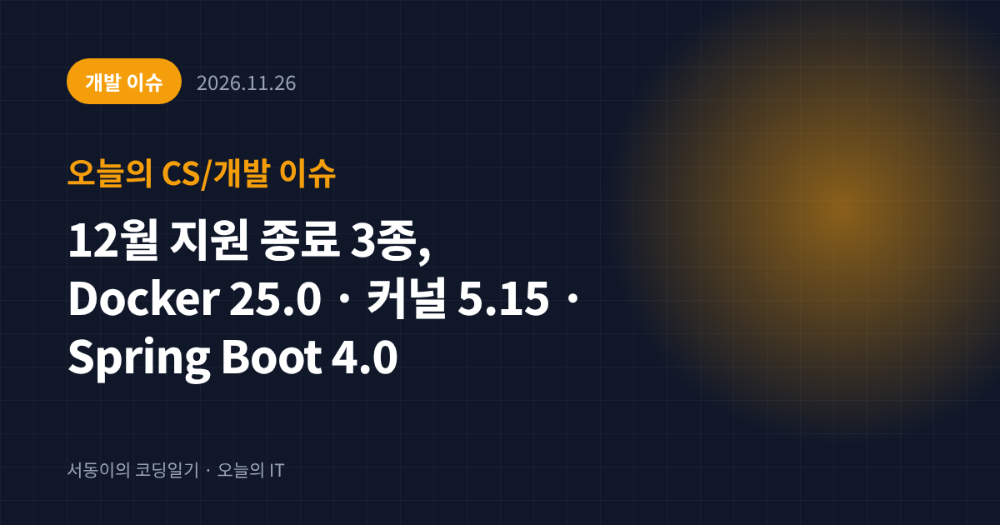

# 오늘의 CS/개발 이슈 (2026.11.26) - 12월 지원 종료 3종: Docker Engine 25.0, 리눅스 커널 5.15, Spring Boot 4.0

> 🛠️ **개발 이슈** · 2026-11-26 · 📝 [티스토리에서 보기](https://dongseodong.tistory.com/70)



12월은 지원 종료가 몰리는 달입니다. 이번 글은 그중에서도 **서버 한 대가 통째로 걸리는 세 가지** 를 다룹니다. 12월 4일 보안 지원이 끝나는 Docker Engine 25.0, 12월에 수명이 끝나는 리눅스 커널 5.10·5.15, 12월 31일 오픈소스 지원이 끝나는 Spring Boot 4.0입니다. 날짜는 endoflife.date와 kernel.org, Docker 공식 릴리스 노트를 2026년 11월 26일에 확인한 기준입니다.

TL;DR · 한눈에 보기

1 **Docker Engine 25.0** 은 2026년 12월 4일 보안 지원이 끝납니다. 현재 지원 중인 줄기는 29 하나이고, 최신 버전은 11월 24일 나온 **29.10.1** 입니다.

2 리눅스 커널 **5.10·5.15 LTS** 는 kernel.org 기준 2026년 12월에 수명이 끝납니다. 다음 LTS는 6.1·6.6(2027년 12월)과 6.12·6.18(2028년 12월)입니다.

3 **Spring Boot 4.0** 은 2026년 12월 31일 오픈소스 지원이 끝납니다. 11월 19일 나온 4.2.0으로 가면 2027년 12월 31일까지 지원됩니다.

목차

[1. Docker Engine 25.0 보안 지원 종료 (12/4)](#s1)

[2. 리눅스 커널 5.10·5.15 LTS 종료 (12월)](#s2)

[3. Spring Boot 4.0 오픈소스 지원 종료 (12/31)](#s3)

[4. 12월 지원 종료 달력](#s4)

[자주 묻는 질문](#s-faq)

[정리](#s-sum)

## 01 Docker Engine 25.0 보안 지원 종료 (12/4)

**핵심:** 2024년 1월 19일 나온 Docker Engine 25.0은 2026년 12월 4일 보안 지원이 끝납니다. 마지막 패치는 9월 30일의 25.0.18이며, 그 뒤로는 취약점이 나와도 고쳐지지 않습니다.

### 지금 지원되는 버전

| 줄기    | 상태                 | 최신 버전 (날짜)     |
|---------|----------------------|----------------------|
| 29      | 보안 지원 중         | 29.10.1 (2026-11-24) |
| 28      | 2026-05-13 종료      | \-                   |
| 25.0    | 2026-12-04 종료 예정 | 25.0.18 (2026-09-30) |
| 27 이하 | 종료                 | \-                   |

endoflife.date 표를 보면 현재 보안 지원을 받는 Docker Engine 줄기는 **29 하나** 입니다. 25.0은 오래 쓰도록 길게 지원된 줄기였기 때문에, 서버를 처음 세팅한 뒤 그대로 둔 곳에 많이 남아 있습니다.

### 왜 컨테이너 엔진은 특히 챙겨야 할까

컨테이너 엔진은 **호스트 root 권한으로 도는 데몬** 입니다. 컨테이너 탈출이나 권한 상승 취약점이 엔진 쪽에서 나오면, 컨테이너 안이 아니라 서버 전체가 위험해집니다. isitpatched.com은 25.0 줄기에 "실제 악용된 취약점" 표시를 붙여 두었습니다.

### 대응 방안: 버전 확인부터 업그레이드까지

STEP 1

서버마다 엔진 버전 확인

STEP 2

설정·스토리지 드라이버 백업

STEP 3

29.x로 업그레이드

STEP 4

컨테이너 재기동 후 확인

▶ 1단계: 엔진 버전 확인

```
docker version --format '{{.Server.Version}}'
# 25.0.x 가 나오면 12월 4일 이후 보안 패치가 없습니다
```

▶ 2단계: Ubuntu/Debian에서 공식 저장소로 업그레이드

```
# 설정 백업
sudo cp /etc/docker/daemon.json ~/daemon.json.bak 2>/dev/null

sudo apt-get update
sudo apt-get install --only-upgrade \
  docker-ce docker-ce-cli containerd.io docker-buildx-plugin docker-compose-plugin

docker version --format '{{.Server.Version}}'   # 29.x 확인
sudo systemctl status docker --no-pager
```

⚠ 주의

25에서 29로 한 번에 넘어가면 그사이 바뀐 기본값이 함께 들어옵니다. 운영 서버라면 스테이징에서 **docker compose up** 까지 한 번 돌려 본 뒤 올리는 것이 안전합니다.

[출처 · endoflife.date · Docker Engine ↗](https://endoflife.date/docker-engine) [출처 · Docker 릴리스 노트 ↗](https://docs.docker.com/engine/release-notes/)

------------------------------------------------------------------------

## 02 리눅스 커널 5.10·5.15 LTS 종료 (12월)

**핵심:** kernel.org는 5.10(2020년 12월 출시)과 5.15(2021년 10월 출시) 장기 지원 커널의 예상 종료 시점을 2026년 12월로 적어 두었습니다. 이후 업스트림 보안 패치는 6.x LTS에만 들어갑니다.

| LTS 커널 | 출시       | 예상 종료   |
|----------|------------|-------------|
| 5.10     | 2020-12-13 | 2026년 12월 |
| 5.15     | 2021-10-31 | 2026년 12월 |
| 6.1      | 2022-12    | 2027년 12월 |
| 6.6      | 2023-10    | 2027년 12월 |
| 6.12     | 2024-11    | 2028년 12월 |
| 6.18     | 2025-11    | 2028년 12월 |

### 누가 영향을 받나

배포판 기본 커널은 배포판이 따로 관리하는 경우가 많습니다. 예를 들어 Ubuntu 22.04는 5.15를 쓰지만 Canonical이 자체적으로 보안 패치를 이어 갑니다. 문제가 되는 곳은 **업스트림 LTS 커널을 직접 빌드해 쓰는 장비** 입니다. 임베디드 보드, 라우터, 자체 빌드 커널을 쓰는 클라우드 이미지가 대표적입니다.

| 환경                          | 영향                                           |
|-------------------------------|------------------------------------------------|
| Ubuntu 22.04 (5.15 기본 커널) | Canonical 지원 기간 동안은 배포판 패치로 유지  |
| Debian 11 (5.10)              | Debian LTS 일정에 따름                         |
| 직접 빌드한 5.10/5.15 커널    | 12월 이후 업스트림 패치 없음 → 6.x로 이전 필요 |
| Android·임베디드 BSP          | 칩 제조사 BSP 일정 확인 필요                   |

▶ 내 서버 커널과 배포판 확인

```
uname -r                      # 예: 5.15.0-xxx-generic
cat /etc/os-release | head -3

# Ubuntu 22.04라면 HWE 커널(6.x)로 올릴 수 있습니다
sudo apt-get install --install-recommends linux-generic-hwe-22.04
sudo reboot
```

💡 왜 중요할까

커널은 업데이트하려면 재부팅이 필요해 미루기 가장 쉬운 부품입니다. 직접 빌드한 커널이 5.10·5.15에 머물러 있다면, 12월 이후 나오는 커널 CVE는 스스로 백포트해야 합니다. 지금 6.12나 6.18로 옮기면 2028년 12월까지 업스트림 지원을 받을 수 있습니다.

[출처 · kernel.org · Releases ↗](https://www.kernel.org/category/releases.html)

------------------------------------------------------------------------

## 03 Spring Boot 4.0 오픈소스 지원 종료 (12/31)

**핵심:** 2025년 11월 30일 나온 Spring Boot 4.0은 2026년 12월 31일 오픈소스 지원이 끝납니다. 상용 지원은 2027년 12월 31일까지입니다. 4.0의 마지막 버전은 11월 19일의 4.0.10입니다.

| 버전 | OSS 지원 종료 | 상용 지원 종료 | 최신               |
|------|---------------|----------------|--------------------|
| 4.0  | 2026-12-31    | 2027-12-31     | 4.0.10             |
| 4.1  | 2027-07-31    | 2028-07-31     | 4.1.3              |
| 4.2  | 2027-12-31    | 2028-12-31     | 4.2.0 (2026-11-19) |

Spring Boot는 마이너 버전마다 지원 기간이 정해져 있습니다. 같은 4.x 안에서 올라가는 것이라 메이저 업그레이드보다 부담이 작습니다. 4.0에서 4.2로 바로 가도 되고, 변경이 걱정되면 4.1을 거쳐도 됩니다.

▶ Gradle: 플러그인 버전만 바꾸기 (build.gradle)

```
plugins {
    id 'org.springframework.boot' version '4.2.0'   // 4.0.x → 4.2.0
    id 'io.spring.dependency-management' version '1.1.7'
}
```

▶ Maven: parent 버전 바꾸기 (pom.xml)

```
<parent>
    <groupId>org.springframework.boot</groupId>
    <artifactId>spring-boot-starter-parent</artifactId>
    <version>4.2.0</version>
</parent>
```

▶ 올린 뒤 확인

```
./gradlew dependencies --configuration runtimeClasspath | grep spring-boot | head
./gradlew test
```

💡 팁

업그레이드 전에 4.1, 4.2 릴리스 노트의 "Deprecations" 항목을 먼저 보십시오. 4.0에서 deprecated 경고가 뜨던 API는 이후 버전에서 제거될 수 있습니다.

[출처 · endoflife.date · Spring Boot ↗](https://endoflife.date/spring-boot) [출처 · spring.io · Spring Boot ↗](https://spring.io/projects/spring-boot#support)

------------------------------------------------------------------------

## 04 12월 지원 종료 달력

**핵심:** 위 세 가지 외에도 12월에는 지원 종료가 줄줄이 있습니다. 아래 날짜는 endoflife.date와 isitpatched.com 기준입니다.

| 날짜  | 대상                  | 다음 버전          |
|-------|-----------------------|--------------------|
| 11/28 | Angular 20 LTS        | 21 이상            |
| 12/1  | Redis 8.0 보안 지원   | 8.12 (최신 8.12.0) |
| 12/1  | Fedora 43             | 44, 45             |
| 12/4  | Docker Engine 25.0    | 29.10.1            |
| 12/16 | Drupal 10.6·11.3      | 최신 마이너        |
| 12/17 | GitLab 19.4           | 최신 마이너        |
| 12월  | Linux 5.10·5.15 LTS   | 6.12, 6.18         |
| 12/31 | Spring Boot 4.0 (OSS) | 4.2.0              |
| 12/31 | PHP 8.2 보안 지원     | 8.4 이상           |

[출처 · endoflife.date · Redis ↗](https://endoflife.date/redis) [출처 · endoflife.date · Fedora ↗](https://endoflife.date/fedora) [출처 · isitpatched · EOL 달력 ↗](https://isitpatched.com/eol)

## 자주 묻는 질문

### Q. Docker Engine 25.0 지원은 언제 끝나나요?

endoflife.date 기준 Docker Engine 25.0의 보안 지원은 2026년 12월 4일 끝납니다. 마지막 패치는 2026년 9월 30일의 25.0.18입니다. 현재 보안 지원을 받는 줄기는 29이며, 최신 버전은 2026년 11월 24일 나온 29.10.1입니다.

### Q. Ubuntu 22.04를 쓰는데 커널 5.15 종료 영향을 받나요?

kernel.org 기준 업스트림 5.15 LTS는 2026년 12월 종료 예정이지만, Ubuntu 22.04의 기본 커널은 Canonical이 별도로 보안 패치를 제공합니다. 영향이 큰 쪽은 업스트림 5.10·5.15 커널을 직접 빌드해 쓰는 장비입니다. 이런 장비는 6.12나 6.18 LTS(2028년 12월까지)로 옮기는 것이 좋습니다.

### Q. Spring Boot 4.0에서 어느 버전으로 가야 하나요?

Spring Boot 4.0의 오픈소스 지원은 2026년 12월 31일 끝납니다. 2026년 11월 19일 나온 4.2.0은 2027년 12월 31일까지 오픈소스 지원을 받으므로, 지원 기간이 가장 깁니다.

## 정리

**Docker Engine 25.0:** 12월 4일 보안 지원 종료. 지원 줄기는 29 하나, 최신 29.10.1.

**Linux 5.10·5.15:** 2026년 12월 업스트림 LTS 종료. 직접 빌드한 커널이라면 6.12·6.18로 이전.

**Spring Boot 4.0:** 12월 31일 OSS 지원 종료. 4.2.0은 2027년 말까지 지원.

✦ 지금 해볼 것

☐ docker version으로 서버마다 엔진 버전 확인하기

☐ uname -r로 직접 빌드한 5.10·5.15 커널이 있는지 찾기

☐ Spring Boot 프로젝트의 플러그인/parent 버전을 4.2.0으로 올려 테스트 돌리기

**참고 링크** : [endoflife.date Docker Engine](https://endoflife.date/docker-engine) · [Docker Engine 릴리스 노트](https://docs.docker.com/engine/release-notes/) · [kernel.org Releases](https://www.kernel.org/category/releases.html) · [endoflife.date Spring Boot](https://endoflife.date/spring-boot) · [isitpatched EOL 달력](https://isitpatched.com/eol)

---

`#개발이슈` `#EOL` `#지원종료` `#Docker` `#컨테이너` `#리눅스커널` `#LTS` `#SpringBoot` `#업그레이드` `#보안패치`
