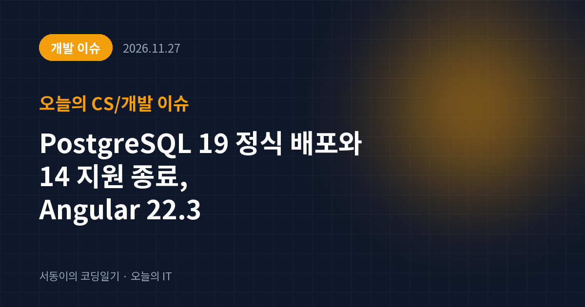

# 오늘의 CS/개발 이슈 (2026.11.27) - PostgreSQL 19 정식 배포와 14 지원 종료, Angular 22.3

> 🛠️ **개발 이슈** · 2026-11-27 · 📝 [티스토리에서 보기](https://dongseodong.tistory.com/71)



이번 주 개발 쪽에서 가장 무게가 있는 소식은 데이터베이스와 프런트엔드 양쪽에서 하나씩 나왔습니다. PostgreSQL 19가 정식 배포됐고, 같은 주에 PostgreSQL 14가 지원 종료를 맞았습니다. 프런트엔드에서는 Angular 22.3이 나오면서 Rust로 일부를 다시 쓴 새 컴파일러와 새 라이브러리 빌더가 들어왔습니다.

TL;DR · 한눈에 보기

1 **PostgreSQL 19** 가 2026년 11월 19일 정식 배포됐습니다. **REPACK (CONCURRENTLY)** 가 추가돼 테이블을 잠그지 않고 재구성할 수 있고, 오토배큠이 병렬로 돌며, JIT는 기본값이 꺼짐으로 바뀌었습니다.

2 **PostgreSQL 14** 는 2026년 11월 12일 마지막 마이너 버전 14.25를 끝으로 **지원이 종료됐습니다** . 이제 보안 패치가 나오지 않습니다.

3 **Angular 22.3** 이 2026년 11월 18일 공개됐습니다. Rust로 일부를 작성한 새 컴파일러 **ngp** , 새 라이브러리 빌더(증분 재빌드 약 2~4배), 라우터 에러 바운더리가 들어갔습니다.

목차

[1. PostgreSQL 19 정식 배포 - REPACK과 오토배큠 병렬화](#s1)

[2. PostgreSQL 14 지원 종료 - 11월 12일부로 패치 없음](#s2)

[3. Angular 22.3 - Rust 컴파일러 ngp와 새 라이브러리 빌더](#s3)

[정리](#s-sum)

[자주 묻는 질문](#s-faq)

## 1. PostgreSQL 19 정식 배포, REPACK과 오토배큠 병렬화

**PostgreSQL 19는 2026년 11월 19일 "PostgreSQL 19 Released!" 공지와 함께 정식 배포됐습니다.** 운영에서 체감이 큰 변화는 테이블 재구성을 잠금 없이 하는 새 명령 `REPACK (CONCURRENTLY)`, 병렬로 도는 오토배큠, 그리고 기본값이 바뀐 몇 가지 설정입니다.

### 잠그지 않고 테이블을 재구성하는 REPACK

기존에는 부풀어 오른 테이블을 정리하려면 `VACUUM FULL`이나 `CLUSTER`를 썼고, 둘 다 테이블 전체에 배타 잠금을 걸었습니다. 운영 중에는 사실상 쓰기 어려워 `pg_repack` 같은 외부 확장을 쓰는 경우가 많았습니다. 19부터는 `REPACK`이 코어에 들어왔습니다. 공지는 `REPACK`이 두 명령을 대체하며, 기존 두 명령도 호환을 위해 그대로 남는다고 밝혔습니다.

▶ REPACK로 테이블 재구성하기 (PostgreSQL 19)

```
-- 배타 잠금 없이 재구성 (운영 중 실행 가능)
REPACK (CONCURRENTLY) public.orders;

-- 인덱스 순서대로 물리 정렬까지 하고 싶을 때
REPACK (CONCURRENTLY) public.orders USING INDEX orders_created_at_idx;

-- 부풀어 오른 정도부터 확인
SELECT relname,
       n_dead_tup,
       pg_size_pretty(pg_total_relation_size(relid)) AS total
FROM pg_stat_user_tables
ORDER BY n_dead_tup DESC
LIMIT 10;
```

### 오토배큠 병렬 처리와 새 모니터링 뷰

오토배큠에는 `autovacuum_max_parallel_workers` 설정이 생겼고, 어떤 테이블을 먼저 처리할지 고르는 점수 체계가 들어갔습니다. 점수는 새 뷰 `pg_stat_autovacuum_scores`로 확인합니다. 잠금 상태를 보는 `pg_stat_lock`, 복구 상태를 보는 `pg_stat_recovery` 뷰도 추가됐습니다.

▶ 오토배큠 병렬 워커 설정과 점수 확인

```
-- postgresql.conf
autovacuum_max_parallel_workers = 4

-- 적용
SELECT pg_reload_conf();

-- 어떤 테이블이 먼저 처리될지 점수로 확인
SELECT * FROM pg_stat_autovacuum_scores ORDER BY score DESC LIMIT 10;

-- 현재 잠금 현황
SELECT * FROM pg_stat_lock;
```

### 기본값이 바뀐 항목

| 항목 | 19에서의 변화 | 영향 |
|----|----|----|
| `JIT` | 기본값 꺼짐 | 짧은 쿼리가 많은 서비스에서 계획 시간이 줄어듭니다. 장시간 분석 쿼리는 다시 켜는 편이 나을 수 있습니다. |
| `io_workers` | `io_min_workers` / `io_max_workers`로 대체 | 기존 설정을 그대로 두면 시작 시 오류가 날 수 있어 교체가 필요합니다. |
| TOAST 압축 | LZ4로 빌드된 경우 기본값 `lz4` | 압축/해제가 빨라지지만 압축률은 pglz보다 낮을 수 있습니다. |
| RADIUS 인증 | 제거됨 | RADIUS를 쓰던 환경은 19로 올리기 전에 인증 방식을 바꿔야 합니다. |
| `effective_wal_level` | 신규 | 첫 논리 복제 슬롯을 만들면 WAL 수준이 자동으로 `logical`로 올라갑니다. |

### 쿼리 성능과 복제

공지가 제시한 성능 수치는 하나입니다. 외래 키 검사 개선으로 **대량 INSERT가 테스트에서 거의 2배 빨라졌습니다** 고 적었습니다. 그 밖에 NULL이 없는 경우 `NOT IN`을 안티 조인으로 바꾸는 변환, 조인 전에 집계를 먼저 수행하는 eager aggregation이 들어갔습니다. 논리 복제 쪽은 `CREATE PUBLICATION`의 `FOR ALL SEQUENCES`와 `EXCEPT` 절, 구독 옵션 `retain_dead_tuples`가 추가됐습니다. 스탠바이에서 자기 쓰기를 바로 읽기 위한 `WAIT FOR LSN` 명령도 새로 생겼습니다.

▶ EXPLAIN의 새 IO 옵션으로 실제 I/O 확인하기

```
EXPLAIN (ANALYZE, BUFFERS, IO, WAL)
SELECT o.id, o.total
FROM orders o
JOIN users u ON u.id = o.user_id
WHERE o.created_at >= now() - interval '7 days';

-- auto_explain 쪽에도 같은 IO 옵션이 생겼다
-- postgresql.conf
-- auto_explain.log_io = on
```

💡 왜 중요할까

PostgreSQL 19는 "운영 중에 못 하던 일"을 코어로 가져온 버전입니다. `REPACK (CONCURRENTLY)`로 외부 확장 없이 테이블을 재구성할 수 있고, 오토배큠이 병렬로 돌면서 대형 테이블이 밀리는 상황이 줄어듭니다. 다만 JIT 기본값 변경, `io_workers` 제거, RADIUS 인증 제거처럼 설정 파일을 건드려야 하는 항목이 함께 있어 그대로 올리면 기동에서 막힐 수 있습니다.

[출처 · PostgreSQL 19 Released! ↗](https://www.postgresql.org/about/news/postgresql-19-released-3449/) [출처 · PostgreSQL 19 Release Notes ↗](https://www.postgresql.org/docs/19/release-19.html)

## 2. PostgreSQL 14 지원 종료, 11월 12일부로 패치 없음

**PostgreSQL 14는 2026년 11월 12일 마지막 마이너 버전 14.25를 끝으로 지원이 종료됐습니다.** PostgreSQL 글로벌 개발 그룹은 메이저 버전을 최초 릴리스 후 5년간 지원하고, 그 뒤 마지막 마이너 버전을 내고 지원을 끝낸다고 정책에 밝히고 있습니다. 14는 2021년 9월 30일에 나왔으니 정확히 5년을 채운 셈입니다.

| 버전 | 현재 마이너 | 지원    | 최초 릴리스 | 마지막 릴리스 |
|------|-------------|---------|-------------|---------------|
| 19   | 19.0        | ✅      | 2026-11-19  | 2031-11-19    |
| 18   | 18.7        | ✅      | 2025-09-25  | 2030-11-14    |
| 17   | 17.12       | ✅      | 2024-09-26  | 2029-11-08    |
| 16   | 16.16       | ✅      | 2023-09-14  | 2028-11-09    |
| 15   | 15.20       | ✅      | 2022-10-13  | 2027-11-11    |
| 14   | 14.25       | ❌ 종료 | 2021-09-30  | 2026-11-12    |
| 13   | 13.23       | ❌ 종료 | 2020-09-24  | 2025-11-13    |

지원 종료는 기능이 멈춘다는 뜻이 아니라 **보안 패치가 더 나오지 않습니다** 는 뜻입니다. 14를 쓰고 있다면 지금부터 발견되는 취약점은 공식 패치를 받지 못합니다. 내년 11월 11일에는 15가 같은 상태가 되므로, 올릴 거라면 17이나 18처럼 지원 기간이 긴 쪽을 목표로 잡는 편이 낫습니다.

▶ 현재 버전 확인과 pg_upgrade 사전 점검

```
# 지금 돌고 있는 버전
psql -XtAc "SHOW server_version"

# 업그레이드 전 호환성만 먼저 검사 (--check는 데이터를 바꾸지 않는다)
/usr/lib/postgresql/18/bin/pg_upgrade \
  --old-datadir=/var/lib/postgresql/14/main \
  --new-datadir=/var/lib/postgresql/18/main \
  --old-bindir=/usr/lib/postgresql/14/bin \
  --new-bindir=/usr/lib/postgresql/18/bin \
  --check

# 확장 버전도 같이 확인해 둔다
psql -XtAc "SELECT name, default_version, installed_version
            FROM pg_available_extensions
            WHERE installed_version IS NOT NULL"
```

📌 알아둘 점

메이저 업그레이드 뒤에는 통계가 비어 있어 실행 계획이 나빠질 수 있습니다. `pg_upgrade` 직후 `vacuumdb --all --analyze-in-stages`를 돌려 통계부터 다시 만드는 편이 안전합니다. 다운타임을 줄여야 한다면 `pg_upgrade --link`나 논리 복제를 이용한 전환을 검토합니다.

[출처 · PostgreSQL Versioning Policy ↗](https://www.postgresql.org/support/versioning/)

## 3. Angular 22.3, Rust 컴파일러 ngp와 새 라이브러리 빌더

**Angular 22.3.0이 2026년 11월 18일 공개됐습니다.** v22 사이클의 세 번째 마이너 버전이고, 빌드 속도와 템플릿 검사 쪽 변화가 눈에 띕니다.

### 일부를 Rust로 다시 쓴 컴파일러 ngp

빌드와 재빌드를 빠르게 하는 것을 목표로 일부를 Rust로 작성한 새 컴파일러 `ngp`가 들어갔습니다. 다만 `ngp`는 템플릿 검사에 TypeScript 타입 검사기를 쓰지 않습니다. 그래서 호출되지 않은 함수나 시그널을 잡아 주던 일부 템플릿 경고는 `ngp`에서 나오지 않습니다. 속도를 얻는 대신 검사 범위가 줄어드는 교환이라, 기존 경고에 의존하던 프로젝트라면 먼저 확인이 필요합니다.

### 새 라이브러리 빌더: 증분 재빌드 약 2~4배

라이브러리 빌드가 `ng-packagr`에서 `@angular/build:library`로 바뀝니다. 새로 만드는 라이브러리는 이미 이 빌더가 기본값이고, 기존 라이브러리는 마이그레이션 스키매틱으로 옮길 수 있습니다. Ninja Squad의 정리에 따르면 증분 재빌드가 **대략 2~4배 빨라졌습니다** . 기존 `@angular/build:ng-packagr` 빌더는 더 이상 권장되지 않으며 경고를 띄웁니다.

▶ 새 라이브러리 빌더로 옮기고 서브 엔트리 포인트 만들기

```
# 기존 라이브러리를 새 빌더로 마이그레이션
ng update @angular/cli --migrate-only --name=use-library-builder

# 새 빌더를 쓰는 라이브러리에서만 동작하는 서브 엔트리 포인트 생성
ng generate entry-point testing --project=my-lib
# -> my-lib/testing 으로 import 가능
```

### 새 템플릿 검사 플래그 두 가지

템플릿에서 조용히 넘어가던 실수를 잡는 플래그가 두 개 생겼습니다. 둘 다 22.3에서는 기본값이 꺼짐이고, `strictUnknownElements`는 v23에서, `strictNgTemplateTypes`는 다음 메이저에서 기본값이 켜짐으로 바뀔 예정입니다. 기본값이 바뀌기 전에 미리 켜서 오류를 털어 두는 편이 낫습니다.

| 플래그 | 잡아 주는 것 | 오류 코드 |
|----|----|----|
| `strictUnknownElements` | 속성 디렉티브에 매칭돼 조용히 통과하던 알 수 없는 엘리먼트. 예를 들어 컴포넌트를 `imports`에 넣지 않은 채 쓴 `<custom-color-picker formControlName="color" />` | `NG8001` |
| `strictNgTemplateTypes` | `<ng-template>`의 알 수 없는 프로퍼티 바인딩. 예를 들어 오타가 난 `[ngTemplateOutet]` | `NG8002` |
| `numericCssPropertyRequiresUnit` | 단위가 빠진 숫자 스타일 바인딩. 예를 들어 `<div [style.height]="200">`. `strictTemplates`가 켜져 있으면 기본으로 동작합니다. | `NG8119` |

▶ tsconfig.json에서 새 검사 플래그 미리 켜기

```
{
  "angularCompilerOptions": {
    "strictTemplates": true,
    "strictUnknownElements": true,
    "strictNgTemplateTypes": true
  }
}
```

### 라우터 에러 바운더리와 HttpClient QUERY

라우터에 에러 바운더리가 개발자 프리뷰로 들어왔습니다. `provideRouter`에 `withErrorBoundaries()`를 넣고 라우트마다 `errorComponent`를 지정하면, 컴포넌트 생성과 렌더링 중에 난 오류를 대체 컴포넌트로 받아낼 수 있습니다. 실패한 리소스 읽기도 여기에 포함됩니다. 다만 가드나 리졸버에서 난 내비게이션 오류는 처리하지 않습니다. 또 `HttpClient`가 QUERY 메서드를 지원해 본문이 있는 조회 요청을 보낼 수 있고, 이 요청은 GET·HEAD처럼 기본적으로 SSR 전송 캐시 대상이 됩니다.

▶ 라우터 에러 바운더리와 QUERY 요청

```
// main.ts
provideRouter(
  routes,
  withErrorBoundaries({
    defaultErrorComponent: GenericErrorFallback,
    onError: (error, details) => console.error(error, details),
  }),
);

// routes.ts
export const routes: Routes = [
  { path: 'users/:id', component: UserComponent, errorComponent: UserErrorFallback },
];

// 본문이 있는 조회 요청 (QUERY)
const users = this.http.query<Array<UserModel>>('/api/users/search', {
  roles: ['admin'],
  active: true,
});
```

📌 알아둘 점

22.3에서는 미완성 프로토타입이던 시그널 컴포넌트(`signals: true`)와 셀렉터리스 컴포넌트가 제거됐습니다. Ninja Squad는 둘 다 지원되는 기능이 아니었다고 적었습니다. 또 애플리케이션과 라이브러리를 생성할 때 쓰던 `--test-runner` 옵션이 더 이상 권장되지 않습니다. Karma는 아직 고를 수 있지만, 앞으로 새 프로젝트는 Vitest로만 구성될 예정입니다.

[출처 · Angular v22.3.0 릴리스 ↗](https://github.com/angular/angular/releases/tag/v22.3.0) [출처 · Ninja Squad · What is new in Angular 22.3 ↗](https://blog.ninja-squad.com/2026/11/18/what-is-new-angular-22.3)

## 정리

**PostgreSQL 19:** 2026년 11월 19일 정식 배포. REPACK (CONCURRENTLY), 오토배큠 병렬 워커, JIT 기본 꺼짐, io_workers 제거, RADIUS 인증 제거.

**PostgreSQL 14:** 2026년 11월 12일 14.25를 끝으로 지원 종료. 보안 패치 없음. 15는 2027년 11월 11일이 마지막입니다.

**Angular 22.3:** 2026년 11월 18일 공개. Rust 기반 ngp 컴파일러, 새 라이브러리 빌더(증분 재빌드 약 2~4배), 템플릿 검사 플래그 2종, 라우터 에러 바운더리.

✦ 지금 해볼 것

☐ PostgreSQL 14를 쓰고 있다면 pg_upgrade --check부터 돌려 호환성을 확인하기

☐ 19로 올릴 계획이라면 io_workers, JIT, RADIUS 설정이 있는지 postgresql.conf 훑어보기

☐ Angular 프로젝트에 strictUnknownElements와 strictNgTemplateTypes를 미리 켜고 오류 수 세어 보기

## 자주 묻는 질문

### Q. PostgreSQL 19의 REPACK은 기존 VACUUM FULL과 무엇이 다른가?

REPACK (CONCURRENTLY)는 테이블에 배타 잠금을 걸지 않고 재구성합니다. 2026년 11월 19일 PostgreSQL 19 공지는 REPACK이 VACUUM FULL과 CLUSTER를 대체하며, 두 명령은 호환을 위해 그대로 남는다고 밝혔습니다. 운영 중에 쓸 수 있다는 점이 가장 큰 차이입니다.

### Q. PostgreSQL 14를 지금 꼭 올려야 하나?

PostgreSQL 14는 2026년 11월 12일 14.25를 끝으로 지원이 종료됐습니다. 동작은 계속하지만 이후 발견되는 취약점에 대한 공식 보안 패치가 나오지 않습니다. 15도 2027년 11월 11일이 마지막 릴리스로 예정돼 있어, 올린다면 17이나 18처럼 지원 기간이 더 남은 버전을 목표로 잡는 편이 낫습니다.

### Q. Angular 22.3의 새 컴파일러 ngp를 바로 써도 되나?

ngp는 일부를 Rust로 작성해 빌드와 재빌드 속도를 노린 컴파일러입니다. 다만 템플릿 검사에 TypeScript 타입 검사기를 쓰지 않아, 호출되지 않은 함수나 시그널을 잡아 주던 일부 템플릿 경고가 나오지 않습니다. 그 경고에 의존해 온 프로젝트라면 먼저 확인한 뒤 적용하는 편이 안전합니다.

**참고 링크:** [PostgreSQL 19 Released!](https://www.postgresql.org/about/news/postgresql-19-released-3449/) · [PostgreSQL Versioning Policy](https://www.postgresql.org/support/versioning/) · [Angular v22.3.0](https://github.com/angular/angular/releases/tag/v22.3.0) · [Ninja Squad · Angular 22.3](https://blog.ninja-squad.com/2026/11/18/what-is-new-angular-22.3)

---

`#개발이슈` `#PostgreSQL` `#PostgreSQL19` `#REPACK` `#오토배큠` `#EOL` `#지원종료` `#Angular` `#Angular22` `#프런트엔드`
