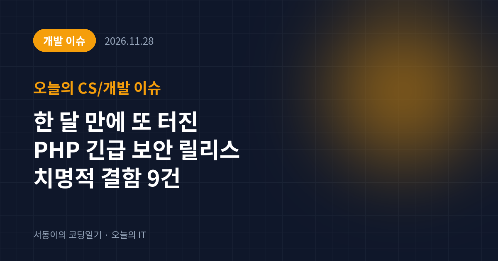

# PHP 긴급 보안 릴리스 (2026.11.19) - 한 달 만에 또, 세션과 FPM을 노린 치명적 결함 9건

> 🛠️ **개발 이슈** · 2026-11-28 · 📝 [티스토리에서 보기](https://dongseodong.tistory.com/72)



PHP가 2026년 11월 19일에 긴급 보안 릴리스를 내놓았습니다. 10월 21일 릴리스에서 심각도 9.2점짜리 결함 두 건을 막은 지 한 달 만입니다. 이번에는 결함이 아홉 건이고, 그중 일곱 건이 CVSS 9.2점으로 분류됐습니다. 지원 중인 모든 버전이 영향을 받고, 문제가 된 코드 가운데 일부는 PHP 4.1 시절부터 그대로 남아 있던 것입니다. 무엇이 뚫렸고 무엇을 지금 해야 하는지 공식 권고를 기준으로 정리했습니다.

TL;DR · 한눈에 보기

1 PHP가 **11월 19일 8.2.36 / 8.3.37 / 8.4.28 / 8.5.13** 을 배포했습니다. 같은 날 정식 공개된 **8.6.0** 에도 같은 수정이 들어갔습니다.

2 아홉 건 중 **일곱 건이 CVSS 9.2** 입니다. 세션 처리 두 건과 PHP-FPM 요청 스머글링은 **원격 코드 실행** 까지 이어질 수 있습니다.

3 세션 파일 결함(CVE-2026-126714)의 문제 코드는 **PHP 4.1.0** 부터, FPM 스머글링(CVE-2026-129289)은 **PHP 5.6.0** 부터 들어 있었습니다.

4 바로 올릴 수 없다면 **session.upload_progress.enabled=0** , 프런트엔드의 **FastCGI 연결 재사용 끄기** , **zend.exception_ignore_args=1** 이 공식 권고에 적힌 완화책입니다.

5 PHP 8.2는 **2026년 12월 31일** 에 지원이 끝납니다. 8.2.36이 보안 패치를 받는 마지막 구간입니다.

목차

[1. 한 달 만에 또, 무슨 일이 있었나](#s1)

[2. 아홉 건을 한 표로 보기](#s2)

[3. 세션을 노린 두 건 — 기본 설정에서도 위험합니다](#s3)

[4. PHP-FPM 요청 스머글링 — 프런트엔드 설정이 갈림길입니다](#s4)

[5. 지금 해야 할 일](#s5)

[정리](#s-sum)

[자주 묻는 질문](#s-faq)

[참고 링크](#s-ref)

## 1. 한 달 만에 또, 무슨 일이 있었나

PHP 팀은 11월 18일에 "다음 날 긴급 보안 릴리스를 배포한다"고 미리 공지했고, 예고한 대로 11월 19일 14:00~14:30 UTC(한국 시간 23시 전후)에 네 개 버전을 동시에 내놓았습니다. 공지에는 최고 심각도가 **CRITICAL** 이라고만 적혀 있었고, CVE 번호와 버전은 릴리스 시점에 공개됐습니다.

| 날짜 | 무슨 일 | 내용 |
|----|----|----|
| 2026-10-21 | 직전 보안 릴리스 | CVE-2026-109618, CVE-2026-109619 수정. 8.5.12 / 8.4.27 / 8.3.36 / 8.2.35 배포. 두 건 모두 CVSS v4.0 9.2 |
| 2026-10-23 | 사전 안내 | session.upload_progress 관련 안내를 먼저 공개하고, CVE-2026-115560 전체 권고는 "다음 릴리스와 함께" 공개한다고 예고 |
| 2026-11-18 | 긴급 릴리스 예고 | 11월 19일 14:00~14:30 UTC 배포 예정, 최고 심각도 CRITICAL이라고 공지 |
| 2026-11-19 | 보안 릴리스 | 8.2.36 / 8.3.37 / 8.4.28 / 8.5.13 배포. 모두 "This is a security release"로 표기 |
| 2026-11-19 | PHP 8.6.0 정식 공개 | 같은 날 GA. 변경 목록에 이번 CVE 수정이 함께 들어감 |

10월 릴리스는 국내외에서 **PHP2Shell** 이라는 이름으로 불렸습니다. 안랩 ASEC은 11월 20일 글에서 이번 세션 결함 중 CVE-2026-115560을 두고 일부 업체가 "세 번째 PHP2Shell"이라고 부른다고 적었습니다. 한 달 사이에 비슷한 급의 사건이 반복된 셈입니다.

📌 악용 여부

실제 공격에 쓰였다는 보고는 아직 없습니다. 안랩 ASEC은 11월 19일 기준으로 악용 사례가 보고되지 않았고 미국 CISA의 악용 취약점 목록(KEV)에도 올라가지 않았다고 적었습니다. 다만 연구자가 공개한 재현 방법은 이미 있습니다.

[출처 · php.net 11월 18일 공지 ↗](https://www.php.net/archive/2026.php#2026-11-18-1) [출처 · php.net 11월 19일 릴리스 ↗](https://www.php.net/archive/2026.php#2026-11-19-4) [출처 · 안랩 ASEC ↗](https://asec.ahnlab.com/ko/96689/)

## 2. 아홉 건을 한 표로 보기

이번에 수정된 CVE는 아홉 건입니다. 세션과 PHP-FPM에 몰려 있고, 나머지는 Phar 서명 검증, CGI 메모리 오류, 날짜 처리, DOM 직렬화에 흩어져 있습니다. CVSS 점수는 The Hacker News가 정리한 값입니다. php.net 변경 목록 자체에는 점수가 적혀 있지 않습니다.

| CVE | 구성 요소 | 내용 | CVSS |
|----|----|----|----|
| CVE-2026-115560 | Session | 세션 직렬화 방식 불일치로 원격 코드 실행 가능 | 9.2 |
| CVE-2026-126714 | Session | 세션 파일이 일부만 덮어써져 원격 코드 실행 가능 | 9.2 |
| CVE-2026-129481 | Session | 세션 종료가 중단된 뒤 해제된 메모리 사용 | 9.2 |
| CVE-2026-129289 | FPM | 읽지 않은 요청 본문을 통한 요청 스머글링 | 9.2 |
| CVE-2026-129474 | Core | 매직 메서드 백트레이스의 해제된 메모리 사용, 원격 코드 실행 가능 | 9.2 |
| CVE-2026-129182 | Core | 종료 후 치명적 오류 백트레이스 전역 변수 재설정으로 해제된 메모리 사용 | 9.2 |
| CVE-2026-129496 | Date | 타임존 캐시의 해제된 메모리 사용, 원격 코드 실행 가능 | 9.2 |
| CVE-2026-129291 | FPM | epoll 처리의 해제된 메모리 사용, 로컬 권한 상승 가능 | 8.8 |
| CVE-2026-128090 | Phar | 알고리즘 하향으로 Phar OpenSSL 서명 우회 | 표기 없음 |

같은 릴리스에는 PHP-CGI의 PATH_INFO 처리 오류(CVE-2026-129538), DOM 직렬화 이중 해제(CVE-2026-129501), FPM 상태 페이지의 XSS(CVE-2026-129292), SOAP과 URI 관련 수정도 함께 들어갔습니다. 위 표는 심각도가 높은 아홉 건만 추린 것입니다.

💡 왜 중요할까

아홉 건 가운데 여섯 건이 해제된 메모리를 다시 쓰는 종류입니다. 이런 결함은 공격 조건이 까다로운 대신, 성공하면 웹 서버 권한으로 임의 코드가 실행됩니다. 세션 두 건과 FPM 스머글링은 공격자가 외부에서 조건을 만들 수 있다는 점에서 특히 무게가 다릅니다.

[출처 · php.net 변경 목록 ↗](https://www.php.net/ChangeLog-8.php) [출처 · The Hacker News ↗](https://thehackernews.com/2026/11/php-fixes-7-critical-flaws-including.html)

## 3. 세션을 노린 두 건 — 기본 설정에서도 위험합니다

세션 관련 두 건은 PHP가 세션을 파일로 저장하는 방식 자체를 건드립니다. 특별한 확장이나 비표준 설정이 없어도 조건이 맞으면 성립한다는 점이 핵심입니다.

### CVE-2026-115560 — 세션 직렬화 방식 불일치

세션 업로드 진행률 기능이 켜져 있으면, 그 기능은 한쪽 직렬화 방식으로 세션 데이터를 쓰고 나중에 그 파일을 읽는 쪽은 다른 방식으로 해석할 수 있습니다. 공식 권고는 이때 읽는 쪽이 **키의 일부를 직렬화된 객체로 잘못 파싱** 할 수 있다고 적었습니다. 코드 실행까지 가려면 애플리케이션 안에 악용할 수 있는 클래스 연결고리가 필요합니다.

| 항목 | 내용 |
|----|----|
| 영향 버전 | 8.2.36 미만, 8.3.0 이상 8.3.37 미만, 8.4.0 이상 8.4.28 미만, 8.5.0 이상 8.5.13 미만 |
| 패치 버전 | 8.2.36, 8.3.37, 8.4.28, 8.5.13 |
| 필요 조건 | 세션 업로드 진행률 기능 활성화 + 공격자가 멀티파트 업로드를 보낼 수 있음, 또는 직렬화 핸들러가 서로 다른 설정이 같은 세션 저장소를 공유 |
| 코드 유입 시점 | 해당 기능이 들어온 PHP 5.4.0 |
| 완화책 | session.upload_progress.enabled=0을 관리자 설정으로 적용. 애플리케이션에서 ini_set()으로 끄는 것은 이미 늦습니다 |

⚠ 업데이트만으로 끝나지 않는 부분

공식 권고는 업로드 진행률 기능을 쓸 경우 **업데이트 이후에도** 세션 저장소를 읽고 쓰는 모든 쪽이 같은 session.serialize_handler를 써야 한다고 적었습니다. FPM 풀마다, 가상 호스트마다, CLI 배치 작업마다 설정이 다른 환경이 특히 위험합니다.

### CVE-2026-126714 — 세션 파일이 일부만 덮어써지는 문제

PHP의 기본 세션 저장 방식인 files 핸들러는 새 세션 데이터를 기존 파일에 쓸 때 파일을 먼저 비우지 않습니다. 쓰는 도중에 중단되면 파일에 **새 세션의 앞부분과 예전 세션의 뒷부분** 이 남습니다. 다음에 그 세션을 읽을 때 이 조각이 직렬화된 객체로 해석될 수 있습니다. 공식 권고는 문제 코드가 **PHP 4.1.0** 부터 있었다고 적었습니다.

| 항목 | 내용 |
|----|----|
| 영향 버전 | 8.2.36 미만, 8.3.0 이상 8.3.37 미만, 8.4.0 이상 8.4.28 미만, 8.5.0 이상 8.5.13 미만 |
| 패치 버전 | 8.2.36, 8.3.37, 8.4.28, 8.5.13 |
| 필요 조건 | 세션 데이터에 공격자가 영향을 줄 수 있음 + 쓰기가 적절한 지점에서 중단됨 + 애플리케이션 안의 클래스 연결고리 |
| 완화책 | 쓰지 않는다면 session.upload_progress.enabled 끄기, 세션에 담는 신뢰할 수 없는 데이터 줄이기. 레코드를 원자적으로 교체하는 세션 저장소를 쓰면 이 결함을 피할 수 있습니다 |

권고는 업로드 진행률이 데이터 유입 경로의 하나일 뿐이고 그 기능에만 국한되지 않는다고 적었습니다. 즉 그 기능을 끄는 것만으로는 세션에 외부 입력을 직접 담는 애플리케이션을 지켜 주지 못합니다.

### CVE-2026-129474 — PHP 8.5만 영향받는 백트레이스 결함

`__call()` 또는 `__callStatic()` 호출 중에 백트레이스가 만들어지면 PHP가 해제된 메모리를 읽을 수 있습니다. 권고에 적힌 영향 범위는 **8.5.0 이상 8.5.13 미만** 하나뿐입니다. 8.2~8.4는 원격에서 터뜨리는 방법이 확인되지 않아 범위에서 빠졌습니다.

원격 공격이 성립하려면 치명적 오류가 발생하고 `fatal_error_backtraces=1`과 `zend.exception_ignore_args=0`이 함께 필요합니다. PHP 8.5에서 치명적 오류 백트레이스는 기본값이 켜짐입니다. 다만 `php.ini-production`은 `zend.exception_ignore_args=1`로 설정하고 있어 이 경로를 막습니다. 권고는 `display_errors=0`으로는 백트레이스 생성 자체를 막지 못한다고 적었습니다.

[출처 · GHSA-658j-r8rw-q6mx ↗](https://github.com/php/php-src/security/advisories/GHSA-658j-r8rw-q6mx) [출처 · GHSA-fm2m-fjf5-v3cp ↗](https://github.com/php/php-src/security/advisories/GHSA-fm2m-fjf5-v3cp) [출처 · GHSA-8mjj-2r7p-4hg2 ↗](https://github.com/php/php-src/security/advisories/GHSA-8mjj-2r7p-4hg2)

## 4. PHP-FPM 요청 스머글링 — 프런트엔드 설정이 갈림길입니다

CVE-2026-129289은 이번 아홉 건 가운데 운영 환경의 설정이 피해 여부를 가장 크게 가르는 결함입니다. 공식 권고는 **PHP-FPM 쪽 공격은 PHP의 비기본 설정을 필요로 하지 않는다** 고 적었습니다.

PHP는 지속 연결을 재사용하기 전에 읽지 않은 요청 본문을 버리지 않습니다. 그래서 남은 바이트가 **별개의 FastCGI 요청으로 해석** 될 수 있습니다. 이 요청은 프런트엔드를 거치지 않으므로 인증을 우회하고, 위조한 PHP_ADMIN_VALUE 파라미터로 `allow_url_include`나 `auto_prepend_file`을 켜서 기존 스크립트를 상대로 코드를 실행할 수 있습니다.

| 항목 | 내용 |
|----|----|
| 영향 버전 | 8.2.0 이상 8.2.36 미만, 8.3.0 이상 8.3.37 미만, 8.4.0 이상 8.4.28 미만, 8.5.0 이상 8.5.13 미만 |
| 패치 버전 | 8.2.36, 8.3.37, 8.4.28, 8.5.13 |
| 필요 조건 | 프런트엔드가 백엔드 연결을 재사용(nginx fastcgi_keep_conn on, Apache mod_proxy_fcgi enablereuse=on, HAProxy FastCGI 연결 유지, LSAPI) + php://input을 열고 끝까지 읽지 않는 코드 경로 |
| 코드 유입 시점 | php://input 지연 처리가 들어온 PHP 5.6.0 |
| 완화책 | 프런트엔드의 백엔드 연결 재사용 끄기. php://input을 끝까지 읽는 것은 그 자체만으로는 신뢰할 수 없다고 적혀 있습니다 |

📌 권고에 적힌 추가 사항

권고는 LSAPI도 같은 정리 오류의 영향을 받지만, LSAPI를 통한 코드 실행은 확인되지 않았다고 적었습니다. 또한 PHP-FPM이나 LSAPI 리스너를 신뢰할 수 없는 네트워크에 직접 노출하지 말라고 권고했습니다.

▶ nginx와 Apache에서 연결 재사용 상태 확인

```
# nginx: fastcgi_keep_conn 이 on 으로 켜져 있는지 확인 (기본값은 off)
grep -rn "fastcgi_keep_conn" /etc/nginx/ 2>/dev/null

# Apache: mod_proxy_fcgi 의 enablereuse 설정 확인 (기본값은 off)
grep -rn "enablereuse" /etc/apache2/ /etc/httpd/ 2>/dev/null

# 지속 연결을 쓰고 있다면, 업그레이드 전까지는 끄는 쪽이 공식 권고입니다.
# nginx 예: fastcgi_keep_conn off;
# Apache 예: SetHandler "proxy:unix:/run/php/php-fpm.sock|fcgi://localhost" (enablereuse=on 을 빼기)
```

[출처 · GHSA-qc49-hpvq-g2w6 ↗](https://github.com/php/php-src/security/advisories/GHSA-qc49-hpvq-g2w6)

## 5. 지금 해야 할 일

순서는 간단합니다. 쓰고 있는 버전을 확인하고, 패치 버전으로 올리고, 바로 올릴 수 없다면 권고에 적힌 완화책을 적용하는 것입니다.

STEP 1

쓰는 PHP 버전과 SAPI 확인

STEP 2

패치 버전으로 업그레이드

STEP 3

올릴 수 없으면 완화 설정 적용

STEP 4

워커 재시작 후 반영 확인

▶ 1단계 · 현재 버전과 설정 확인

```
# CLI 와 FPM 의 버전은 다를 수 있으므로 둘 다 봅니다
php -v
php-fpm -v 2>/dev/null || php-fpm8.3 -v 2>/dev/null

# 패치 기준: 8.2.36 / 8.3.37 / 8.4.28 / 8.5.13 이상이면 이번 건은 반영된 버전입니다

# 이번 결함과 직접 관련된 설정값을 FPM 이 실제로 쓰는 값으로 확인합니다
# (CLI 의 php -i 와 FPM 의 값이 다른 경우가 많습니다)
php -i | grep -E "session.upload_progress.enabled|session.serialize_handler|session.save_handler|zend.exception_ignore_args"

# 웹에서 확인하려면 임시 스크립트로 보고 반드시 지웁니다
# <?php echo ini_get("session.upload_progress.enabled") ? "on" : "off";
```

▶ 2단계 · 업그레이드

```
# Debian / Ubuntu (deb.sury.org 또는 배포판 저장소)
sudo apt update
sudo apt install --only-upgrade php8.3-cli php8.3-fpm php8.3-common
php -v                      # 8.3.37 이상인지 확인
sudo systemctl restart php8.3-fpm

# RHEL / Rocky / AlmaLinux (Remi 저장소)
sudo dnf update php php-fpm php-common
sudo systemctl restart php-fpm

# Docker 를 쓴다면 베이스 이미지 태그를 올리고 다시 빌드합니다
# FROM php:8.3.37-fpm  (또는 8.4.28-fpm, 8.5.13-fpm)
```

▶ 3단계 · 바로 올릴 수 없을 때의 완화 설정 (php.ini 또는 FPM 풀 설정)

```
;; 세션 두 건 완화 — 관리자 설정으로 적용해야 합니다 (ini_set 은 이미 늦습니다)
session.upload_progress.enabled = 0

;; 업로드 진행률을 반드시 써야 한다면, 세션 저장소를 공유하는 모든 쪽이
;; 같은 값을 쓰도록 맞춥니다 (FPM 풀, 가상 호스트, CLI 배치 전부)
session.serialize_handler = php_serialize

;; CVE-2026-129474 완화 (PHP 8.5)
zend.exception_ignore_args = 1
;; PHP 8.5 이상이라면 아래도 이 경로를 막습니다
fatal_error_backtraces = 0
```

▶ 4단계 · 반영 확인

```
# 설정을 바꿨으면 FPM 워커를 재시작해야 반영됩니다
sudo systemctl restart php8.3-fpm

# FPM 이 실제로 어떤 값을 쓰는지 확인 (풀 설정이 php.ini 를 덮어쓸 수 있습니다)
sudo php-fpm8.3 -tt 2>&1 | grep -iE "upload_progress|serialize_handler|ignore_args"

# 패치 버전이 적용됐는지 최종 확인
php -r 'echo PHP_VERSION, PHP_EOL;'
```

💡 왜 중요할까

완화 설정은 **FPM이 실제로 읽는 설정** 에 적용해야 효과가 있습니다. 공식 권고는 CLI 설정만 바꾸는 것으로는 부족하고, FPM 풀 설정과 덮어쓰기까지 확인하라고 적었습니다. php.ini를 고치고 재시작하지 않으면 기존 워커는 예전 설정으로 계속 돕니다.

📅 8.2 지원 종료가 한 달 남았습니다

PHP 8.2는 **2026년 12월 31일** 에 지원이 끝납니다. 8.2.36이 보안 패치를 받는 사실상 마지막 구간이므로, 아직 8.2를 쓰고 있다면 이번 업그레이드를 8.3 이상으로 올리는 계기로 삼는 편이 낫습니다.

## 정리

**릴리스:** 2026년 11월 19일, 8.2.36 / 8.3.37 / 8.4.28 / 8.5.13. 같은 날 공개된 8.6.0에도 같은 수정이 들어갔습니다

**규모:** 심각도 높은 결함 아홉 건, 그중 일곱 건이 CVSS 9.2. 10월 21일 릴리스로부터 한 달 만입니다

**핵심 세 건:** 세션 직렬화 불일치(CVE-2026-115560), 세션 파일 부분 덮어쓰기(CVE-2026-126714), FPM 요청 스머글링(CVE-2026-129289)

**오래된 코드:** 세션 파일 결함은 PHP 4.1.0부터, FPM 스머글링은 PHP 5.6.0부터 남아 있던 코드입니다

**악용 여부:** 11월 19일 기준 실제 공격 보고는 없고 CISA KEV에도 없다는 것이 안랩 ASEC의 설명입니다

✦ 지금 해볼 것

☐ php -v 와 php-fpm -v 로 CLI·FPM 버전을 각각 확인하기

☐ 8.2.36 / 8.3.37 / 8.4.28 / 8.5.13 이상으로 업그레이드하고 FPM 재시작하기

☐ session.upload_progress.enabled 값을 FPM 기준으로 확인하기

☐ nginx fastcgi_keep_conn, Apache enablereuse 설정 점검하기

☐ 8.2를 쓰고 있다면 12월 31일 지원 종료 전 상위 버전 계획 세우기

## 자주 묻는 질문

### Q. PHP를 꼭 지금 올려야 하나요?

네, 지원 중인 모든 버전이 영향을 받습니다. 패치 버전은 8.2.36, 8.3.37, 8.4.28, 8.5.13이고 2026년 11월 19일에 배포됐습니다. 아홉 건 중 일곱 건이 CVSS 9.2이며 세션 두 건과 PHP-FPM 요청 스머글링은 원격 코드 실행까지 이어질 수 있습니다. 당장 올릴 수 없다면 session.upload_progress.enabled=0과 프런트엔드의 FastCGI 연결 재사용 끄기를 먼저 적용하는 것이 공식 권고입니다.

### Q. 기본 설정만 쓰는데도 위험한가요?

CVE-2026-129289 권고는 PHP-FPM 쪽 공격이 PHP의 비기본 설정을 필요로 하지 않는다고 적었습니다. 다만 프런트엔드가 백엔드 연결을 재사용해야 성립합니다. nginx의 fastcgi_keep_conn과 Apache mod_proxy_fcgi의 enablereuse는 둘 다 기본값이 꺼짐이므로, 이를 켜 두었는지 확인하는 것이 먼저입니다. 세션 파일 결함(CVE-2026-126714)은 PHP의 기본 세션 저장 방식인 files 핸들러에서 발생합니다.

### Q. 10월에 나온 PHP2Shell과 같은 문제인가요?

다른 건입니다. 10월 21일 릴리스는 CVE-2026-109618과 CVE-2026-109619를 수정했고, 11월 19일 릴리스는 그와 별개의 아홉 건을 수정했습니다. 안랩 ASEC은 일부 업체가 이번 CVE-2026-115560을 "세 번째 PHP2Shell"이라고 부른다고 적었습니다. 10월 패치(8.5.12 등)를 이미 적용했더라도 11월 패치를 따로 적용해야 합니다.

## 참고 링크

- [php.net 2026년 공지 모음 (11월 18일 예고, 11월 19일 릴리스)](https://www.php.net/archive/2026.php)
- [PHP 8 변경 목록 (CVE 전체 목록)](https://www.php.net/ChangeLog-8.php)
- [GHSA-658j-r8rw-q6mx · CVE-2026-115560 세션 직렬화 불일치](https://github.com/php/php-src/security/advisories/GHSA-658j-r8rw-q6mx)
- [GHSA-fm2m-fjf5-v3cp · CVE-2026-126714 세션 파일 부분 덮어쓰기](https://github.com/php/php-src/security/advisories/GHSA-fm2m-fjf5-v3cp)
- [GHSA-qc49-hpvq-g2w6 · CVE-2026-129289 FPM 요청 스머글링](https://github.com/php/php-src/security/advisories/GHSA-qc49-hpvq-g2w6)
- [GHSA-8mjj-2r7p-4hg2 · CVE-2026-129474 백트레이스 해제 메모리 사용](https://github.com/php/php-src/security/advisories/GHSA-8mjj-2r7p-4hg2)
- [안랩 ASEC · PHP 취약점 분석 (한국어)](https://asec.ahnlab.com/ko/96689/)
- [The Hacker News · CVSS 점수 정리](https://thehackernews.com/2026/11/php-fixes-7-critical-flaws-including.html)

---

`#개발이슈` `#PHP` `#PHP보안` `#CVE` `#PHPFPM` `#세션취약점` `#요청스머글링` `#원격코드실행` `#보안패치` `#서버보안`
